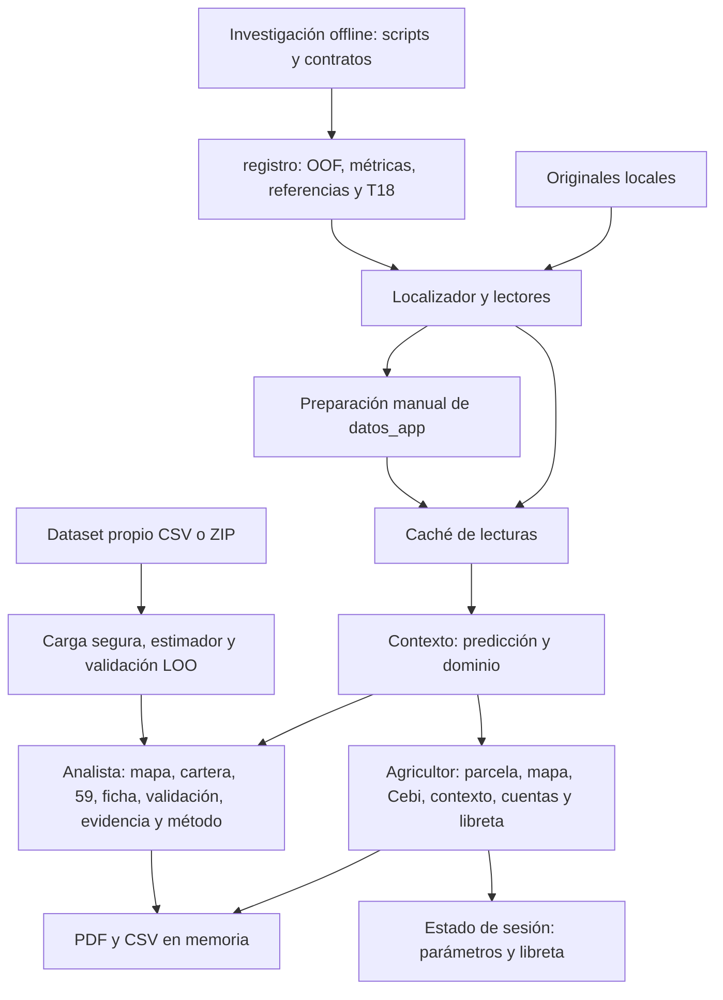

# Arquitectura efectiva y recorridos

Verificado: 2026-10-19 contra `efbb2dd`. Las relaciones siguientes son CONFIRMED por los imports y llamadas citados. El detalle de cada módulo vive en los informes de [backend](auditoria-backend.md) y [frontend](auditoria-frontend.md).

Actualización local fase 3 (CONFIRMED): Agricultor enruta a catálogo o consulta rápida sin ID. La consulta compone referencia municipal, confianza existente y calculadora común con área externa; el estado canónico conserva modo, municipio y selección de catálogo al desmontar sus widgets. Sin API nueva ni cambios al estimador. Evidencia: [fase 3](planeador/fase-3/README.md).

Actualización fase 4 (CONFIRMED): títulos del planeador optan por h1/h2 sin alterar el default de otros módulos; CSS acotado corrige especificidad de cifras y contraste del detalle. Sin cambios al dominio. La herramienta `app/herramientas/verificar_planeador.py` ejecuta regresiones desde app/ y registra huellas/logs sin regenerar datos. [Entrega](planeador/fase-4/README.md).

Actualización local fase 1: `backend/dominio/planeador.py` compone referencia municipal y cuentas con validación; `frontend/estado/planeador.py` mantiene captura canónica y compatibilidad de widgets; calculadora de parcela adapta al render común y PDF utiliza la misma evaluación. Flujo visual existente conservado. Entrega y verificación: [fase 1](planeador/fase-1/README.md). Auditorías originales corresponden al estado previo a estos cambios.

Actualización local fase 2 (CONFIRMED): `backend/dominio/planeador.py` adapta la misma tabla a escenarios, posiciones y C2; `frontend/componentes/escenarios/vista.py` los presenta en la calculadora. C3 modifica sólo el lenguaje histórico. Los contratos legacy y las fuentes no cambian. Verificación y límites: [fase 2](planeador/fase-2/README.md).

La aplicación es un proceso Python/Streamlit con separación funcional entre presentación, dominio/cálculo y lectura de archivos. No hay una API HTTP de negocio entre frontend y backend en los recorridos revisados. La separación no es una arquitectura de servicios: los componentes se llaman directamente y comparten DataFrames en memoria. Evidencia: `app/app.py:14`, `app/agrocebada_app/frontend/estado/contexto.py:6`, `app/agrocebada_app/frontend/vistas/agricultor/calculadora.py:7`.

## Recorridos comprobados en código

1. **Arranque y consulta. CONFIRMED.** `app/app.py:29` configura página/sesión/estilo y exige datos antes de mostrar cualquier modo; la cabecera determina vista/modelo/satélite; `frontend/estado/contexto.py:37` genera predicciones y combina OOF, confianza y textos. Las lecturas tienen caché; el cálculo del contexto se invoca en cada ejecución.
2. **Parcela y cuenta. CONFIRMED.** `frontend/vistas/agricultor/panel_parcela.py:69` selecciona una parcela del catálogo. `calculadora.py:27` elige predicción o cosecha real según CONJUNTO; solicita área/precio/costo y llama a cálculos puros de dominio. Cebi y PDF leen las claves de esos widgets. No se modifica el modelo por cambiar el área, precio o costo.
3. **Conjunto propio. CONFIRMED.** `frontend/vistas/datos_propios/vista.py:27` identifica contenido por hash y conserva el resultado de validación en sesión. `resultado.py:98` usa ese conjunto separado, predice y valida dejando una parcela fuera; no añade cosechas al dataset base.
4. **Libreta. CONFIRMED.** `frontend/vistas/agricultor/bitacora.py:26` guarda DataFrames por parcela en sesión y permite CSV. No existe conexión de ese diccionario a `predecir`, `confianza_municipios` ni a los pipelines de investigación. Esto no constituye aprendizaje continuo.

## Fronteras que condicionan el planeador

- **CONFIRMED:** el modelo no necesita geometría para calcular, pero el arranque actual exige y carga el conjunto completo con series. Un nuevo modo sin mapa puede reutilizar ese contexto; volver opcionales las fuentes globales sería otro cambio, no consecuencia automática de ocultar el mapa. `app/app.py:33`, `:43`; `backend/datos/paquete.py:35`, `:42`.
- **CONFIRMED:** los cálculos científicos y su evaluación se ejecutan fuera de la consulta. Cambiar UI no exige reentrenar T09–T15 ni regenerar las 59. `frontend/estado/contexto.py:39`; `backend/modelo/estimador.py:10`.
- **CONFIRMED:** las cachés de lectura no incluyen versión de archivo y las descargas excluyen parte del contexto del hash. El dataset fijo actual y una app con campañas intercambiables tienen requisitos distintos de invalidación. `frontend/estado/cache.py:7`; `componentes/descargas/boton_ficha.py:8`; `boton_cifras.py:11`.
- **PROPOSED:** ampliar el flujo de Agricultor con un adaptador de entrada municipal y componentes de escenarios. Mantener Contexto, estimador, analista y fuentes sin cambios en la primera versión. Contratos y límites: [plan propuesto](planeador-campana-auditoria-y-plan.md).
