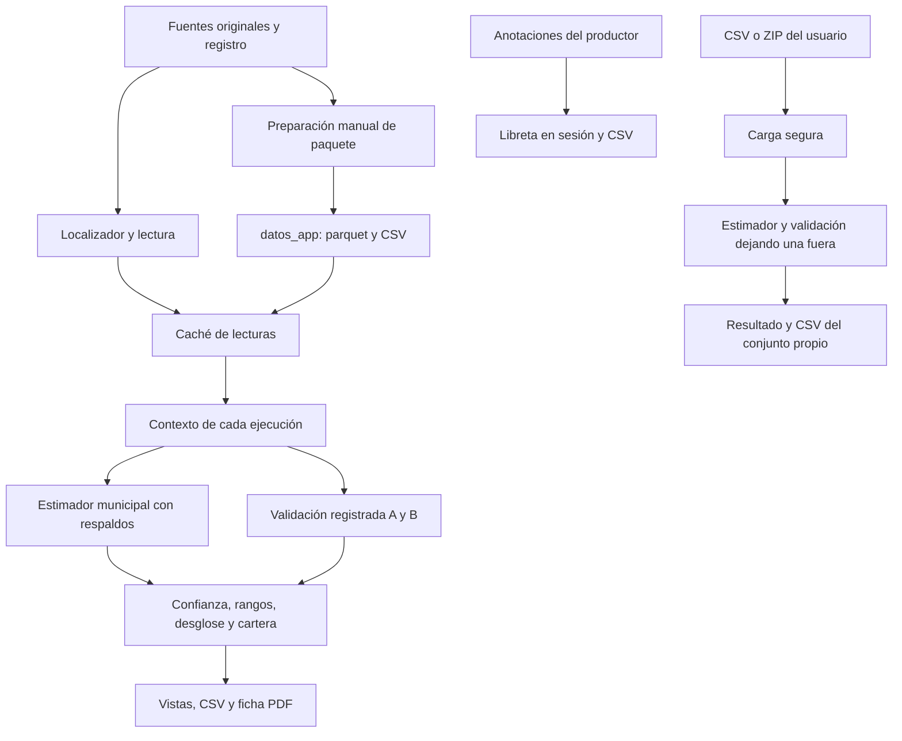

# Auditoría de datos, dominio y estimación de la app

Fecha: 19 de octubre de 2026. Contrato: `.agent/tasks/TASK-002-backend.md`. Base declarada por el contrato: `efbb2dd`; evidencia obtenida por lectura del árbol de trabajo. Investigación estática, sin ejecutar pruebas, preparar datos, descargar fuentes ni iniciar servicios.

**CONFIRMED** significa comportamiento directamente visible en código o una expectativa directamente visible en una prueba, con esa distinción indicada. **INFERRED** significa consecuencia razonada pendiente de reproducción. **UNKNOWN** significa que esta investigación no lo verificó. **PROPOSED** identifica posibilidades de reutilización, sin convertirlas en contratos aprobados.

## Resultado principal

**CONFIRMED.** La aplicación calcula una referencia retrospectiva de rendimiento de 2025. El estimador vigente no usa satélite, clima, área, altitud, notas del productor ni historial de años. Usa las cosechas marcadas `ENTRENAMIENTO`, calcula media o mediana por municipio y grupo de registro, y asigna a cada `PREDICCION` su municipio → grupo → global. El modelo oficial es la mediana y la media es referencia. Evidencia: `app/agrocebada_app/backend/modelo/estimador.py:6-23`; `app/agrocebada_app/config.py:10-18`.

**CONFIRMED.** Hay lógica de dominio reutilizable para escenarios económicos, rangos históricos, confianza y explicaciones. El sistema actual no contiene una entidad de campaña, una cuenta de productor ni un repositorio persistente de libretas en los componentes investigados. La libreta se indexa por ID de parcela en `st.session_state`, y los conjuntos propios se guardan en esa misma sesión. Evidencia positiva del almacenamiento: `app/agrocebada_app/frontend/vistas/agricultor/bitacora.py:26-32`; `app/agrocebada_app/frontend/vistas/datos_propios/vista.py:27-38`. El alcance de la afirmación de ausencia es exclusivamente el código auditado.

## Arquitectura efectiva y flujo completo

**CONFIRMED.** `app/app.py` inicializa sesión, comprueba disponibilidad, lee parcelas/soporte/series/clima, obtiene modelo de cabecera y construye contexto antes de elegir vista (`app/app.py:27-44`). `Contexto` es un contenedor de tablas y resultados en memoria, no una capa de acceso a base de datos. `calcular` vuelve a predecir; carga OOF ya registrado; separa A con fuente municipal (`OA`) de todo A (`OAT`); obtiene MAE/cobertura municipal, avisos, confianza y textos de mapa; prepara datos de ficha (`app/agrocebada_app/frontend/estado/contexto.py:15-55`).

**CONFIRMED.** Las funciones de dominio y estimación se llaman directamente desde Python/Streamlit; este flujo no atraviesa una API REST. Los módulos `backend/dominio` separan cuentas y contenido de la representación, aunque el constructor de contexto y las cachés viven en frontend. Evidencia: imports y llamadas en `app/agrocebada_app/frontend/estado/contexto.py:6-12,37-55`, `app/agrocebada_app/frontend/vistas/datos_propios/resultado.py:16-20,98-110` y `app/agrocebada_app/frontend/vistas/agricultor/calculadora.py:7-10,27-50`.

### Localización, fuentes y paquete

| Pieza | Comportamiento CONFIRMED | Evidencia |
|---|---|---|
| Raíz y variables de entorno | Busca hacia arriba marcadores dataset/registro/.git. `AGRO_DATOS`, `AGRO_T03`, `AGRO_T04`, `AGRO_T07`, `AGRO_T08`, `AGRO_T18` pueden sustituir ubicaciones. Las rutas de entorno tienen prioridad y se devuelven sin validar contenido. | `app/agrocebada_app/backend/rutas/localizador.py:8-69` |
| Dataset original | Une CSV de área/rendimiento/conjunto con shapefile por ID, exige relación uno a uno, renombra rendimiento a `real`, transforma a EPSG:4326 y calcula centroides en EPSG:6372. | `app/agrocebada_app/backend/datos/lectura.py:12-27` |
| Series visibles | Concatena BASICO y PRO; conserva Sentinel-2/Planet, nubosidad ≤20% y temporada abril–octubre 2025. Lleva NDVI/EVI/LAI. No entrena con ellas. | `app/agrocebada_app/backend/datos/lectura.py:30-37`; `app/agrocebada_app/config.py:11-12` |
| Clima | Lee registro T04, meses marzo–octubre 2025, pivota `media_ponderada` por variable. La referencia mensual promedia 2022–2024, marzo–octubre. | `app/agrocebada_app/backend/datos/lectura.py:40-51` |
| OOF y oficiales | Concatena archivos de validación de los dos candidatos; carga referencias de las 59 de T08 y entrega final de T18 por separado. | `app/agrocebada_app/backend/datos/lectura.py:54-68` |
| Soporte/calidad | Soporte T03 por ID; T07 suministra categoría/estrechez/alerta de contorno. | `app/agrocebada_app/backend/datos/lectura.py:71-81` |
| Selección de paquete | Basta que exista `parcelas.parquet`, salvo `AGRO_SIN_PAQUETE`. Lee parcelas/series desde paquete; clima, normal, validación, soporte y calidad faltantes devuelven `None`, sin buscar su equivalente original. | `app/agrocebada_app/backend/datos/paquete.py:13-14,35-105` |
| Entrega T18 | Se busca en rutas originales incluso cuando está activo el paquete; no se incorpora como parte del paquete. | `app/agrocebada_app/backend/datos/paquete.py:86-90`; `app/herramientas/preparar_datos.py:26-42` |
| Datos estáticos | Elevación y tabla de experimentos vienen de CSV bajo `app/datos_estaticos`, retornan `None` si faltan. | `app/agrocebada_app/backend/datos/elevacion.py:7-9`; `app/agrocebada_app/backend/datos/experimentos.py:7-9` |

**CONFIRMED.** `preparar_datos.py` escribe el paquete compacto y conserva sólo columnas requeridas de OOF y referencias (`app/herramientas/preparar_datos.py:21-44`). `usar_paquete`/`hay_datos` no validan integridad ni coherencia de todos sus archivos; `series()` intenta leer su archivo directamente (`app/agrocebada_app/backend/datos/paquete.py:13-27,42-46`). **INFERRED:** un paquete parcial puede pasar el chequeo inicial y fallar al cargar series, o mantener contexto opcional ausente aunque exista en originales. Verificación pendiente: fixture de paquete parcial en entorno aislado.

**CONFIRMED.** La preparación de elevación descarga Terrain Tiles de AWS mediante HTTPS, con contexto TLS y timeout de 30 s; evalúa vértices simplificados y punto representativo y escribe el CSV local. No es una llamada realizada por el lector de elevaciones en cada consulta (`app/herramientas/preparar_elevacion.py:27-62`; `app/agrocebada_app/backend/datos/elevacion.py:7-9`). `construir_experimentos.py` lee resultados T10/T12/T13/T14/T15/T16; copia/reexpresa resultados y añade tres complementarios explícitos; no ejecuta esos modelos (`app/herramientas/construir_experimentos.py:61-173`).

### Entrenamiento, predicción y validación

**CONFIRMED.** No hay ajuste iterativo ni artefacto de modelo entrenado en el estimador de la app: cada llamada agrega `real` con NumPy por municipio y `grupo_registro`. Cualquier nombre que empiece por `mediana` elige mediana y el resto media. `ocultar` excluye un municipio del entrenamiento para una demostración; no modifica `d`. La predicción retorna municipio, rendimiento, fuente, número de cosechas municipales y área (`app/agrocebada_app/backend/modelo/estimador.py:6-23`).

**CONFIRMED.** El respaldo se activa cuando falta un valor municipal, incluso si sólo existe una cosecha municipal esa cosecha se utiliza. El número `n_municipio` sigue siendo municipal aunque la fuente sea grupo/global (`app/agrocebada_app/backend/modelo/estimador.py:17-22`). No equivale al número total de observaciones usadas por el respaldo.

**CONFIRMED.** Para la vista principal, la app lee predicciones fuera de muestra ya calculadas, filtra candidato, mapea municipio por ID y añade `ae=abs(predicción-real)` y error con signo (`app/agrocebada_app/backend/datos/paquete.py:62-73`). El código de app no reconstruye particiones ni prueba el protocolo histórico de 5×5; el módulo de alcance lo describe y las pruebas existentes fijan sus conteos. Evidencia: `app/agrocebada_app/backend/dominio/alcance.py:19-25`; `app/tests/backend/test_validacion.py:100-125`.

**CONFIRMED.** `metricas` calcula MAE, RMSE, sesgo y R² dentro de cada repetición y después promedia repeticiones; no es simplemente RMSE de todas las filas acumuladas (`app/agrocebada_app/backend/modelo/metricas.py:8-14`). R² divide por variación de `real` sin caso especial de rendimiento constante (`metricas.py:12-13`). **INFERRED:** para rendimiento constante puede producir un valor no finito; debe probarse antes de exponerlo como indicador de un conjunto propio.

**CONFIRMED.** Las poblaciones son A/B × fuente municipal/todas. A sin respaldo es principal y cuenta IDs distintos por separado de filas repetidas (`app/agrocebada_app/backend/dominio/validacion.py:10-34`). El error municipal se obtiene de `OA`; la cobertura mostrada es proporción de errores ≤MAE de ese mismo municipio, no un intervalo probabilístico ni garantía para una parcela (`app/agrocebada_app/frontend/estado/contexto.py:41-49`; `app/agrocebada_app/frontend/vistas/analista/pestanas/estimaciones.py:88-89`).

**CONFIRMED, expectativa de pruebas; no resultado ejecutado.** Se esperan 197 parcelas, 138 con cosecha y 59 reservadas; A principal de 135 IDs/675 filas, A total 138/690; B municipal 135/659, B total 138/690; MAE principal ≈0.3126 mediana y ≈0.3205 media. Se espera que las 59 actuales usen fuente municipal (`app/tests/backend/test_exportar.py:29-38`; `app/tests/backend/test_validacion.py:100-116`). Esta auditoría no recalculó estas cifras con los archivos presentes.

**CONFIRMED.** Datos propios usa el mismo estimador, pero valida dejando una cosecha fuera cada vez. El predictor de cada fila excluye su propio ID y aplica municipio→grupo→global (`app/agrocebada_app/backend/modelo/metricas.py:17-30`). La pantalla presenta métricas de todas las filas, confianza calculada sólo con fuente municipal y rangos de las cosechas de ese archivo. Explica que esa validación y la del proyecto no son comparables de frente (`app/agrocebada_app/frontend/vistas/datos_propios/resultado.py:83-110`). La frase de cabecera del archivo que promete las mismas confianzas que el reto no demuestra esa equivalencia: se usan protocolos distintos (`resultado.py:8-10,102-106`). **UNKNOWN:** coincidencia exacta actual de niveles entre ambos protocolos; verificar con el ZIP del reto.

## Inventario del dominio

Todos los comportamientos de esta tabla son **CONFIRMED** por lectura, con alcance indicado.

| Módulo | Entradas, mecanismo y salida real | Evidencia |
|---|---|---|
| `confianza` | Cuenta `real` no nulo por municipio. 0–2 cosechas: baja; 3–9: media; ≥10: alta sólo con MAE municipal ≤general, de otro modo media. Sin MAE es media. Respaldo grupo/global fuerza baja. No estima probabilidad de acierto. Calpulalpan añade nota de redondeo sin rebajar nivel. | `app/agrocebada_app/backend/dominio/confianza.py:11-18,29-114` |
| `rangos` | Con cosechas del municipio: ≥10, P10/P90; 3–9, mínimo/máximo; <3, sin rango. `dentro` cuenta cosechas dentro del rango. Independiente del modelo. `cerca_del_municipio` mide proximidad descriptiva al estadístico municipal usando las mismas cosechas, no error fuera de muestra. | `app/agrocebada_app/backend/dominio/rangos.py:22-89` |
| `desglose` | Expresa base regional y diferencia municipal/grupal para llegar a la estimación. Redondea base y predicción a 2 decimales antes de restar para que el texto sume. No son contribuciones causales de variables. | `app/agrocebada_app/backend/dominio/desglose.py:9-64` |
| `calculadora` | Recibe rendimiento, área, precio/t y costo/ha. Producción=rendimiento×área; ingreso=producción×precio; costo=costo/ha×área; saldo=ingreso−costo; equilibrio=costo/ha÷precio. Compara equilibrio con cosechas de 2025. No consulta precios actuales ni calcula crédito, deuda, seguro o calidad maltera. | `app/agrocebada_app/backend/dominio/calculadora.py:13-63` |
| `cartera` | Sólo parcelas `PREDICCION`. Suma producción y área por municipio; rendimiento agregado=producción/ha. Escenarios son rango municipal×ha; sin rango ambos escenarios igualan estimación y se dice en nota. Suma mezcla de confianza por número de parcelas. | `app/agrocebada_app/backend/dominio/cartera.py:11-43` |
| `clima_anomalia` | Compara la misma parcela/mes en 2025 con promedio 2022–2024. Lluvia exige ≥10 mm y ≥20%; temperatura ≥1°C. Elige hasta cuatro diferencias mayores normalizadas por umbral y las ordena por mes. No genera pronóstico ni ajuste del rendimiento. | `app/agrocebada_app/backend/dominio/clima_anomalia.py:4-54` |
| `franja_verdor` | Prefiere Planet con ≥5 capturas, en otro caso sensor con más. Excluye parcela seleccionada de comparación municipal. Mediana parcela/semana y P25/P75 entre parcelas con ≥3 datos. Mes máximo usa serie semanal y centro de franja. Sin recomendación agronómica ni efecto en estimador. | `app/agrocebada_app/backend/dominio/franja_verdor.py:6-56` |
| `calidad` | Expone capturas y huecos de T03, alertas de contorno de T07 y escalón de redondeo 0.5/0.1/0.01 con ≥3 cosechas. No resta puntos al rendimiento ni altera confianza salvo la nota independiente de M01. | `app/agrocebada_app/backend/dominio/calidad.py:11-110`; `confianza.py:16-18,85-89` |
| `avisos` | Acompaña predicción si hay una cosecha municipal, respaldo o ninguna etiquetada en celda de lluvia. No modifica predicción. | `app/agrocebada_app/backend/dominio/avisos.py:5-16` |
| `notas` | Texto de origen 2025 y cobertura municipal; para entrenamiento explica validación. La rama de predicción describe cosechas municipales incluso si la predicción usa respaldo, por lo que no debe reutilizarse sin revisar para un municipio nuevo. | `app/agrocebada_app/backend/dominio/notas.py:5-18` |
| `resumen` | Área, elevación, lluvia abr–oct, máximo NDVI y corte fijo; tooltips de predicción con confianza, rango y producción, o cosecha registrada y promedio OOF. | `app/agrocebada_app/backend/dominio/resumen.py:7-50` |
| `validacion` | Tablas por población/municipio, regla escrita de M01, contraste respaldo vs municipio y tabla de simulación ocultando municipio. No recalcula protocolo histórico. | `app/agrocebada_app/backend/dominio/validacion.py:22-117` |
| `alcance` | Explica pasos, población principal, respaldos y límites. Declara uso retrospectivo 2025, no validado para otro año, estado, riego ni cultivo; rendimiento no mide calidad maltera/capacidad de pago. | `app/agrocebada_app/backend/dominio/alcance.py:15-118` |
| `evidencia` | Lee experimentos registrados, etiqueta complementarios, ordena/filtra resultados sin reentrenar. Regla de promoción: reducción ≥0.01 t/ha, IC sin cero, ≥4/5 mejoras y sin empeorar RMSE. Presenta mediana como excepción explícita, no mejora confirmada. Variación entre municipios es descriptiva sobre las mismas cosechas. | `app/agrocebada_app/backend/dominio/evidencia.py:20-29,36-159` |
| `respuestas` | Preguntas fijas y plantillas de Cebi; reúne desglose/confianza/costos/clima/libreta. No hay LLM, entrada libre ni servicio de IA en este módulo. Usa mismos cálculos, con referencias a 2025. | `app/agrocebada_app/backend/dominio/respuestas.py:1-12,26-39,82-139,152-189` |
| `geometria` y `colores` | Vecinas por distancia angular de centroides; `anillo` conserva exterior de mayor parte de un MultiPolygon y simplifica. Se usa para dibujo/encuadre, no análisis de cercanía agronómica. Color interpola y limita paleta de rendimiento. | `app/agrocebada_app/backend/dominio/geometria.py:5-20`; `app/agrocebada_app/backend/dominio/colores.py:7-12` |

### Bitácora y lo que realmente cambia al usarla

**CONFIRMED.** Una anotación convierte toneladas totales/área en t/ha, acepta año 2000–2100 y rendimiento 0.1–15 t/ha, recorta nota a 140 caracteres y redondea cifras a dos decimales. Un año repetido reemplaza el anterior; hay una cosecha por año en el contrato actual. El resumen produce promedio, mejor/peor año, toneladas totales, diferencia media absoluta frente a cifra adjunta, cambio primero→último y contraste con valor municipal (`app/agrocebada_app/backend/dominio/bitacora.py:17-86`).

**CONFIRMED.** El frontend toma área del catálogo, predicción actual si es reservada o promedio OOF actual si tiene cosecha, y pasa esa misma estimación a toda nueva anotación, cualquiera que sea su año (`app/agrocebada_app/frontend/vistas/agricultor/bitacora.py:104-114,129-143`). No existe predicción histórica por año en esa operación. El indicador `error_app` del resumen no constituye validación interanual del estimador de 2025 (`app/agrocebada_app/backend/dominio/bitacora.py:79-85`).

**CONFIRMED.** Añadir una cosecha a la libreta no suma filas al entrenamiento, no actualiza confianza municipal, rangos ni predicción. El progreso de confianza lee el conteo existente de `ctx.conf`, no el contenido nuevo de la libreta (`app/agrocebada_app/frontend/vistas/agricultor/bitacora.py:142-152`; `app/agrocebada_app/frontend/estado/contexto.py:37-55`). Los textos que invitan a reunir cosechas son orientación, no un canal actual de aprendizaje automático.

**CONFIRMED.** Exporta ID y municipio junto al contenido; al importar conserva únicamente `COLUMNAS` y descarta identificación. Convierte números, filtra año/toneladas/rendimiento y deduplica año; no recalcula rendimiento con área ni diferencia con estimación, y admite estimación/diferencia proporcionadas en el CSV. La UI asigna el resultado al ID actualmente seleccionado (`app/agrocebada_app/backend/dominio/bitacora.py:103-132`; `app/agrocebada_app/frontend/vistas/agricultor/bitacora.py:158-164`). **INFERRED:** cargar CSV de otra parcela puede atribuirle un historial ajeno; editar columnas derivadas puede alterar el tablero. Verificación: importar una libreta válida de ID distinto y otra con diferencia incongruente en sesión aislada.

## Seguridad de carga y límites

**CONFIRMED.** La entrada de conjuntos propios acepta sólo `.zip` o `.csv`, contenido no vacío y ≤50 MiB (`app/agrocebada_app/backend/carga_segura/revisar.py:10-20`). Los límites son 200 MiB descomprimidos, 30 archivos por archivo ZIP revisado, ratio de compresión ≤100, máximo 5,000 parcelas y mínimo 10 cosechas; áreas 0.01–10,000 ha, rendimientos 0.1–15 t/ha (`app/agrocebada_app/backend/carga_segura/reglas.py:4-18`).

**CONFIRMED.** ZIP comprueba firma, rutas absolutas/`..`/unidad Windows, symlinks, contraseña, extensiones y tamaños. Sólo admite un ZIP interno, rechaza tercer nivel, acumula tamaño interno y externo y evita extraer con rutas suministradas por el archivo. Conserva nombres base y rechaza duplicados exactos; escribe componentes de shapefile con nombre propio `parcelas.*` en directorio temporal (`app/agrocebada_app/backend/carga_segura/zip_seguro.py:17-79,104-120`).

**CONFIRMED.** CSV exige columnas, UTF-8, IDs únicos con caracteres limitados, conjunto válido, datos numéricos dentro de rangos y al menos una fila de predicción. Rendimiento suministrado para filas de predicción se borra y se avisa. Municipio/grupo deben ser texto no vacío ≤60 caracteres; no hay normalización de catálogo/capitalización ni comprobación de que correspondan geográficamente (`app/agrocebada_app/backend/carga_segura/tabla.py:21-90`).

**CONFIRMED.** Con geometría exige CRS, IDs idénticos a tabla, Polygon/MultiPolygon y límites de México; intenta reparar geometría inválida con `buffer(0)`. No compara `AREA_HA` declarada con superficie geométrica (`app/agrocebada_app/backend/carga_segura/tabla.py:93-126`). Son validaciones de formato/coherencia básica, no certificación de ubicación o veracidad agronómica.

**CONFIRMED.** La carga de dataset original utiliza `extractall` en temporal y confía en el formato del dataset del repositorio; no pasa por los controles de carga de usuario (`app/agrocebada_app/backend/datos/lectura.py:12-22`). El cargador de libreta tampoco pasa por `carga_segura.revisar`: lee CSV sin límite propio de filas/tamaño en su parser (`app/agrocebada_app/backend/dominio/bitacora.py:111-132`). La limitación global del servidor Streamlit para esa carga es **UNKNOWN** en esta auditoría; no debe equipararse al máximo explícito de 50 MiB de datasets.

**CONFIRMED.** El resultado validado se conserva por hash SHA-256 del contenido dentro de sesión y se muestran errores genéricos para excepciones no previstas; el conjunto subido no se combina con el catálogo original (`app/agrocebada_app/frontend/vistas/datos_propios/vista.py:27-43`; `app/agrocebada_app/frontend/vistas/datos_propios/resultado.py:98-110`). Los componentes de shapefile sí se escriben temporalmente durante el parseo; la afirmación de “sólo sesión” se refiere al resultado conservado, no a ausencia de procesamiento en el servidor.

## PDF, CSV y persistencia

**CONFIRMED.** La ficha reúne identidad, área, cifra, producción, OOF si corresponde, rango, confianza/calculadora opcionales, vecinas, series y clima. El renderizador Matplotlib crea A4 en memoria y retorna bytes; no escribe un documento permanente (`app/agrocebada_app/backend/ficha_pdf/armado.py:25-57`; `app/agrocebada_app/backend/ficha_pdf/ficha.py:32-46`). Dibuja el mapa con contornos locales y gráficos, sin solicitar mapas remotos en el módulo PDF (`ficha.py:129-191`). Pie y títulos toman año de la temporada global, y la fecha de generación es la del servidor (`ficha.py:25,59,165,195-201`).

**CONFIRMED.** La ficha recupera precio/costo de claves globales de sesión, área específica de parcela o catálogo y recalcula misma tabla económica; incluye producción, saldo y, si existe, escenario bajo, con máximo de tres filas de calculadora (`app/agrocebada_app/frontend/componentes/descargas/boton_ficha.py:19-37`; `app/agrocebada_app/backend/ficha_pdf/ficha.py:118-126`). El PDF actual depende de geometría; no es directamente una ficha de municipio sin parcela.

**CONFIRMED.** `datos.exportar.tablas` reúne tres salidas: parcelas, municipios y validación. Parcelas mezcla filas reservadas con cosechas reales, distinguidas por `conjunto`; las de entrenamiento no reciben confianza ni escenarios de producción. Rendimiento de predicción se redondea a dos decimales antes de multiplicar por área. Cartera municipal multiplica predicción sin ese redondeo previo (`app/agrocebada_app/backend/datos/exportar.py:20-68`; `app/agrocebada_app/backend/dominio/cartera.py:15-22`). **INFERRED:** suma de producción por parcela exportada y total municipal puede diferir por redondeo para modelos con más de dos decimales, especialmente la media. No mezclar su comparación con igualdad exacta de rendimiento contra T18.

**CONFIRMED.** El ZIP del navegador se arma en memoria. `exportar_todo` sí crea carpeta/escribe CSV; lo llama la herramienta manual que por defecto escribe `registro/t17` (`app/agrocebada_app/frontend/componentes/descargas/boton_cifras.py:11-24`; `app/agrocebada_app/backend/datos/exportar.py:71-80`; `app/herramientas/exportar_cifras.py:19-32`). Existe además CSV de las 59 y CSV de conjunto propio (`app/agrocebada_app/frontend/vistas/analista/pestanas/estimaciones.py:62-67`; `app/agrocebada_app/frontend/vistas/datos_propios/resultado.py:146-153`). Ninguno constituye persistencia automática de la libreta.

| Estado/dato | Dónde vive y cuánto abarca: CONFIRMED | Evidencia |
|---|---|---|
| Dataset y resultados registrados | Archivos locales originales y paquete preparado manualmente | `backend/datos/paquete.py:35-105`; `herramientas/preparar_datos.py:26-42` bajo `app/` |
| Lecturas cacheadas | Funciones `st.cache_data`, sin parámetros de versión/huella de archivo para carga, clima, series, soporte y calidad | `app/agrocebada_app/frontend/estado/cache.py:7-50` |
| Contexto calculado | Tablas en memoria de la ejecución Streamlit | `app/agrocebada_app/frontend/estado/contexto.py:37-55` |
| Tema, vista y modelo | Valores iniciales en sesión; `setdefault` conserva valores existentes | `app/agrocebada_app/frontend/estado/sesion.py:7-19` |
| Precios/costos | Widgets `calc_precio`, `calc_costo`; área `calc_area_{pid}` | `app/agrocebada_app/frontend/vistas/agricultor/calculadora.py:39-47` |
| Libretas | Diccionario de sesión por ID; conservación entre sesiones exige descarga/importación por usuario | `app/agrocebada_app/frontend/vistas/agricultor/bitacora.py:26-32,154-164` |
| Dataset subido | Resultado de parseo en sesión; temporales shapefile durante lectura | `app/agrocebada_app/frontend/vistas/datos_propios/vista.py:27-38`; `app/agrocebada_app/backend/carga_segura/zip_seguro.py:111-120` |
| Conversación Cebi | Índices de preguntas hechas en sesión por parcela; respuestas se regeneran con datos actuales | `app/agrocebada_app/frontend/vistas/agricultor/pregunta_cebi.py:19-41` |

**CONFIRMED.** Caché de PDF usa ID/modelo/confianza/calculadora y excluye `_ctx`. Caché de ZIP usa sólo modelo y excluye todos los DataFrames; el comentario lo declara (`app/agrocebada_app/frontend/componentes/descargas/boton_ficha.py:8-12`; `app/agrocebada_app/frontend/componentes/descargas/boton_cifras.py:11-18`). **INFERRED:** al soportar varios conjuntos o campañas con misma clave, puede reutilizar documentos de datos previos. Las cachés de lectura tampoco observan cambios de archivo por sí solas. Reproducción requerida antes de diseñar multicampaña: misma clave y contexto modificado, comprobar invalidación. No se afirmó una filtración actual entre usuarios de datasets propios: ese flujo no llama a estas cachés de descarga.

## Límites científicos y hallazgos para una nueva campaña

1. **CONFIRMED: una campaña de rendimiento, sin modelo temporal.** `TEMPORADA` y corte son globales 2025; clima y resúmenes además contienen fechas literales. Cambiar sólo título/año no cambia población ni validez (`app/agrocebada_app/config.py:11,18`; `app/agrocebada_app/backend/datos/lectura.py:40-51`; `app/agrocebada_app/backend/dominio/resumen.py:15-22`; `app/agrocebada_app/backend/dominio/alcance.py:58-69`).
2. **CONFIRMED: distribución espacial, no distribución de años.** P10/P90 y mínimo/máximo comparan parcelas cosechadas del municipio en 2025. Los nombres actuales “año bajo/alto” son escenarios de cuentas basados en esa distribución, no frecuencias temporales ni cuantiles de la siguiente campaña (`app/agrocebada_app/backend/dominio/rangos.py:1-3,22-48`; `app/agrocebada_app/backend/dominio/calculadora.py:18-25`).
3. **CONFIRMED: confianza es regla de evidencia.** Cuenta observaciones municipales y MAE de A sin respaldo; no certifica cosecha futura ni capacidad crediticia. Los rangos tampoco son intervalos de predicción (`app/agrocebada_app/backend/dominio/confianza.py:29-108`; `app/agrocebada_app/backend/dominio/alcance.py:65-69`).
4. **CONFIRMED: elección final y evidencia son conceptos diferentes.** Código usa mediana oficial; evidencia explica que no pasó promoción frente a la media y fue excepción. El generador conserva una nota de aprobación pendiente que puede haber quedado histórica; esta auditoría no resuelve decisiones humanas (`app/agrocebada_app/config.py:16-17`; `app/agrocebada_app/backend/dominio/evidencia.py:98-110`; `app/herramientas/construir_experimentos.py:146-153`).
5. **CONFIRMED: libreta no valida otros años.** El mismo estimado 2025 se adjunta a cualquier año y el CSV no asegura identidad ni coherencia de derivados. Una nueva campaña necesita distinguir referencia, año observado y estimación de ese año antes de llamar al resultado “error del modelo” (evidencia en sección de bitácora).
6. **CONFIRMED: área editable sólo en la cuenta.** El área de la calculadora se conserva en un widget por parcela y se pasa a cuentas; no modifica `d.AREA_HA`, predicción ni cartera. PDF puede incluir calculadora con esa área y a la vez identidad/producción principal con área del catálogo (`app/agrocebada_app/frontend/vistas/agricultor/calculadora.py:27-50`; `app/agrocebada_app/frontend/componentes/descargas/boton_ficha.py:25-34`; `app/agrocebada_app/backend/ficha_pdf/armado.py:39-44`).

### Contraste acotado con C1–C6 de la propuesta

Se leyó `context/planeador_campaña.md` después de completar el mapa del comportamiento actual. La propuesta original no fue editada. Estos hallazgos describen incompatibilidades que root deberá resolver en su síntesis, no cambios implementados.

| Punto | Hallazgo y estado | Evidencia |
|---|---|---|
| C1: etiqueta central | **CONFIRMED:** para una parcela `ENTRENAMIENTO` la calculadora usa `r.real` y dice “Con tu cosecha registrada”. Renombrarla literalmente “típico” confunde una observación con estadístico municipal. | `app/agrocebada_app/frontend/vistas/agricultor/calculadora.py:30-33`; `context/planeador_campaña.md:168-175` |
| C1/C2: “año bajo” | **CONFIRMED:** rango disponible es entre parcelas de 2025; no hay validación de probabilidad de un año malo. Una barra económica es posible, siempre conservando procedencia y límite temporal. | `app/agrocebada_app/backend/dominio/rangos.py:22-48`; `context/planeador_campaña.md:124-195` |
| C4: respaldo | **CONFIRMED:** propuesta pasa directamente a global sin grupo, mientras `predecir` intenta grupo primero. Para municipios con cosechas coincide si usa mismos datos/estadístico; para municipio nuevo no representa el mismo contrato completo. | `context/planeador_campaña.md:228-249`; `app/agrocebada_app/backend/modelo/estimador.py:17-22` |
| C4: `n_cosecha` | **CONFIRMED:** propuesta dice cantidad que respalda cifra; M01 cuenta cosechas del municipio. Usar conteo global como si fuera municipal inflaría evidencia; `fuente` debe seguir determinando confianza baja del respaldo. | `context/planeador_campaña.md:238-245`; `app/agrocebada_app/backend/dominio/confianza.py:69-84,95-108` |
| C5/C6: estado | **CONFIRMED:** Cebi y PDF leen `calc_precio/costo` y área por ID; propuesta conserva nombres, pero no especifica retención/limpieza al ocultar widgets de un modo y volver. **INFERRED:** desaparición de valores por ciclo de widgets o contaminación entre modos; verificar con AppTest de ida/vuelta. No bastan pruebas de función backend. | `context/planeador_campaña.md:262-270,278-329`; `app/agrocebada_app/frontend/vistas/agricultor/pregunta_cebi.py:21-24`; `app/agrocebada_app/frontend/componentes/descargas/boton_ficha.py:19-30` |
| C6: sin parcela | **CONFIRMED:** estimador municipal no necesita geometría; PDF, mapa, franja, clima, libreta y Cebi actuales sí dependen de ID/contexto de parcela. La propuesta excluye esos componentes del modo rápido, coherente con sus límites actuales. | `context/planeador_campaña.md:306-324`; `app/agrocebada_app/backend/ficha_pdf/armado.py:29-52`; `app/agrocebada_app/backend/dominio/respuestas.py:157-188` |
| C1–C6: cachés | **CONFIRMED:** descargas no incluyen versión de dataset/campaña en clave. **INFERRED:** extender descargas a consultas nuevas con claves existentes puede entregar datos viejos; requiere diseño y prueba explícitos. | `app/agrocebada_app/frontend/componentes/descargas/boton_cifras.py:11-18`; `app/agrocebada_app/frontend/componentes/descargas/boton_ficha.py:8-12` |

**CONFIRMED.** La propuesta dice que las pruebas T13/T14/T15 no superaron la mediana, pero el generador identifica media municipal como referencia de esos contrastes; no sustituirla en la explicación histórica (`context/planeador_campaña.md:57-62`; `app/herramientas/construir_experimentos.py:25,68-74,85-89,110,133-141`).

## Pruebas existentes y límites de esta revisión

**CONFIRMED por lectura, sin ejecución.** Hay 19 scripts backend: alcance, bitácora, calculadora, calidad, carga segura, cartera, clima/anomalía, confianza, desglose, evidencia, exportación, ficha PDF, franja de verdor, localizador, mes verde, rangos, respuestas, resumen y validación. Predominan aserciones a nivel superior; muchas combinan datos inventados con fuentes reales y terminan imprimiendo `OK`. No se interpreta su existencia como éxito de ejecución.

| Cobertura comprobada al leer pruebas | Evidencia |
|---|---|
| Niveles, umbrales, excepciones, respaldo, conteos y MAE esperados | `app/tests/backend/test_confianza.py:31-108,117-162` |
| Poblaciones A/B, métricas principales, respaldo, ocultar municipio | `app/tests/backend/test_validacion.py:28-93,100-125` |
| Percentiles/extremos/sin rango e independencia respecto del modelo | `app/tests/backend/test_rangos.py:14-56` |
| Cuentas a mano, equilibrio exacto y escenarios según muestra | `app/tests/backend/test_calculadora.py:14-48` |
| Cartera, escenarios, áreas y mezcla de confianza | `app/tests/backend/test_cartera.py:23-75` |
| ZIP/CSV válido, paridad T08 y rechazos de rutas, tipos, bombas, duplicados, tamaño y valores | `app/tests/backend/test_carga_segura.py:53-99` |
| Libreta: cálculo, límites, reemplazo, resumen, ida/vuelta y filas inválidas | `app/tests/backend/test_bitacora.py:13-86` |
| Exportación, separación real/estimado, igualdad con cartera, entrega T18 condicional e idempotencia de CSV | `app/tests/backend/test_exportar.py:29-93` |
| PDF: bytes, página única, textos/rangos/modelos, opcionales y expectativas de fecha | `app/tests/backend/test_ficha_pdf.py:29-106` |
| Experimentos registrados/complementarios, trazabilidad, regla y excepción final | `app/tests/backend/test_evidencia.py:22-116` |
| Clima y promedio 2022–2024 | `app/tests/backend/test_clima_anomalia.py:13-44` |
| Contexto y explicaciones, sin alterar estimaciones | `app/tests/backend/test_alcance.py:28-82`; `app/tests/backend/test_calidad.py:23-75`; `app/tests/backend/test_resumen.py:27-34` |

**UNKNOWN:** estado de ejecución en este entorno; coincidencia real de los archivos presentes con las expectativas de pruebas; integridad del paquete; validez externa de los supuestos agronómicos; protocolo de entrenamiento histórico fuera de app. Root es responsable de la validación autorizada posterior. El contrato prohibía ejecutar pruebas y pipelines.

**PROPOSED, sin implementación:** reutilizar `estadistico`, `cuentas`, `equilibrio`, `rango_municipio`, `frase_equilibrio` y `confianza_parcela` para una consulta municipal, precisando identidad del dataset, temporada, procedencia municipal/grupal/global y casos sin datos; mantener `r.real` separado de referencia típica. Reutilizar tabla económica como única fuente de tarjetas/barra. No reutilizar automáticamente la ficha de parcela ni su caché para una ficha sin parcela.

**Exclusiones:** no se modificó código, datos, configuración, pruebas ni propuesta; no se ejecutaron herramientas de preparación, servicios, descargas, consultas externas ni tests. No se auditaron infraestructura de despliegue, autenticación externa ni la ejecución histórica del pipeline científico. Las únicas escrituras de este investigador corresponden a este informe y al cierre de su contrato.
