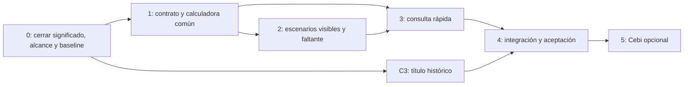

# Planeador de campaña · auditoría y plan de ejecución propuesto

19 de octubre de 2026 · Primera entrega: análisis y planificación, sin implementación.

Base inspeccionada: `efbb2dd`, rama local observada `feature/agriultor-prediccion`. Propuesta original: `context/planeador_campaña.md`, 495 líneas. El documento original no se modificó. Los horarios, responsables sugeridos y commits que contiene son datos de la propuesta: no son instrucciones ejecutadas ni compromisos asumidos por esta auditoría.

CONFIRMED = comprobado en fuentes o ejecución indicada; INFERRED = interpretación con fundamento; UNKNOWN = falta evidencia; PROPOSED = recomendación pendiente de decisión. Las recomendaciones de este documento no autorizan una implementación.

**Estado más reciente (instrucciones posteriores):** fases 0–4 autorizadas y completadas localmente. La [fase 4](planeador/fase-4/README.md) integra regresión, correcciones demostradas y evidencia visual/teclado; zoom 200% confirmado por el usuario. [Matriz final](planeador/fase-4/matriz-aceptacion.md). Fase 5 y Cebi completo siguen aplazados. No despliegue ni aprobación científica; los párrafos siguientes conservan el historial de auditoría y entregas anteriores.

**Actualización posterior a la auditoría:** el usuario autorizó ejecutar fase 0 y aplazó fase 5 y todo cambio relacionado con Cebi por trabajo paralelo. La fase 0 quedó cerrada en [su entrega específica](planeador/fase-0/README.md), con [contratos v1](planeador/fase-0/contratos-v1.md), base numérica y verificador. Las propuestas históricas siguientes se conservan como contexto; en decisiones de fase 0 prevalecen esos contratos. No se implementaron fases 1–5 y no se modificó Cebi.

**Actualización de fase 1:** autorizada e [implementada/verificada](planeador/fase-1/README.md) posteriormente: composición municipal, calculadora común y estado, con corrección de compatibilidad del PDF al borrar área. Esta actualización sustituye únicamente el estado de avance anterior. Fases 2–5 no implementadas; Cebi sigue completamente aplazado.

## 1. Dictamen

**PROPOSED: avanzar con la idea, corrigiendo su especificación antes de programar.** El planeador encaja con la arquitectura actual porque rendimiento de referencia, rangos, confianza, cuentas y explicaciones ya existen por separado. La novedad principal es abrir la consulta sin ID y hacer visibles los resultados económicos condicionados a distintos rendimientos. No requiere otro modelo, una API nueva, usuarios registrados ni una base de datos en su primera versión.

**CONFIRMED:** el estimador vigente calcula mediana o media por municipio → grupo de registro → global usando las 138 etiquetas de ENTRENAMIENTO. Precio, costo, hectáreas, NDVI, clima y libreta no intervienen en esa asignación. `app/agrocebada_app/backend/modelo/estimador.py:6`, `:10`; [auditoría de backend](auditoria-backend.md).

**INFERRED:** esa base permite mostrar referencias históricas municipales y sensibilidad contable; no acredita un pronóstico de cosecha, una distribución de años futuros ni probabilidad individual de pérdida. La identidad del producto debe ser «planeación con referencias de 2025 y tus supuestos», conservando visibles año y procedencia.

La propuesta C1–C7 tiene buen aprovechamiento del sistema existente, pero aún deja decisiones que afectan números, estado y significado. No la considero lista para ejecutar literalmente: esas decisiones se resuelven en fase 0. No hace falta detener el diseño para resolverlas; abajo se propone una opción concreta para cada una.

## 2. Qué hace la app hoy y cómo cambia la lectura

El inventario completo está en [frontend](auditoria-frontend.md) y [backend](auditoria-backend.md). Esta tabla ubica el planeador dentro del producto actual; los comportamientos vigentes son CONFIRMED por los archivos citados.

| Área actual | Lo que muestra o permite | Relación con la propuesta |
|---|---|---|
| Bienvenida/cabecera | Introducción en tres pasos; Agricultor/Analista; tema; satélite; modelo sólo para analista. | Mantener marca y lenguaje; incorporar sólo la explicación del nuevo modo cuando exista. `frontend/vistas/bienvenida.py:126`; `componentes/paneles/cabecera.py:10`. |
| Tu parcela | Municipio/ID; estimado o cosecha registrada; producción, confianza, desglose, rango y ficha. | Conservar como modo «Parcela del catálogo». No usar una parcela cualquiera para simular al nuevo usuario. `vistas/agricultor/panel_parcela.py:69`. |
| Mapa/leyenda/chips | Parcela y vecinas; rendimiento/confianza; 3D/plano; área, elevación, lluvia y verdor. | Sólo recorrido con parcela; ocultarlo en consulta rápida no cambia la fuente de cálculo. `vistas/agricultor/vista.py:27`. |
| Cebi | Preguntas fijas; explica cifra, confianza, costos, contexto y libreta con datos vigentes. | Conservar en modo de parcela; pregunta de faltante opcional al final. `pregunta_cebi.py:19`. |
| Temporada | Verdor y clima 2025; comparación disponible contra parcelas municipales y promedio climático 2022–2024. | Cambiar título/texto, sin convertir contexto en alerta. `verdor_clima.py:50`. |
| ¿Me alcanza? | Precio/costo/área; saldo, equilibrio y cuentas de escenarios plegadas. | Es el núcleo reutilizable. `calculadora.py:27`; `backend/dominio/calculadora.py:13`. |
| Tu libreta | Anotaciones por año y parcela, descarga/importación CSV, tablero en sesión. | Conservar en el flujo actual; no prometer entrenamiento ni pronósticos históricos. `bitacora.py:104`. |
| Cartera | Agregados de las 59 por municipio, producción, confianza y descargas. | Regresión; no ampliar a cartera de usuarios nuevos. `analista/pestanas/cartera.py:55`. |
| Las 59 | Controles de identidad/valores/referencia o T18, tabla y CSV con confianza/rango. | Línea base protegida. `analista/pestanas/estimaciones.py:31`. |
| Ficha técnica/comparación | Detalle y PDF, soporte/calidad, índices/clima, hasta tres parcelas comparadas. | No convertirla en ficha municipal sin geometría. `analista/pestanas/ficha_tecnica.py:18`; `comparar.py:16`. |
| Validación | Poblaciones A/B, errores, respaldo, resultados municipales y simulación al ocultar municipio. | Conservar alcance y poblaciones; nueva consulta no agrega validación prospectiva. `analista/pestanas/validacion.py:32`. |
| Evidencia | Tres preguntas, experimentos, mejoras y no promociones, límites de los datos. | Corregir la justificación del planeador para que coincida con el comparador histórico. `backend/dominio/evidencia.py:92`. |
| Método y límites | Pasos, alcance retrospectivo, errores y situaciones sin respaldo suficiente. | Sirve de sustento; no introducir promesas contrarias en la nueva entrada. `backend/dominio/alcance.py:15`. |
| Datos propios | ZIP/CSV validado, estimaciones/LOO/rangos/confianza de ese conjunto y descargas. | Permanece separado; consulta rápida usa catálogo base en v1. `vistas/datos_propios/resultado.py:98`. |

Las rutas abreviadas de la tabla son relativas a `app/agrocebada_app/frontend/`, salvo las indicadas como backend; las referencias completas están en los informes detallados.

## 3. Cambios necesarios en la propuesta

| Hallazgo | Evidencia y por qué importa | Ajuste PROPOSED |
|---|---|---|
| «Año bajo/alto» no corresponde a varios años | Propuesta:169,491; `backend/dominio/rangos.py:25`. Los extremos vienen de parcelas distintas en 2025. | «Escenario de rendimiento bajo / referencia / alto», con explicación próxima «basado en parcelas de 2025». Con 3–9 usar «menor/mayor rendimiento registrado». No llamarlos probabilidades ni límites de la próxima cosecha. |
| «Año normal» mezcla referencias | Propuesta:223; `verdor_clima.py:46`, `:72`. Clima usa 2022–2024; verdor compara parcelas del propio 2025. | Título «Verdor y clima de 2025»; cada tarjeta conserva la comparación y periodo que realmente tiene. Si falta la base climática, mostrar su estado vacío, no «normal». |
| Comparador científico incorrecto | Propuesta:57 afirma que T13/T14/T15 no mejoran a mediana; sus contrastes registrados son contra media. `docs/T14_clima.md:6`; `docs/t15_resultados.md:11`. | «Ningún bloque cumplió la regla frente a la referencia evaluada; la mediana vigente es una elección práctica documentada como excepción». No repetir evaluaciones para justificar un cambio de UI. |
| M17 ya está conectado en código | `config.py:17`; cabecera fuerza oficial para Agricultor. T18 ya existe. Documentos de T16 aún condicionan aprobación. | Verificar estado/decisión; no programar de nuevo una conexión existente. No afirmar aprobación humana que el repositorio no acredita. |
| Sin grupo no se reproduce todo el respaldo | Propuesta C4:244 salta a global; estimador:17–20 usa grupo primero. | Limitar v1 a los nueve municipios conocidos con cosechas. Si un municipio deja de tener soporte, informar falta de referencia local. Respaldo regional opcional debe ser una política explícita, no una equivalencia con T18. |
| `n_cosecha` ambiguo | Propuesta:245; confianza:69–90 cuenta cosechas municipales. | Separar cantidad municipal de cantidad de la fuente de respaldo. M01 consume la primera; no subir confianza usando el tamaño del conjunto global. |
| «Típico» puede ser cosecha real | Propuesta:173; calculadora frontend:30–33 usa `r.real` para ENTRENAMIENTO. | La tarjeta central conserva «Cosecha registrada 2025» en esa rama; en consulta municipal usa «Referencia del municipio». No suponer que siempre está entre P10 y P90. |
| Área duplicada | Propuesta:291 y :259/:313 pide hectáreas y luego vuelve a dibujar área en calculadora base. | Una sola superficie editable en consulta rápida. Resumen, toneladas, tarjetas y tabla consumen ese mismo valor. |
| Claves conservadas no bastan para conservar estado | Propuesta:262–270; Cebi/PDF leen claves globales; modo rápido desmonta widgets del flujo previo. | Definir estado duradero de planeación separado del ciclo de widgets y mantener adaptadores de las claves existentes. Probar ida/vuelta. La limpieza de widgets del runtime está confirmada en `.venv/Lib/site-packages/streamlit/runtime/state/session_state.py:1416`; efecto específico del nuevo modo aún UNKNOWN. |
| C2 tiene un contrato contradictorio | Propuesta:185 dice siempre disponible y plegada con saldo positivo; :383 pide retornar `None` positivo. | Retornar un estado siempre: falta/cubre/equilibrio, saldo, título, apertura y contenido; frontend decide abierto/cerrado. Si faltan precio/costo no crear un plan con cifras. |
| Igualdad exacta con T18 | Propuesta:247/:380 pide igualdad exacta; T18 es CSV a dos decimales. | Comparación de mismo estadístico antes de serializar; contra archivo comparar valor a su precisión/tolerancia explícita. En esta copia hay diferencias binarias de hasta 8.88e−16, sin desacuerdo a dos decimales. No comparar floats serializados con `==` como única prueba. |
| Alcance mezcla analista «sin cambios» con quitar selector | Propuesta:4/:116 frente a :453. | Conservar selector del analista en esta entrega. Cualquier cambio allí es una decisión de alcance aparte. |
| Tres pantallas frente a dos modos | Propuesta:34–40 y :278. | Dos modos en la misma vista y tres etapas de lectura; sin nuevas rutas ni asistente de tres páginas. |

**CONFIRMED por lectura local:** todos los nueve municipios tienen al menos una cosecha; todas las 59 actuales usan municipio. La rama de municipio sin cosechas no está ejercitada por esas 59. Probarla exige datos sintéticos; no puede darse por validada comparando únicamente T18. Resultados locales: [entornos](environments.md).

## 4. Referencias municipales reales para diseñar casos

CONFIRMED: tabla calculada en memoria durante la auditoría desde el paquete activo con `rangos_municipio(ENTRENAMIENTO)` y mediana municipal. Límites descriptivos, no límites posibles ni probabilidades de otra campaña.

| Municipio | n cosechas | Bajo | Referencia | Alto | Presentación |
|---|---:|---:|---:|---:|---|
| Chignahuapan | 71 | 3.910 | 4.520 | 5.070 | Tres escenarios basados en P10–P90 |
| Calpulalpan | 30 | 2.500 | 3.000 | 3.500 | Tres escenarios; etiquetas originales discretas |
| Singuilucan | 16 | 2.500 | 3.200 | 3.500 | Tres escenarios |
| Almoloya | 10 | 4.383 | 4.530 | 4.708 | Tres escenarios |
| Cuautepec de Hinojosa | 5 | 4.400 | 4.610 | 4.790 | Extremos observados, aviso n=5 |
| Emiliano Zapata | 3 | 3.500 | 3.500 | 3.500 | Los tres coinciden; evitar barra engañosa/división por cero |
| Apan | 1 | — | 3.000 | — | Sólo referencia y falta de rango |
| Nanacamilpa de Mariano Arista | 1 | — | 2.500 | — | Sólo referencia y falta de rango |
| Tepeapulco | 1 | — | 4.450 | — | Sólo referencia y falta de rango |

Unidad de rendimientos: t/ha. Deben mostrarse los conteos reales y la regla de confianza vigente, no una confianza escogida a partir del atractivo de la cifra. La muestra de cada municipio no es un censo de todos sus productores.

## 5. Arquitectura propuesta: composición, sin duplicar cuentas

**PROPOSED.** Un servicio puro `backend/dominio/planeador.py` compone las funciones existentes; no entrena ni mantiene otra tabla de rendimientos. Tres responsabilidades pequeñas: resolver referencia municipal con su procedencia, preparar escenarios/estado de cobertura, y resolver posiciones para la representación. Si `posiciones_barra` se considera presentación, puede mantenerse como helper puro del componente; esa ubicación es secundaria frente a no mezclarla con Streamlit o dinero.

| Pieza | Responsabilidad propuesta | Fuente reutilizada |
|---|---|---|
| Resolución municipal | Filtrar ENTRENAMIENTO; validar modelo/municipio; obtener estadístico; registrar año, fuente y soporte. | `estadistico` del estimador; no crear una fórmula distinta. |
| Rangos y confianza | Usar funciones vigentes y distinguir sus conceptos. | `rango_municipio`, `confianza_parcela(ctx.conf, municipio, fuente)`. |
| Cuentas | Un mismo resultado numérico para resumen, tarjetas, barra, detalle y Cebi opcional. | `columnas`, `cuentas`, `equilibrio`, `frase_equilibrio`. No recalcular con números ya formateados. |
| Calculadora común | Recibir municipio, referencia, tipo de referencia, área y clave/estado; dibujar una sola cuenta. | Adaptar `calculadora(ctx, pid)` preservando su firma y semántica. |
| Escenarios | Tarjetas y barra/alternativa textual; usan tokens existentes. | `frontend/componentes/escenarios/` sólo si queda reutilizado por ambos modos. |
| Consulta rápida | Municipio + hectáreas, resumen histórico y calculadora común. | Nueva vista bajo Agricultor, sin modificar el estimador ni `datos_app`. |
| Selector de modo | Elegir cuál recorrido dibujar; el registrado conserva sus componentes. | `agricultor/vista.py`; valor inicial en sesión explícito. |

### Contratos que deben quedar cerrados antes de codificar

Todos son PROPOSED; aún no existen en el código:

- **Referencia municipal:** municipio, campaña_base=2025, modelo, rendimiento_t_ha o ausencia explícita, fuente, n_cosecha_municipio y n_cosecha_fuente; estado disponible/sin_soporte. No mezclar ausencia con rendimiento cero ni NaN mostrado como cifra.
- **Referencia de cuenta:** tipo `municipal` / `estimacion_parcela` / `cosecha_registrada`, etiqueta visible y valor crudo. Evita llamar típica a una cosecha individual.
- **Escenario económico:** identificador estable, etiqueta, t/ha, toneladas, ingreso, costo, saldo y estado cubre/falta/equilibrio. Orden visual por significado; posiciones de barra por valor. La columna actual central puede estar fuera del rango municipal en una parcela registrada.
- **Cobertura C2:** escenario tomado como referencia de estrés, saldo, faltante no negativo, estado y apertura. Con pocos datos se declara que usa sólo la referencia disponible; no inventar un escenario bajo.
- **Entradas:** precio/costo vacíos esperan captura; precio >0, área ≥0.01, números finitos. Costo 0 hoy no calcula aunque el campo lo admite: conservar ese comportamiento en v1 y aclararlo, o aprobar un cambio explícito con tests. No introducirlo silenciosamente al extraer el componente.
- **Sesión:** precio/costo comunes, hectáreas rápidas únicas y área de cuenta por parcela; selección municipal rápida separada de la del mapa; persistencia dentro de la sesión aunque cambie el modo. No sobrescribir el área del catálogo.
- **Compatibilidad:** `calculadora(ctx,pid)`, `calc_precio`, `calc_costo`, `calc_area_{pid}` y lectores actuales siguen funcionando. Cebi y PDF no reciben un pid ficticio para la consulta rápida.

No se propone un PDF municipal en v1: el existente necesita geometría y está rotulado por parcela. Tampoco una campaña persistente, cuenta de productor, captura de una parcela real nueva o reentrenamiento. Si se incorporan después, exigirán identidad, campaña, procedencia y revisión de cachés/persistencia separadas.

## 6. UI/UX para conservar la estética

Los patrones actuales se documentan con sus fuentes en [auditoría de frontend §6–7](auditoria-frontend.md). Las siguientes son decisiones PROPOSED basadas en ellos.

**Navegación.** Mantener Agricultor/Analista arriba. Dentro de Agricultor, un selector discreto «Consulta rápida» / «Parcela del catálogo». «Mi parcela registrada» puede sugerir propiedad o cuenta autenticada que la app no verifica; si se conserva ese nombre, aclarar que se elige entre parcelas disponibles. En v1 recomiendo predeterminar el recorrido de catálogo por continuidad, como opción conservadora; una entrada rápida predeterminada requiere revisar bienvenida y pruebas explícitas, no debe decidirse sólo porque una prueba falle.

**Consulta rápida.** Un recuadro de entrada con municipio y hectáreas; debajo un recuadro con referencia grande t/ha, toneladas en esa superficie, n cosechas y confianza/motivo. Junto a la cifra: «Referencia de parcelas con cosecha de 2025». Luego precio y costo; área ya capturada se muestra como contexto, sin segundo campo editable. La consulta sin ID no debe presentar una parcela vecina como si perteneciera al usuario.

**Jerarquía de la cuenta.** Primero equilibrio y saldo de referencia; después tres tarjetas en orden bajo/referencia/alto y la barra como apoyo. Cada tarjeta incluye t/ha, toneladas, ingreso y saldo; el costo común se explicita una vez o dentro de cada tarjeta según espacio, y permanece completo en la tabla. Todos los valores salen del mismo resultado. La nota histórica aparece próxima, no sólo al final de la página.

**Superficies y tipografía.** Usar contenedores `glass_*`, radios de 14–18 px, bordes/sombras suaves, Inter y helpers `titulo`, `h`, `e`. Usar `--texto`, `--texto-fuerte`, `--tenue`, `--acento`, `--borde`, `--vidrio`, `--exito`, `--aviso-texto`, `--error`; probar claro y oscuro. No incorporar otra fuente, paleta, mascota, gradiente prominente ni dependencia de gráficos para cuatro marcas estáticas. No tocar las escalas del mapa.

**Estados económicos.** Palabra e icono: «Cubre», «Faltan $…», «Justo cubre». Colores económicos no equivalen a alarmas meteorológicas ni confianza del modelo. Un saldo de cero redondeado no debe mostrarse con un mensaje contrario al criterio numérico; usar la tolerancia vigente de cuentas para decidir y una política de redondeo común.

**Barra.** Incluir equilibrio y escenarios en el dominio; tratar coincidencias, dominio nulo y umbrales muy lejanos. Si las etiquetas se amontonan, usar marcadores numerados/leyenda o retirar la barra en móvil manteniendo cifras; nunca desplazar marcas para que parezcan otros valores. No asumir que las tarjetas y la barra tienen el mismo orden. La alternativa textual debe comunicar todas las cifras sin hover.

**Móvil y accesibilidad.** Apilar las tres tarjetas en una columna en anchos pequeños, con orden consistente y sin carrusel obligatorio. Reusar breakpoints existentes (600/700/900 px según componente) y probar bordes de transición. Campos con etiquetas visibles; error junto al dato; controles de teclado y foco; resumen estructurado con encabezados/listas semánticos; ninguna conclusión sólo por color. Nuevas notas pueden mantener el estilo con cuerpo legible sin heredar automáticamente los tamaños más pequeños del mapa.

**C2 y orientación.** Bajo las tarjetas, expander abierto ante faltante y plegado cuando cubre. El texto explica el saldo con los supuestos capturados. La orientación es contenido genérico que necesita revisión del equipo; no afirmar elegibilidad, garantías, pago de seguro ni que un comprobante por sí mismo habilita crédito. La frase original «Sirven para reclamos y créditos» debe matizarse o validarse antes de publicar. No agregar enlaces/programas por suposición.

**Flujo de parcela.** Mantener mapa/panel, Cebi, contexto, calculadora, libreta y cierre. C3 cambia lenguaje, no composición ni modelos. Distinguir «área registrada» en la ficha/panel de «área usada en esta cuenta» si el usuario la cambia.

## 7. Fases y dependencias

Las fases son PROPOSED. Cada una termina con un resultado revisable y criterios propios. No se asume que las estimaciones de 20–60 minutos del documento cubran diseño, regresión, integración y revisión visual.

| Fase | Trabajo concreto | Cierre verificable |
|---|---|---|
| **0 · Alinear y congelar** | Confirmar modelo vigente/documentación; escoger nombres y alcance; resolver C2, soporte, costo cero y default; registrar datos/entorno y baseline de resultados. Inventariar lectores de estado y criterios de comparación con T18. | Mini especificación sin contradicciones; snapshot de 59 valores/archivos y métricas; datos/entorno identificados. Aprobaciones metodológicas y defecto de huella se registran como pendientes si siguen sin evidencia. |
| **1 · Desacoplar sin cambiar resultados** | Crear composición municipal y entrada común de cuenta; extraer render común; mantener adaptador por parcela y claves existentes; una superficie por modo. | Flujo de parcela conserva semántica y cuentas; funciones municipales coinciden con estadístico vigente; se cubre falta de soporte. No cambio en 59, fuentes o analista. |
| **2 · Mostrar escenarios (entrega A)** | C1 tarjetas/barra y tabla desde mismos datos; C2 con estados consistentes; C3 lenguaje histórico. | Funciona en flujo actual; valores coinciden con tabla; pocos datos y rango nulo correctos; orientación validada o versión mínima sin afirmaciones no revisadas; revisión claro/oscuro/móvil. Puede entregarse sin consulta rápida. |
| **3 · Consulta sin parcela (entrega B)** | C6 selector y vista rápida, municipio/hectáreas/resumen; calculadora común; estado ida/vuelta; explicación de cobertura territorial. | Usuario de cualquiera de los nueve municipios disponibles consulta sin ID; no carga un mapa ficticio ni altera el catálogo; campos se conservan; rutas de parcela y analista intactas. |
| **4 · Integrar y aceptar** | Ejecutar regresiones relevantes en entorno de app, revisar visualmente/teclado, comparar snapshot; actualizar documentación del comportamiento y evidencias para T19. | Casos de la matriz siguiente aprobados; aprobación de contenido trazada; evidencia reproducible y límites visibles. No declarar despliegue por terminar código. |
| **5 · Cebi opcional** | C7 consume el mismo resultado y contenido de C2; no duplicar fórmulas ni textos. | Responde sólo con datos capturados de la parcela; estado y faltante iguales a calculadora. Si no se implementa, entregas A/B siguen completas. |

La propuesta original hace C1/C2 antes de C5. Es viable si se conserva estrictamente ese alcance, pero luego obliga a mover otra vez la calculadora ampliada. Recomiendo una extracción mínima en fase 1 antes del trabajo visual; si sólo se aprueba entrega A, extraer únicamente lo necesario, sin anticipar una infraestructura de campañas.

### Desglose de tareas futuras, con propiedad de archivos

| ID | Depende de | Responsabilidad/archivos previstos | Resultado exigido |
|---|---|---|---|
| P0-1 | — | Decisiones de producto/metodología y baseline; documentación | Modelo/fuente, semántica, municipios cubiertos y precisión definidos; pendientes identificados. |
| P0-2 | P0-1 | Contratos y matriz de aceptación | Entrada única de área, política de estado y estados C2 sin contradicciones. |
| P1-1 | P0-2 | `backend/dominio/planeador.py` y prueba nueva | Composición pura, sin duplicar el estadístico; casos 0/1/2/3/9/10 cosechas. |
| P1-2 | P0-2 | `frontend/vistas/agricultor/calculadora.py`, estado y lectores si necesarios | Adaptador vigente + componente común; sin widgets duplicados ni pérdida de valores. |
| P2-1 | P1-1, P1-2 | `frontend/componentes/escenarios/`, calculadora y CSS | Tarjetas/barra/alternativa textual y misma tabla; dos temas y móvil. |
| P2-2 | P2-1 | Contenido y expander C2, pruebas | Tres estados económicos, estado sin rango y lenguaje revisado. |
| P2-3 | P0-1 | `verdor_clima.py` y pruebas de texto | Año y comparaciones correctos, sin cambios de cálculo. |
| P3-1 | P1-1, P1-2, P2-1 | `consulta_rapida.py`, `vista.py`, sesión | Flujo sin ID y área única; modo registrado intacto. |
| P3-2 | P3-1 | Pruebas transición de modos/Cebi/PDF | Valores retenidos, referencias correctas, sin contaminación del área de otra parcela. |
| P4-1 | P2-2, P2-3, P3-2 | Regresión, revisión visual y documentación | Evidencia por caso y comparación con baseline; no cambios a T18. |
| P5-1 | P4-1 | `respuestas.py` y pruebas Cebi | C7 opcional consume C2 sin repetir cálculo. |

No implementar en paralelo P1-2, P2-1, P2-2 y P3-1 sobre `calculadora.py`/estado sin un propietario e integración secuencial. Backend y revisión de textos pueden avanzar separados una vez congelados los contratos. No se crean ahora ramas, commits ni tareas ejecutables de implementación; este desglose es una propuesta.

## 8. Matriz de aceptación futura

| Caso | Qué debe comprobarse |
|---|---|
| Nueve municipios actuales | Referencia cruda coincide con `estadistico(modelo)` sobre ENTRENAMIENTO, aunque no todos tengan parcelas reservadas. No depender de `ctx.pred` para municipios ausentes de las 59. |
| Las 59 | Referencias municipales coinciden con predicción vigente; archivo T18 comparado a su precisión/tolerancia. Snapshot y hash del archivo permanecen sin cambios por la funcionalidad. El defecto de traza preexistente se trata aparte. |
| Cambio de modelo en analista | Mediana/media, métricas y cifras conservan su comportamiento. Agricultor usa oficial; la consulta rápida usa el modelo pasado explícitamente, sin default que se capture de otra sesión. |
| 0/1/2/3/9/10 cosechas | Sin soporte, sólo cifra/sin rango o rango correcto según contrato; confianza no aumenta por respaldo global. Caso sin entrenamiento total produce ausencia explícita, no mediana de vacío. |
| Emiliano Zapata | Todos los rendimientos 3.5: sin división por cero ni tres marcas ilegibles; explicación de coincidencia sin sugerir riesgo cero. |
| Parcela ENTRENAMIENTO | Conserva cifra/etiqueta de cosecha registrada; puede estar fuera del rango y tener posición numérica correcta. |
| Cuentas | Las fórmulas y valores crudos de tarjetas coinciden con `cuentas` y detalle; equilibrio costo/precio; producción proporcional a área; margen por ha frente a total sin confundir unidades. |
| C2 | Saldo negativo/positivo/cero y tolerancia: monto, título, apertura, estado plegado y procedencia consistentes. Sin rango toma referencia disponible y la identifica. |
| Captura | Campos vacíos esperan; cero y negativos según contrato; área mínima; valores no finitos/rechazados; no mostrar saldos viejos tras limpiar entrada. |
| Barra | Equilibrio menor/mayor/igual, marcas juntas, dominio nulo y costo muy alto. No asumir orden bajo<central<alto para todos los tipos de referencia. |
| Estado | Editar parcela → consulta rápida → regresar; cambiar municipio; cambiar parcela; Agricultor→Analista→Agricultor; alternar tema. Área rápida única, valores retenidos, área del catálogo intacta. |
| Cebi/PDF | Precio/costo/área corresponden a la cuenta vigente de esa parcela; nada de consulta rápida se presenta como cosecha de una parcela ajena. Descargas conservan modelo/fecha. |
| Visual | Claro/oscuro, 320/375/600/700/900/1400 px, nombres largos, zoom 200%, teclado y foco. Ninguna marca esencial sólo por color o hover. |
| Regresión | Mapa/selección, cartera, 59, ficha, validación/evidencia/método, datos propios y libreta mantienen resultados. La mejora no corrige ni oculta defectos preexistentes sin alcance propio. |
| Lenguaje | «2025», base muestral y supuestos próximos a las cifras; sin promesa anual, porcentaje de éxito futuro ni recomendación agronómica. Prueba de frases sirve de apoyo, no reemplaza revisión humana de significado. |

Pruebas existentes a conservar, según alcance: backend `test_calculadora`, `test_rangos`, `test_confianza`, `test_respuestas`; frontend `test_panel_parcela`, `test_app`, `test_descargas_ficha`, `test_tema`, y componentes de analista si cambian helpers compartidos. Nuevas pruebas: composición municipal, escenarios/cobertura, consulta rápida y transición completa. Los nombres del documento original son candidatos, no archivos ya creados.

La imagen científica raíz no garantiza dependencias de app ni descubre automáticamente `app/tests/`. Preparar validación con `app/requirements.txt` o imagen de app y datos identificados. [Comprobaciones reales de esta auditoría](environments.md): cinco scripts de backend OK; AppTest no evaluable por bloqueo del entorno; ninguna verificación visual de navegador. No confundir la matriz futura con resultados obtenidos hoy.

## 9. Hallazgos previos que afectan el plan y trabajo separado

1. **CONFIRMED: coherencia metodológica/documental.** Mediana oficial en código y T18 generado, pero documento/decisión condicionados; README mantiene estado antiguo. Resolver evidencia de aprobación y estado en fase 0, sin inventar una decisión. [Procedencia](auditoria-investigacion.md).
2. **CONFIRMED: T18 normalizado a LF con hash distinto de traza CRLF.** No altera cifras, sí integridad de bytes. Requiere corrección específica antes de certificar entrega exacta; no necesita rehacer la UI ni puede arreglarse regenerando las 59 silenciosamente. Mantenerlo como tarea independiente de procedencia.
3. **CONFIRMED: paquete local sin normal climática ni calidad.** C3 debe funcionar sin esos datos. No añadir esos archivos/regenerar paquete dentro de un cambio sólo de título. [Entornos](environments.md).
4. **CONFIRMED: libreta cruza campañas sin predicción fechada y carga sin identidad.** Su valor como historial requiere trabajo aparte si se usará para aprender, evaluar acierto anual o aportar evidencia. No presentarla como prueba de predictor futuro ni incorporarla al modelo. [Backend, bitácora](auditoria-backend.md).
5. **CONFIRMED: textos de privacidad excesivos.** Streamlit procesa sesión/CSV en servidor; no se acredita almacenamiento permanente en las rutas revisadas, pero «nada sale de tu navegador» es falso respecto al flujo. Revisar esa comunicación en un cambio separado de contenido, antes de publicitar privacidad del planeador.
6. **CONFIRMED: cachés sin identidad de campaña/conjunto.** No introducir cambio de dataset o campaña en esta primera funcionalidad. Una futura versión multiencampaña necesita esa identidad en entradas, predicciones, historial y descargas antes de usarse con datos cambiantes.

Otros hallazgos —selección naranja que no coincide con código, interacción búsqueda/filtros, diferencias de redondeo de producción y R² de muestras constantes— quedan registrados en sus informes. No son motivo para un rediseño total ni se corrigen como efecto lateral de C1–C6.

## 10. Decisiones recomendadas para cerrar la planeación

PROPOSED: adoptar como primera especificación estas opciones: dos modos dentro de Agricultor, catálogo inicial por continuidad, referencia histórica sólo de municipios con soporte, área única, tres escenarios sin nombres de años, sin PDF municipal ni campañas persistentes y C7 opcional después de cerrar consulta rápida.

Quedan por decisión del equipo, sin bloquear la auditoría ya entregada: evidencia de aprobación de T16; contenido final de orientación ante faltante y su revisor; conservar o admitir costo cero; entrada predeterminada si quieren priorizar público nuevo; aceptación de los rótulos históricos. La elección de editar/quitar selector del analista se excluye de esta entrega porque contradice el alcance declarado.

La entrega A mejora utilidad de quienes ya pueden elegir una parcela. La entrega B cumple el objetivo nuevo de consulta sin ID. Sólo A no cumple ese objetivo completo: si se recorta por tiempo, el informe debe decir expresamente que la consulta rápida sigue pendiente. La salida de cada fase se decide por evidencia de aceptación, no por haber llegado a las 19:00 del documento original.
