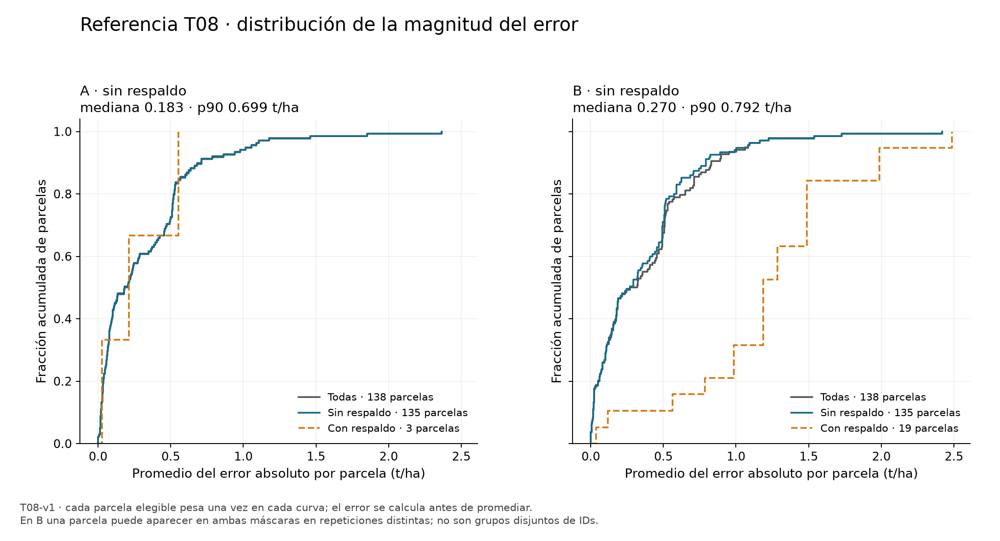
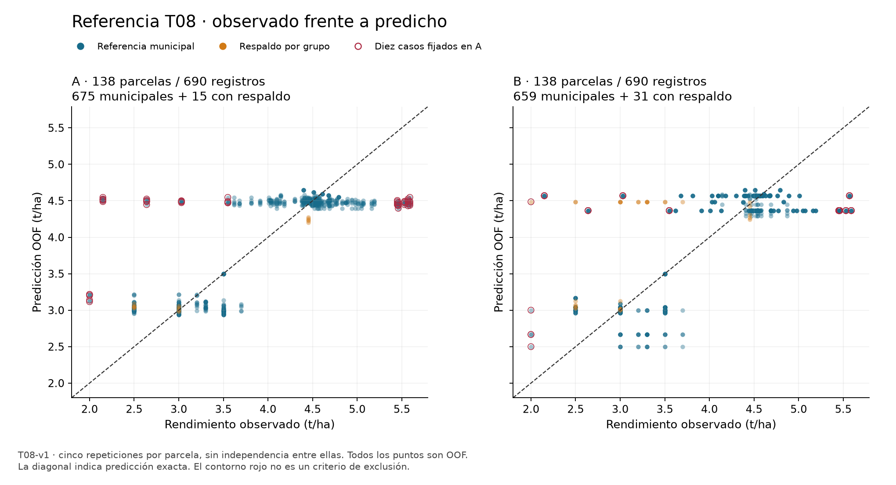
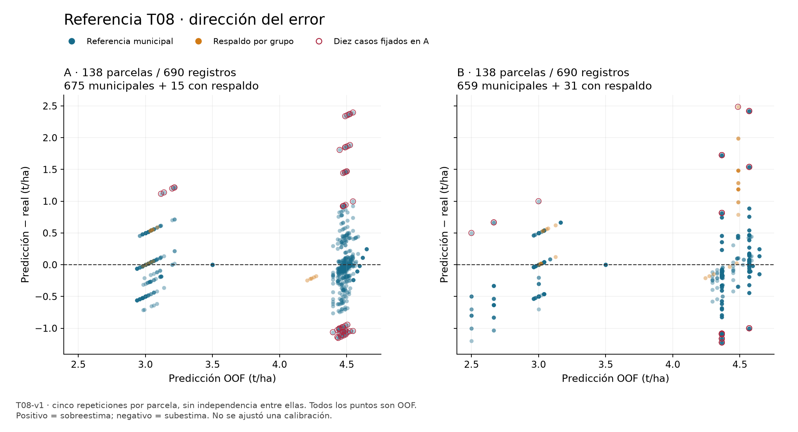
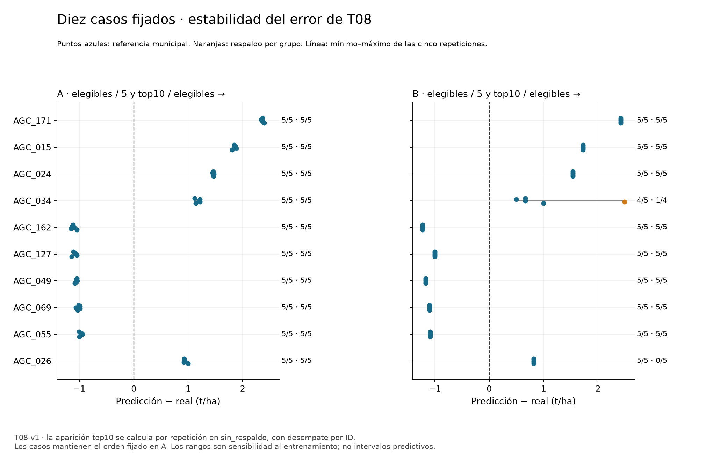

# Diagnóstico de errores y aplicabilidad · fase 1

Responsable: Dani. Rama propia `t15-diagnostico-fase1`, desde fase0 `83fd1076a424c48e9e44288bed1c90344d96410e`, preparada desde dev `b93e34b`. Entrega técnica para revisión humana. El análisis usa exclusivamente la referencia histórica **T08-v1**. No es evaluación nueva de T15 ni elección de ganador.

## Problema que resuelve

Un MAE global no dice si los fallos se concentran en pocas parcelas, si sobreestima o subestima ni si persisten al cambiar el entrenamiento. Promediar predicciones antes del error puede ocultar signos opuestos. En B cambian las máscaras de respaldo entre repeticiones: un resumen sin denominadores podría comparar poblaciones o ponderaciones diferentes.

## Solución que implementa

Se conservan las 1,380 predicciones OOF originales de 138 parcelas, cinco repeticiones en A y cinco en B. Cada error se calcula antes de agregar. Se entregan las 138 en cada máscara, incluidos los vacíos estructurales, respaldo separado, ranking fijo, contraste A/B emparejado y cuatro figuras en PNG/PDF. Los diez casos y diez controles permanecen como en fase0. Otros modelos se compararán en fase2, con sus versiones y métodos; no se reúnen aquí como una misma evaluación.

## Fuentes y criterios

El [diseño previo](../registro/diagnostico/fase1_diseno.json) quedó guardado antes de calcular esta fase, commit `4d2f55e`, SHA256 `8fbec800f8d474e551d0a6e20bfe565beb52e7760671d920b7631a53c2cbbb03`. Los resultados/etiquetas ya se habían explorado: esta cronología no convierte el diagnóstico en un análisis ciego. Se conserva la revisión de la pestaña [Diagnóstico de errores y aplicabilidad](https://docs.google.com/document/d/1G2-cyDyIHyaQsGjbdzdvvsU65rnc6Tc4SrnIZAoNynk/edit?tab=t.r7d5h4run1h6) registrada en fase0; no se modificó el documento.

La entrada es el ledger de fase0 SHA256 `199fed965f34033e94716c8c0edaef189ac94e186ec5a28e8325496269fbdea0`, anclado al manifiesto `e5eb9bd692d00f64b0b59fa611723bff7dcaabf00297bc5c3aed27341984f691`. Se comprueban los 154 archivos de las fuentes fijadas y sus tablas/particiones, sin ejecutar código de los compañeros. Las 59 reservadas no tienen etiqueta y no aportan errores.

Error firmado = predicción − real; error absoluto = |error|; cuadrático = error². MAE de parcela = promedio de sus errores absolutos elegibles; MSE = promedio de cuadrados; RMSE = raíz del MSE. Los cuantiles usan interpolación lineal R7. Cero significa error exactamente cero, y vacío significa ausencia de estimación; nunca se sustituyen.

La media descriptiva por parcelas pesa cada ID elegible por igual. Por separado se conserva el MAE promedio de las métricas de cada repetición, usado en T03, y la media por registros. El ranking y las contribuciones usan MAE/MSE individuales, no el error de una predicción media. Cinco repeticiones no son cinco parcelas independientes. Ninguna dispersión de esta fase es un intervalo predictivo.

## 1.1 · Magnitud y concentración del error

La siguiente tabla resume los MAE individuales. Mediana y p90 pertenecen a esa distribución por parcela, no a 690 muestras independientes. RMSE es raíz de la media de MSE individuales.

| Escenario/máscara | Parcelas | Registros | MAE por parcelas | MAE promedio por repetición | Mediana | p90 | RMSE por parcelas |
|---|---:|---:|---:|---:|---:|---:|---:|
| A / Todas | 138 | 690 | 0.3192 | 0.3192 | 0.1935 | 0.6900 | 0.4898 |
| A / Sin respaldo | 135 | 675 | 0.3205 | 0.3205 | 0.1829 | 0.6989 | 0.4926 |
| A / Con respaldo | 3 | 15 | 0.2635 | 0.2635 | 0.2109 | 0.4850 | 0.3430 |
| B / Todas | 138 | 690 | 0.3801 | 0.3801 | 0.2950 | 0.8306 | 0.5595 |
| B / Sin respaldo | 135 | 659 | 0.3632 | 0.3579 | 0.2697 | 0.7917 | 0.5250 |
| B / Con respaldo | 19 | 31 | 1.2208 | 0.4330 | 1.1862 | 1.9862 | 1.3523 |

Todas las magnitudes son t/ha. En A/sin_respaldo hay 135 parcelas con cinco elegibles; las otras tres se conservan en respaldo. El MAE principal original sigue en **0.3204897104**. La mediana de MAE individuales es **0.1829** y p90 **0.6989**: el promedio por sí solo no describe bien la cola.

Los diez casos representan **30.15 % del total absoluto y 57.87 % del total cuadrático** de A/sin_respaldo. En las 138 completas son 29.61 % y 57.26 %. Son concentración descriptiva del error, no parcelas autorizadas para excluir: eliminarlas haría el problema parecer más fácil sin resolverlo. Ocho de 135 tienen MAE individual >1 t/ha; esos conteos ilustran escala, no añaden una regla de selección.

En B/sin_respaldo siguen apareciendo 135 IDs, pero sólo 659 registros elegibles: el promedio por repeticiones conserva **0.3578674086**, mientras dar el mismo peso a cada ID da **0.3631873749**. Ambos son correctos y responden a ponderaciones distintas. No se sustituye la métrica de T03 por el descriptivo.

En B hay 19 IDs con al menos una repetición con respaldo, 31 registros. Dieciséis también tienen repeticiones municipales; los grupos de IDs se solapan. El MAE 1.2208 de esos 19 se obtiene pesando igual cada ID en sus repeticiones con respaldo, mientras el promedio de MAE por repetición es 0.4330. Se muestran ambas cifras y sus denominadores: no deben compararse como si fueran la misma población o la misma ponderación. En A sólo hay tres IDs con respaldo durante las cinco repeticiones. No se activó respaldo global: ese resumen permanece sin estimación.

## 1.2 · Dirección y patrones del conjunto

En A/sin_respaldo el sesgo medio es **+0.000338 t/ha**, muy próximo a cero, aunque MAE es 0.3205. Los errores positivos y negativos se compensan; esto no demuestra precisión parcela por parcela.

Con tramos descriptivos de ancho 1 t/ha fijados antes del cálculo, las 13 parcelas con rendimiento [2,3) se sobreestiman en todas sus repeticiones elegibles; MAE medio 0.8288. Las diez con [5,6) se subestiman en todas; MAE 0.8435. En [3,4) y [4,5) se mezclan signos. Es un patrón de regresión hacia las medias de la referencia y una hipótesis para contrastar con los otros procedimientos; no permite calibrar con las mismas etiquetas externas, probar una causa agronómica ni convertir los tramos en clases a predecir.

El conjunto se resume por sus nueve municipios, conservando filas sin elegibles y los respaldos. En A/sin_respaldo, Chignahuapan tiene 71 IDs y MAE 0.3801; Singuilucan 16 y 0.3467; Calpulalpan 30 y 0.2869. Nueve de los diez casos fijados son de Chignahuapan, pero ese municipio también contiene muchas más parcelas etiquetadas. La presencia en el ranking no debe leerse como un efecto causal municipal. Emiliano Zapata se muestra explícitamente: tres etiquetas iguales, MAE cero con esta referencia en A/B; ese soporte pequeño no garantiza acierto futuro.

## 1.3 · Persistencia y sensibilidad a A/B

Los diez casos fijados aparecen entre los diez peores en **5/5 repeticiones de A** y conservan el signo en todas. Cinco se sobreestiman y cinco se subestiman. Los rangos firmados de A van de 0.0264 a 0.1096 t/ha: son fallos persistentes respecto a esta referencia, no un fallo aislado de una sola partición.

| Caso fijado | Municipio | MAE A | Sentido en A | Top10 A | MAE B municipal | Elegibles B | Top10 B |
|---|---|---:|---|---:|---:|---:|---:|
| AGC_171 | Chignahuapan | 2.3665 | Sobreestima | 5/5 | 2.4197 | 5/5 | 5/5 |
| AGC_015 | Chignahuapan | 1.8516 | Sobreestima | 5/5 | 1.7259 | 5/5 | 5/5 |
| AGC_024 | Chignahuapan | 1.4593 | Sobreestima | 5/5 | 1.5397 | 5/5 | 5/5 |
| AGC_034 | Singuilucan | 1.1774 | Sobreestima | 5/5 | 0.7083 | 4/5 | 1/4 |
| AGC_162 | Chignahuapan | 1.1080 | Subestima | 5/5 | 1.2241 | 5/5 | 5/5 |
| AGC_127 | Chignahuapan | 1.0885 | Subestima | 5/5 | 1.0003 | 5/5 | 5/5 |
| AGC_049 | Chignahuapan | 1.0555 | Subestima | 5/5 | 1.1641 | 5/5 | 5/5 |
| AGC_069 | Chignahuapan | 1.0164 | Subestima | 5/5 | 1.0941 | 5/5 | 5/5 |
| AGC_055 | Chignahuapan | 0.9794 | Subestima | 5/5 | 1.0841 | 5/5 | 5/5 |
| AGC_026 | Chignahuapan | 0.9422 | Sobreestima | 5/5 | 0.8159 | 5/5 | 0/5 |

Ocho permanecen top10 en todas sus repeticiones elegibles de B. AGC_026 conserva el sentido de sobreestimación, pero entra 0/5 en top10 B. AGC_034 entra 1/4 municipales y tiene una repetición con respaldo: no se reporta falsamente 1/5 ni se agrega esa corrección al MAE municipal. El gráfico muestra los cinco puntos y distingue el respaldo. Los nueve casos de Chignahuapan tienen rango de error B cero; repetir exactamente la misma predicción no aporta cinco evidencias independientes de rendimiento ni confianza calibrada.

En el conjunto completo sin respaldo, 106/135 parcelas en A y 111/135 en B conservan signo estrictamente positivo o negativo en todas sus repeticiones elegibles. Los ceros y cambios de signo se conservan en la tabla, sin inventar un umbral posterior para clasificar persistencia. En B algunos conteos se basan en menos de cinco elegibles; el denominador individual siempre se muestra.

El contraste A/B sobre **659 pares comunes de 135 IDs** —misma parcela y repetición, referencia municipal en ambos— da una diferencia media de error absoluto B−A de **+0.043423 t/ha**, pesando por igual cada parcela. Describe sensibilidad al soporte de la partición; no una prueba confirmatoria ni la mejora de un modelo. Si se promedian sobre máscaras distintas se obtendría otra pregunta.

## Entrega para revisión y reproducción

Las ocho tablas están en [fase1](../registro/diagnostico/fase1/manifest.json).

- `errores_por_repeticion.csv`: las 1,380 filas T08 OOF y errores firmados/absolutos/cuadráticos, con procedencia intacta.
- `errores_por_parcela.csv`: 138 IDs × dos escenarios × cinco máscaras; 1,380 filas, incluidas ausencias explícitas.
- `resumen_metricas.csv` y `metricas_por_repeticion.csv`: distinguen las ponderaciones.
- `direccion_por_grupo.csv`: municipio y tramos descriptivos con denominadores.
- `respaldos_separados.csv`: vistas de respaldo grupo/global y su unión, sin sumarlas como grupos de IDs disjuntos.
- `ranking_principal_y_sensibilidad_B.csv`: los mismos diez IDs y orden fijo en A/B.
- `contraste_AB_emparejado.csv`: todas las 138 en cada una de dos máscaras; n=0 con estadísticas vacías.

El [diccionario](../registro/diagnostico/fase1_diccionario.csv) explica las 81 columnas distintas, unidades y vacíos. El manifiesto fija hashes de las ocho tablas y las cuatro figuras en dos formatos. El ledger de todas las entregas sigue local y regenerable; sólo T08 aporta a esta entrega.

~~~sh
python -m scripts.diagnostico_fase0 --preparar-fuentes --fuentes reports/diagnostico_fuentes_v1
python -m scripts.diagnostico_fase0 --fuentes reports/diagnostico_fuentes_v1 --salida reports/diagnostico_fase0_v1
python -m scripts.diagnostico_fase1 --fase0 reports/diagnostico_fase0_v1 --fuentes reports/diagnostico_fuentes_v1 --salida reports/diagnostico_fase1_v1
AGRO_DIAG_FASE0=reports/diagnostico_fase0_v1 AGRO_DIAG_FUENTES=reports/diagnostico_fuentes_v1 python -m unittest tests.test_diagnostico_fase0 tests.test_diagnostico_fase1
python -m scripts.auditar_diagnostico_fase1 --fuentes reports/diagnostico_fuentes_v1 --salida reports/diagnostico_fase1_v1 --evidencia reports/auditoria_fase1_v1.json
~~~

Los destinos deben ser nuevos: no se sobrescriben entregas. Usar el entorno fijado o Docker común, preparar las fuentes Git en el host y montarlas de sólo lectura. No se necesita conexión de red ni entrenar modelos. La variante `--sin-figuras` es una comprobación tabular; su manifiesto declara la ausencia de figuras y no sustituye la entrega completa.

## Verificación e incidencias

La [evidencia técnica](../registro/diagnostico/fase1_verificacion.json) identifica entorno, código, pruebas, auditor y reproducción. Son 19 regresiones nuevas, además de las 23 de fase0 conservada: 42 pruebas. El auditor independiente parte del CSV original T08 y usa NumPy/pandas sin importar el productor; contrasta 1,380 registros exactos, 1,380 resúmenes por parcela, 276 filas de pares, vistas y grupos, con 34,240 comparaciones numéricas y diferencia máxima 8.9e-16 frente al límite 1e-12.

Incidencia del verificador propio: inicialmente pidió igualdad float exacta entre la predicción guardada y la referencia reconstruida. La diferencia máxima en 557 registros fue 8.9e-16; se corrigió el guard para usar la tolerancia **ya fijada en fase0, 1e-9**, sin cambiar predicciones ni etiquetas. Se mantienen anclas exactas de los bytes originales. La consulta auxiliar de versiones falló al importar la biblioteca gráfica en un contenedor de sólo lectura sin caché temporal; se obtuvo la versión desde los metadatos instalados. La reproducción gráfica ya usaba caché temporal explícita y no falló por esto.

Incidencia de máscara vacía: el primer resumen expresaba 0 para una contribución sin denominador en respaldo global no activado. Se dejó vacía y se añadió una regresión; los conteos siguen en cero. No afectaba a los MAE de A/B ni a los casos.

Incidencia del auditor: pandas infería una columna entera en la vista de diez casos y texto con vacíos en la tabla completa; su comparación de tipos falló aunque los valores coincidían. Se corrigió únicamente la comparación textual de las vistas. Los cálculos numéricos se contrastan aparte y no se relajan tolerancias.

QA visual: la primera exportación superponía la leyenda al título y cortaba los denominadores de B. Se ajustó el espacio y se revisaron las cuatro imágenes completas. Mac y Docker dan las ocho tablas CSV y los cuatro PDF idénticos por bytes; los cuatro PNG tienen píxeles idénticos y compresión distinta, por eso difieren sus hashes. La entrega conserva los hashes de la exportación canónica Docker, sin fingir igualdad binaria del paquete Mac.

## Qué permite concluir y qué sigue

Se cierra técnicamente la descripción de tamaño, dirección y persistencia para la referencia fijada. El error se concentra en una cola persistente que merece inspección, y el promedio municipal no distingue bien los extremos del rendimiento. No sabemos todavía si los otros procedimientos comparten esos fallos ni qué parte se asocia a calidad, etiquetas o factores ausentes.

En fase2 se contrastarán las mismas parcelas/contextos con las versiones históricas de T09–T14 y se separará el soporte de referencia. Después se inspeccionarán mapas/curvas/calidad con los controles ya seleccionados; no se elegirán nuevos controles por conveniencia. Cualquier intervención necesitará una hipótesis y una evaluación registrada, sin usar estos errores para calibrar fuera del entrenamiento. No se borran casos ni se promete reducir MAE. La disponibilidad histórica y el uso en otra campaña siguen pendientes de evidencia. La revisión humana permanece pendiente. No se publica, fusiona ni envía mensaje con esta entrega.

## Referencias de procedimiento

- NIST, [Scatter Plot](https://www.itl.nist.gov/div898/handbook/eda/section3/eda33q.htm): apoyo para leer asociaciones en los gráficos, sin atribuir causalidad.
- Kassis, T., Agarwal, V., He, Y., Patel, D., & Brueckner, A. M. (2026). *Scientific Agent Skills: A Library of Procedural Knowledge for Research Agents*. [DOI](https://doi.org/10.48550/arXiv.2609.00065), registro consultado v2. La skill de análisis exploratorio apoya la jerarquía de medidas y el reporte; no es evidencia de mejora predictiva.
