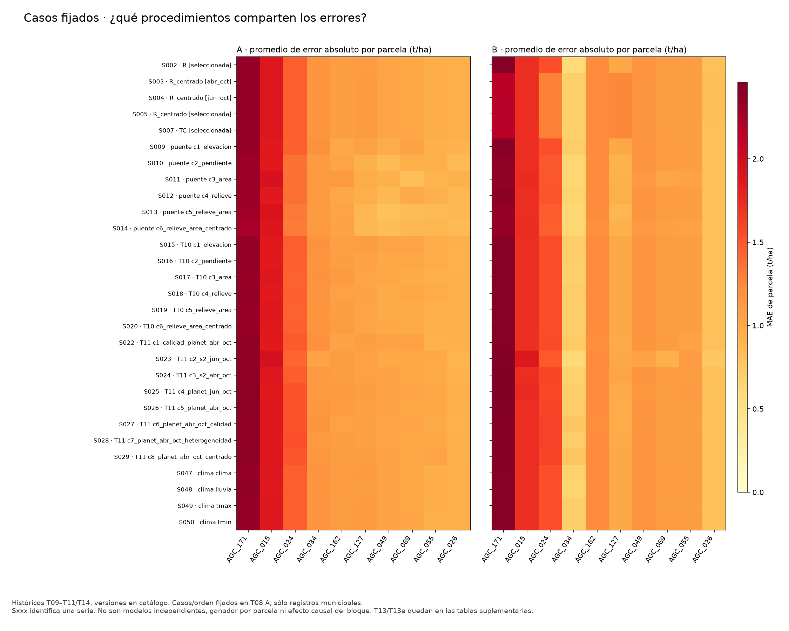
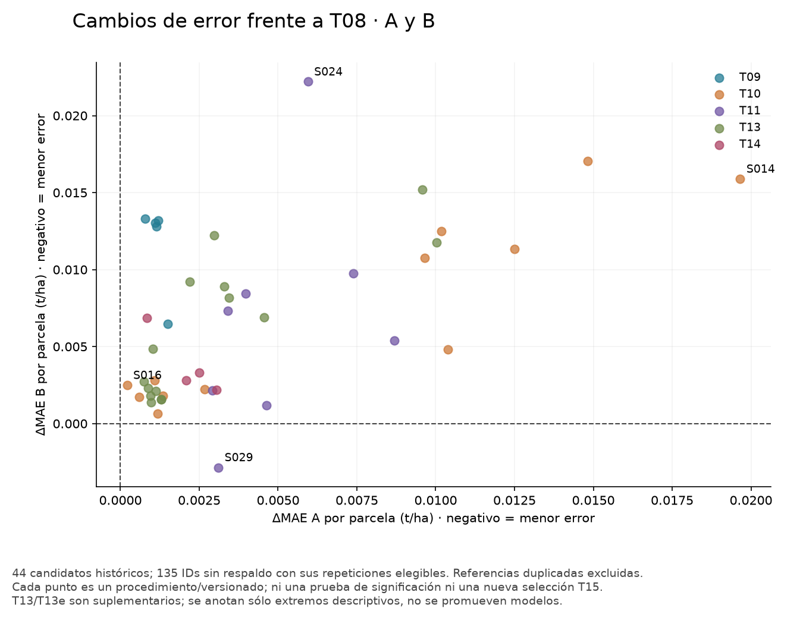
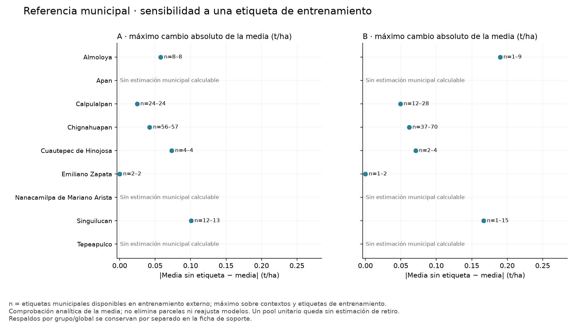

# Diagnóstico de errores y aplicabilidad · fase 2

Responsable: Dani. Rama `t15-diagnostico-fase2`, desde fase1 `a5497913de9c79c2734963a0d6ea44dd4528d7b9`. Entrega técnica para revisión humana. Usa exclusivamente resultados históricos y fuentes fijadas en fase0; no entrena ni evalúa un modelo nuevo de T15.

## Problema que resuelve

Un error persistente de T08 puede pertenecer sólo a la referencia o repetirse al añadir clima, relieve y satélite. Comparar entregas por nombre de modelo sin método/versión, mezclar respaldos o contar copias de la referencia como expertos distintos produciría una conclusión engañosa. También necesitamos saber cuándo una referencia territorial tiene poco soporte o depende mucho de una etiqueta de entrenamiento.

## Solución que implementa

Se cruzan 70,380 registros OOF de A/B de 51 series: 44 candidatos no referencia —cinco T09, doce T10 (principal/puente), ocho T11, cuatro T14 y quince suplementarios T13/T13e— y siete series de referencia, incluido T08 canónico, conservadas en sus versiones. Los 828 registros C de T09 permanecen en el ledger de fase0 y se declaran fuera del contraste común, porque los otros frentes no tienen esa evaluación compatible. Son mediciones repetidas de 138 parcelas, no 70,380 ejemplos de cosecha independientes.

El [diseño](../registro/diagnostico/fase2_diseno.json) se guardó antes de los cálculos, commit `762855a`, SHA256 `03cf3cf4cb1eef8e554fad92da3466e1f360179adbbf03f66297e71c443ea93b`. Los resultados/etiquetas eran conocidos: es exploración trazable, no análisis ciego. Se conserva la fuente documental [Diagnóstico de errores y aplicabilidad](https://docs.google.com/document/d/1G2-cyDyIHyaQsGjbdzdvvsU65rnc6Tc4SrnIZAoNynk/edit?tab=t.r7d5h4run1h6), revisión identificada en fase0; no se modifica el Google Doc. T13/T13e ya estaban inventariadas: se incorporan como suplemento identificado, sin convertirlas en requisito nuevo ni aceptación de sus PR.

## 2.1 · Matriz de los procedimientos existentes

La [matriz](../registro/diagnostico/fase2/matriz_procedimientos_por_caso.csv) conserva **138 IDs × 51 series × 2 escenarios × 2 máscaras = 28,152 filas**. Cada `serie_id` remite a tarea, archivo, candidato, variante, versión, método, centrado, intercepto, commit y estado de revisión en el [catálogo](../registro/diagnostico/fase2/catalogo_series.csv). Incluye todas las parcelas y los vacíos cuando no son elegibles; los diez casos y diez controles siguen los de fase0.

Primero se calcula error firmado, absoluto y cuadrático por registro. MAE/diferencias se promedian por ID sobre los mismos registros elegibles y luego por parcelas; también se informa MAE promedio por repetición para conservar la ponderación T03. Así, B de T08 sigue en 0.3578674086 por repeticiones y 0.3631873749 por IDs. Las cifras no se intercambian ni cambian el criterio de selección.

Se excluyen los seis alias de referencia adicionales de la matriz de pares; no se agregan como votos. Se conservan 44 candidatos y T08 canónico, 3,960 contrastes de pares por escenario/máscara. La distancia entre predicciones y la correlación de errores medios sólo describen acuerdo. No son incertidumbre de una parcela, expertos independientes ni intervalos predictivos.

Los siete referentes están en dos grupos de igualdad binaria (S001/S006/S051 y S008/S021/S030/S039); sus diferencias restantes son de representación numérica admitidas en fase0. Además S033 (NDVI S2 de T13) y S046 (control NDVI S2 de T13e) tienen las 1,380 predicciones exactamente iguales. Es una coincidencia prevista de un control, no un error de cálculo. Se preservan sus nombres y la firma para no tratarlos como información independiente.

### Coincidencias concretas

En A/sin_respaldo, **AGC_171, AGC_015, AGC_024 y AGC_034 están top10 en 5/5 repeticiones en las 29 variantes de T09/T10/T11/T14**, no sólo en T08. Mantienen sobreestimación en todas esas series/repeticiones. Los demás casos varían en frecuencia e intensidad: se muestran los rangos por frente y sus denominadores, sin escoger el modelo que mejor predice cada ID después de ver su rendimiento.

| Caso fijado | Rango de MAE en 29 variantes, A | Rango de MAE, B municipal | Menor frecuencia top10 A | Menor frecuencia top10 B |
|---|---:|---:|---:|---:|
| AGC_171 | 2.255–2.381 | 2.161–2.460 | 100% | 100% |
| AGC_015 | 1.846–1.953 | 1.720–1.878 | 100% | 100% |
| AGC_024 | 1.312–1.530 | 1.281–1.599 | 100% | 100% |
| AGC_034 | 1.054–1.198 | 0.591–0.763 | 100% | 0% |
| AGC_162 | 1.001–1.122 | 1.200–1.234 | 80% | 100% |
| AGC_127 | 0.871–1.113 | 0.891–1.259 | 80% | 60% |
| AGC_049 | 0.798–1.053 | 1.046–1.167 | 40% | 100% |
| AGC_069 | 0.822–1.065 | 0.939–1.107 | 40% | 80% |
| AGC_055 | 0.865–1.021 | 1.052–1.105 | 60% | 100% |
| AGC_026 | 0.859–0.951 | 0.754–0.817 | 40% | 0% |

Rangos en t/ha; frecuencia mínima entre las variantes históricas indicadas. En B, AGC_034 tiene cuatro repeticiones municipales y una con respaldo, no cinco municipales. Sus resultados con respaldo siguen en la máscara `todas`; no se mezclan en este rango. T13/T13e se pueden contrastar aparte en las tablas. Los mínimos de una fila son descripciones de resultados vistos; no se suman como un supuesto MAE alcanzable por una mezcla de ganadores.

En A, los candidatos no referencia comparten entre **90 % y 100 %** de los top10 de T08 por repetición; en B, entre **84 % y 100 %**. Las correlaciones de errores firmados medios entre pares van de **0.9703 a 1.0 en A** y **0.9551 a 1.0 en B**. Estas semejanzas son consistentes con procedimientos de corrección similares, entradas y referencia compartidas. La correlación de errores también contiene el término común de restar el mismo rendimiento real; por eso se acompaña de distancias directas entre predicciones y no se interpreta como igualdad de modelos. No demuestran que el error sea inevitable ni que todos los bloques sean inútiles.

### Ventajas y deterioros

En A/sin_respaldo, **ninguno de los 44 candidatos históricos reduce el MAE agregado frente a T08**. El menor cambio es +0.0002092 t/ha (T10 pendiente, S016) y el mayor +0.0196588. La clasificación usa tolerancia numérica ±1e-9 t/ha; no es significación estadística, equivalencia ni regla de promoción. No se rehizo la elección interna ni se seleccionó un ganador externo.

En B/sin_respaldo aparece un cambio negativo pequeño: **S029, Planet abr_oct centrado de T11**, reduce MAE por ID de 0.3631874 a 0.3603387, Δ=−0.0028487 t/ha. En A empeora de 0.3204897 a 0.3235965, Δ=+0.0031068. En B mejora en cuatro de cinco repeticiones, pero sólo 65 de 135 IDs mejoran y 70 empeoran; en A mejoran 66 y empeoran 69. Es una pista de sensibilidad al soporte, no mejora global suficiente para sustituir T08 ni evidencia nueva de cumplir T03. La reducción B es menor que el margen 0.01 de promoción registrado; también falla A.

La distancia media a T08 de esa variante es 0.02867 t/ha en A y 0.03818 en B. Un cambio en la predicción no equivale a ganancia de exactitud. No se construye mezcla que use S029 sólo en los IDs donde conocemos que acierta. Tampoco se ajusta un ensamble con las mismas etiquetas externas observadas.

## 2.2 · Soporte e influencia municipal

Se reconstruyen los 50 entrenamientos externos A/B a partir de las particiones fijadas. El pool de referencia utiliza sólo etiquetas de ese entrenamiento: primero municipio, si falta grupo de registro y si falta global. Grupo de registro conserva `Cebada`/`CEBADA`; no es variedad agronómica. Se comprueban membresía, fuente, conteos, media, dispersión y que ninguna parcela evaluada entra en el pool.

La influencia analítica de retirar una etiqueta j del mismo pool de n≥2 es:

    media_sin_j − media = (media − rendimiento_j) / (n − 1)

Se informa la máxima magnitud, el ID de entrenamiento que la produce y la media correspondiente. El ID más influyente no se elige mirando el error del caso evaluado. Si n=1 la media tras retirar la única etiqueta es indefinida: se deja vacía, sin dividir por cero ni inventar otro respaldo. **No se borra ninguna etiqueta, no se altera su evaluación ni se calcula un MAE mejorado por borrarla.** El auditor verifica la fórmula retirando explícitamente cada ID y recalculando la media.

| Municipio con referencia municipal | Etiquetas totales | Soporte A min–max | Mayor influencia A | Soporte B min–max | Mayor influencia B calculable |
|---|---:|---:|---:|---:|---:|
| Almoloya | 10 | 8–8 | 0.0577 | 1–9 | 0.1900 |
| Calpulalpan | 30 | 24–24 | 0.0245 | 12–28 | 0.0492 |
| Chignahuapan | 71 | 56–57 | 0.0423 | 37–70 | 0.0616 |
| Cuautepec de Hinojosa | 5 | 4–4 | 0.0733 | 2–4 | 0.0708 |
| Emiliano Zapata | 3 | 2–2 | 0.0000 | 1–2 | 0.0000 |
| Singuilucan | 16 | 12–13 | 0.1008 | 1–15 | 0.1667 |

Influencias en t/ha; son máximos descriptivos de medias de entrenamiento, no intervalos de rendimiento. Las nueve fichas municipales conservan además las fuentes grupo/global y filas sin datos, incluidos Apan, Nanacamilpa de Mariano Arista y Tepeapulco; no se ocultan por carecer de referencia municipal.

En B hay **34 registros de evaluación de 26 IDs** con una sola etiqueta municipal disponible: nueve registros Almoloya, diez Emiliano Zapata y quince Singuilucan. Son registros repetidos, no 34 parcelas. Que Emiliano Zapata tenga MAE cero y media 3.5 no acredita soporte robusto: sus pocas etiquetas son idénticas y retirar la única disponible en esos contextos deja la media indefinida.

Para **AGC_171**, la influencia máxima de una sola etiqueta de entrenamiento es 0.03405 t/ha en A y 0.05216 en B. Su MAE T08 es 2.36649 y 2.41974 respectivamente. Esto limita la explicación “una etiqueta de entrenamiento domina la media”: retirar sólo una mueve poco esa referencia frente a la magnitud del fallo. No prueba que el rendimiento de AGC_171 sea falso ni descarta efectos conjuntos, falta de manejo/observación o límites del estimador. Su etiqueta nunca participó en las medias que lo evaluaron.

Para **AGC_034**, B usa soporte municipal 3/2/3/1 en cuatro repeticiones y respaldo por grupo en otra. El salto de referencia hacia el grupo explica parte de su sensibilidad a B; su caso con respaldo está separado. No se confunde el cambio de fuente con una ventaja agronómica del satélite o del relieve.

## 2.3 · Interpretación y prioridades

Los cuatro casos compartidos merecen revisión temprana en fase3, manteniendo **los diez casos, sus diez controles y el conjunto completo**. Los controles fueron elegidos por metadatos, no por buen error; se informa su resultado aunque también fallen. Las fichas posteriores deben contrastar contorno, mezcla de píxeles, cobertura, nube, huecos/fechas y curvas con las fuentes originales, sin cambiar filtros según el error observado. La validación de etiquetas/unidades/manejo reportado corresponde a fase4; no se acusa una etiqueta por su error.

Para los casos con rangos de respuesta mayores, por ejemplo AGC_049/AGC_069/AGC_127, se puede investigar qué representación explica la variación, con el método y soporte visibles. Que alguna serie tenga menor error para un caso no permite elegirla para ese ID a posteriori. Para los municipios con soporte unitario, documentar fragilidad de referencia y distinguirla de aporte de atributos.

La comparación conserva las diferencias de método: T09 R-v1 sin centrar, R centrado con escala global y sin intercepto, TC con ajuste territorial conjunto; T10 propio selecciona por MAE e incluye referencia sola, puente cambia criterio; T10/T11 centrados estandarizan las desviaciones y aprenden intercepto; T13 hereda T11; T14 pondera temperatura por días. **Ninguno se etiqueta como evaluación común v2**. H3 limita atribuir una corrección no centrada exclusivamente a diferencias dentro del municipio; esta fase no obliga a repetir todos los históricos ni modifica código ajeno.

### Hipótesis de mejora que conviene conservar

Además de revisar calidad y factores ausentes, los procedimientos comparten una familia de corrección Ridge que ajusta un objetivo cuadrático. Seleccionar su regularización con MAE no convierte su entrenamiento en una minimización directa del error absoluto. Una comprobación futura pequeña podría contrastar una corrección robusta orientada al MAE, por ejemplo mediana condicional (`QuantileRegressor` con cuantil 0.5), frente a la misma referencia y datos. La [documentación oficial](https://scikit-learn.org/stable/auto_examples/linear_model/plot_quantile_regression.html#comparing-quantileregressor-and-linearregression) respalda la diferencia entre objetivos; **no demuestra que mejorará Agrocebada**.

Esta hipótesis surge después de ver resultados. No se implementa, no cambia el registro T15 ni amplía el presupuesto ahora. Si se adopta después del diagnóstico, habrá que fijar método, comparadores, pocos parámetros, tratamiento de municipio/faltantes, selección interna aislada y criterio antes de entrenar. Informar MAE y RMSE, coste y cronología post hoc; una mejora MAE puede deteriorar RMSE. No usar los peores diez como entrenamiento privilegiado ni para elegir parámetros externos. Datos externos sólo ante una carencia verificable y disponibilidad acreditada; no se agregaron en esta fase.

## Entrega y reproducción

Los [artefactos](../registro/diagnostico/fase2/manifest.json) conservan ocho tablas y tres figuras PNG/PDF: catálogo; matriz completa; resumen de comparaciones; métricas por repetición; coincidencias por frente; pares de procedimientos; sensibilidad de referencia por contexto; ficha municipal; y las figuras de casos compartidos, cambios A/B e influencia. El [diccionario](../registro/diagnostico/fase2_diccionario.csv) explica 85 campos, unidades y vacíos. El ledger con todos los resultados OOF sigue local y regenerable; no se repiten nombres/rutas largas en cada fila de la matriz.

~~~sh
python -m scripts.diagnostico_fase0 --preparar-fuentes --fuentes reports/diagnostico_fuentes_v1
python -m scripts.diagnostico_fase0 --fuentes reports/diagnostico_fuentes_v1 --salida reports/diagnostico_fase0_v1
python -m scripts.diagnostico_fase2 --fase0 reports/diagnostico_fase0_v1 --fuentes reports/diagnostico_fuentes_v1 --salida reports/diagnostico_fase2_v1
AGRO_DIAG_FASE0=reports/diagnostico_fase0_v1 AGRO_DIAG_FUENTES=reports/diagnostico_fuentes_v1 python -m unittest tests.test_diagnostico_fase0 tests.test_diagnostico_fase1 tests.test_diagnostico_fase2
python -m scripts.auditar_diagnostico_fase2 --fase0 reports/diagnostico_fase0_v1 --fuentes reports/diagnostico_fuentes_v1 --salida reports/diagnostico_fase2_v1 --evidencia reports/auditoria_fase2_v1.json
~~~

Preparar blobs Git en el host con los commits declarados disponibles. Usar destinos nuevos; no se sobrescriben entregas. En Docker común, montar código/fuentes/fase0 de sólo lectura, salida propia escribible y `/tmp` temporal para la caché gráfica; red deshabilitada. No se ejecutan scripts/modelos de compañeros. `--sin-figuras` sirve como control tabular y lo declara en el manifiesto; no sustituye la entrega completa.

## Comprobaciones, problemas y resolución

La [evidencia](../registro/diagnostico/fase2_verificacion.json) fija código, entorno y huellas. Pasan **64 pruebas** en Mac y Docker con Python optimizado: 23 fase0, 19 fase1 y 22 fase2. El auditor independiente carga CSV originales fijados y usa matrices NumPy/pandas sin importar productores ni estimadores. Contrasta 70,380 registros, 28,152 resúmenes, 3,960 pares, 1,380 contextos de soporte y 54 fichas; realiza **494,962 comprobaciones numéricas**, diferencia máxima 1.47e-15 frente a tolerancia 1e-12. Reconstruye la sensibilidad por retiros explícitos de entrenamiento, además de verificar pools y folds.

No se detectó discrepancia matemática en las predicciones comparadas. Esto no acepta automáticamente PR pendientes ni certifica cualquier otro aspecto de su implementación. La referencia compartida, los alias exactos y los métodos distintos son límites de interpretación, no motivos para cambiar sus resultados.

Optimización propia previa: la comparación entre pares habría recorrido las 1,380 filas para cada parcela de cada par. Se prepararon vectores alineados por ID/escenario/máscara y se compararon esos vectores, manteniendo todos los contextos y pesos. En el auditor se reemplazaron consultas repetidas de metadatos con diccionarios y se prepararon los 50 conjuntos de entrenamiento una sola vez; además se verifica cobertura de contexto y fold. La evidencia Mac antes/después fue exactamente igual. No se sacrificaron comprobaciones ni se tomó una muestra.

Las ocho tablas CSV coinciden por bytes entre Mac y Docker. Los PNG tienen hashes de archivo distintos pero **píxeles idénticos**; el PDF del mapa de calor tampoco es idéntico por bytes, y su renderizado independiente muestra píxeles idénticos. Los otros dos PDF coinciden por bytes. Se revisaron las tres figuras y el PDF renderizado; la entrega conserva la exportación Docker con sus hashes reales. No se relajan tolerancias ni se finge identidad binaria del paquete Mac.

Los originales, la entrega fase1 y las ramas previas permanecen intactos. Sólo se añaden artefactos propios y bitácoras con prefijo conservado. No se elimina ningún caso, no se ajustan modelos ni las 59, no se publica/mergea, no se envían mensajes ni se modifica el Google Doc. La revisión humana permanece pendiente.

## Cierre y siguiente alcance

Fase2 describe coincidencias, desacuerdos y soporte de las fuentes fijadas. Todavía no sabemos la causa de los cuatro fallos más compartidos ni que alguno de los cambios propuestos reduzca MAE en datos nuevos. El siguiente trabajo es fase3: fichas de mapas/curvas/calidad con los mismos casos y controles, apoyadas por el conjunto de 138; después fase4 de etiquetas/factores y fase5 de aplicabilidad. No adelantar una intervención antes de distinguir esas evidencias.

## Referencias

- Skills utilizadas: análisis exploratorio y pensamiento crítico científico; Kassis, T., Agarwal, V., He, Y., Patel, D., & Brueckner, A. M. (2026), *Scientific Agent Skills: A Library of Procedural Knowledge for Research Agents*. [DOI](https://doi.org/10.48550/arXiv.2609.00065), registro consultado v2. Apoyo de procedimiento, no prueba de mejora predictiva.
- scikit-learn, [prevención de filtraciones](https://scikit-learn.org/stable/common_pitfalls.html#data-leakage) y [comparación de objetivos en regresión cuantílica](https://scikit-learn.org/stable/auto_examples/linear_model/plot_quantile_regression.html#comparing-quantileregressor-and-linearregression). Fuentes primarias para la hipótesis futura; no se importan modelos en este diagnóstico.
