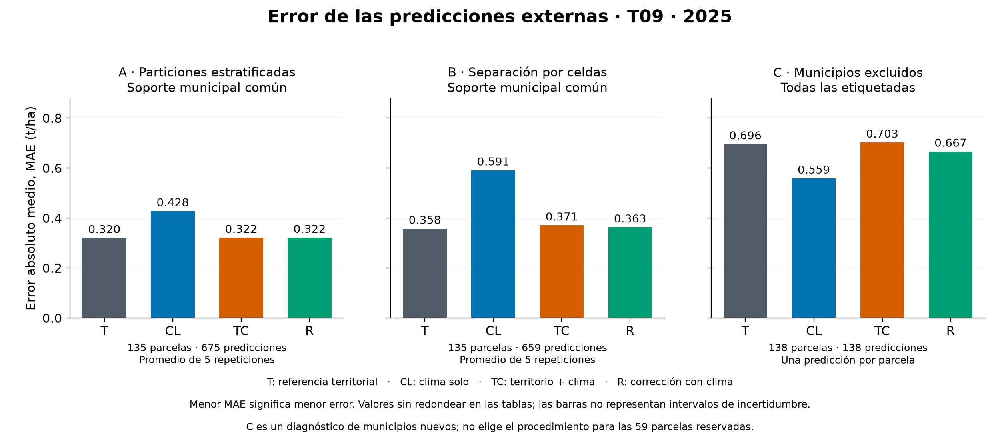
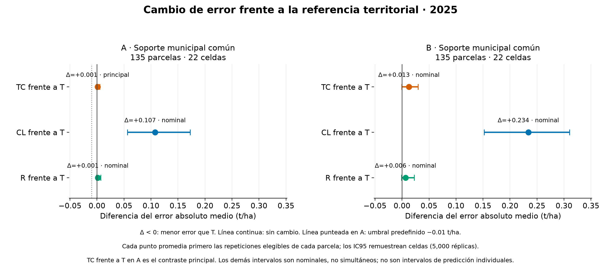
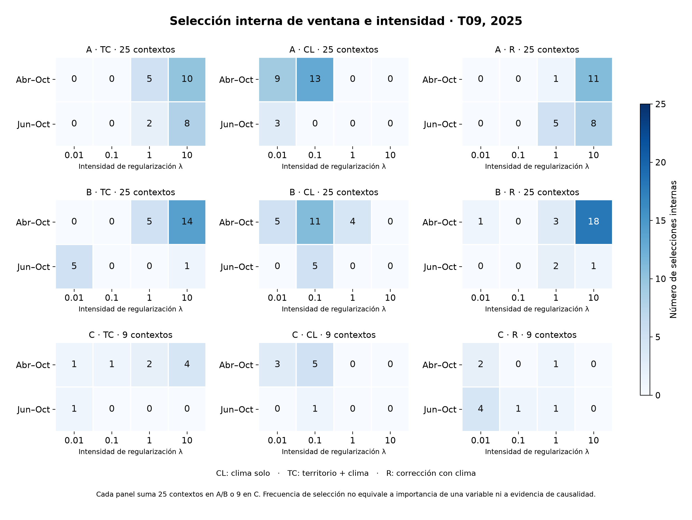

# T09 · Evaluación del aporte climático

**Responsable:** Dani · **Revisa:** Migue · **Fecha:** 12 de octubre de 2026.
**Estado:** ejecución y verificaciones técnicas completas; revisión humana pendiente.
**Versión:** T09-evaluacion-v1, diseño congelado `1072e419…`.

## Problema que resuelve

Ya tenemos una referencia municipal útil y un bloque climático verificado, pero disponer de lluvia y temperatura no demuestra que mejoren la estimación de rendimiento. Hace falta comparar procedimientos sobre las mismas parcelas apartadas del entrenamiento, respetando las ventanas, la selección interna y la dependencia espacial.

## Solución que implementa

Se evalúan cuatro procedimientos con las 138 etiquetas de grano de 2025: referencia territorial, clima solo, municipio + clima y corrección climática de la referencia. Las entradas son lluvia acumulada y temperaturas mínima/máxima mensuales agregadas por T07. Se comparan abril–octubre y junio–octubre dentro de cada entrenamiento, con ocho opciones por procedimiento climático y cuatro validaciones internas. No se amplía la búsqueda después de ver resultados.

**Conclusión para el uso actual:** ninguno de los tres procedimientos climáticos satisface la regla de promoción frente a la referencia en el escenario principal. T09 recomienda conservar la referencia T como base para las comparaciones siguientes. T16 todavía debe decidir el procedimiento final del proyecto; T09 no genera la entrega definitiva de las 59.

## 1. Qué se comparó, en palabras simples

| Código | Cómo estima | Pregunta |
| --- | --- | --- |
| T | Media del municipio aprendida con entrenamiento; si falta, respaldo por grupo de registro y después global | ¿Qué logra la ubicación territorial por sí sola? |
| CL | Ridge con tres variables climáticas y un intercepto global | ¿Qué podemos estimar con el clima sin usar municipio para predecir? |
| TC | Interceptos municipales sin penalizar y tres relaciones climáticas penalizadas | ¿Añade el clima información después de considerar el municipio? |
| R | Referencia T más corrección Ridge, aprendida con residuos calculados excluyendo la propia fila | ¿Ayuda corregir con clima lo que la referencia no explica? |

CL no utiliza municipio, grupo, coordenadas ni celda como entradas numéricas. Municipio/celda sirven para organizar la evaluación y los reportes. ID sirve para verificar las uniones; nunca como predictor. Cebada/CEBADA conserva el uso de respaldo/procedencia de T08; no se interpreta como variedad.

Cada ajuste recibe una sola ventana: `abr_oct` (7 meses, 214 días) o `jun_oct` (5 meses, 153 días). La lluvia se suma en el tiempo y las temperaturas se ponderan por días, conforme a T07. Las intensidades λ son 0.01, 0.1, 1 y 10; el Ridge efectivo utiliza α = n del entrenamiento × λ.

## 2. Qué escenarios representan los resultados

| Escenario | Qué apartamos para evaluar | Uso de su resultado |
| --- | --- | --- |
| A | Parcelas por las particiones principales de T03; cinco repeticiones de cinco particiones | Principal para las 59 actuales, que tienen municipios representados |
| B | Celdas CHIRPS del centroide completas, con las mismas cinco repeticiones | Sensibilidad a separación espacial |
| C | Un municipio completo cada vez, nueve exclusiones | Diagnóstico de transferencia territorial en 2025; no elige el procedimiento de las 59 |

En A/B se reportan `todas` y `sin_respaldo`. La segunda población se define con T08 y se mantiene común a los cuatro procedimientos, aunque CL tenga fuente global. A aporta 675 predicciones elegibles de 135 IDs; B aporta 659 de 135 IDs en la unión de repeticiones. En B hay una repetición con 119 casos elegibles, por lo que promediar por parcela y promediar las métricas de repeticiones son cálculos distintos. C reporta las 138 parcelas, sin población `sin_respaldo`.

La política interna sigue el diseño propio de T09: A estratifica por municipio/otros; B mantiene juntas las celdas; C mantiene juntos los municipios. Las externas de T03 y su regla de promoción permanecen intactas. La extensión interna B/C y la normalización de λ deben revisarse con Migue y unificarse antes de atribuir diferencias entre frentes exclusivamente a las variables en T15.

## 3. Resultados principales

Métricas externas: primero una métrica por repetición completa y después el promedio de las cinco. Valores en t/ha salvo R². La tabla siguiente usa la población común `sin_respaldo`; no es error observado de las 59, cuyas etiquetas no tenemos.

| Procedimiento | MAE A | RMSE A | R² A | MAE B | RMSE B |
| --- | ---: | ---: | ---: | ---: | ---: |
| T · referencia | 0.3205 | 0.4926 | 0.6586 | 0.3579 | 0.5220 |
| CL · clima solo | 0.4280 | 0.5595 | 0.5595 | 0.5914 | 0.7139 |
| TC · territorio + clima | 0.3216 | 0.4917 | 0.6599 | 0.3710 | 0.5133 |
| R · corrección climática | 0.3220 | 0.4919 | 0.6595 | 0.3633 | 0.5266 |

La referencia tiene un MAE aproximado de 320 kg/ha en A. Es un promedio de errores de validación; hay parcelas con errores mayores. El 0.3192 de la tabla general de T08 corresponde a las 138 (`todas`); el 0.3205 corresponde a las 135 con soporte municipal común. La diferencia no es un cambio de cálculo.

TC y R reducen ligeramente RMSE en A, pero empeoran MAE. La elección sigue MAE, la métrica fijada antes de ejecutar, y no cambia a RMSE/R² porque resulten más favorables.



### Contraste principal y regla de aceptación

ΔMAE es candidato menos referencia: negativo mejora. Para la regla se promedian primero las diferencias de cada parcela en sus repeticiones elegibles; después se promedian parcelas. El IC95 remuestrea celdas, con 5,000 réplicas y semilla 20261006. No representa un intervalo individual de rendimiento.

| Contraste en A | ΔMAE | IC95 por celdas | Repeticiones que mejoran | ΔRMSE | ¿Cumple? |
| --- | ---: | --- | ---: | ---: | --- |
| TC frente a T · principal | +0.0011 | [−0.0015, +0.0050] | 2/5 | −0.0009 | No |
| CL frente a T · secundario | +0.1075 | [+0.0563, +0.1724] | 0/5 | +0.0669 | No |
| R frente a T · secundario | +0.0015 | [−0.0013, +0.0071] | 2/5 | −0.0007 | No |

La regla exige ΔMAE ≤ −0.01, límite superior del IC95 por celdas < 0, mejora en al menos cuatro repeticiones y empeoramiento medio de RMSE ≤ 0.01. TC sólo satisface el último control. El umbral 0.01 t/ha es del equipo, no una tolerancia agronómica confirmada por FIRA.

Los contrastes secundarios y de ventanas fijas se conservan completos en las tablas, con intervalos nominales no simultáneos. No se escoge el más favorable para reemplazar el contraste principal. Se publican también TC frente a CL y R frente a TC. Los contrastes de ventana fija son TC/T y TC/CL en ambas ventanas, sin configuraciones adicionales.



### Diagnóstico C: municipios no vistos

En C, MAE: T 0.6959, CL 0.5589, TC 0.7027 y R 0.6665. CL funciona mejor que T en esta prueba de municipios sin etiquetas de entrenamiento. Es un resultado útil: el clima puede ayudar a describir diferencias territoriales cuando la referencia local no existe.

Esto no transforma a CL en el elegido para las 59 actuales ni demuestra desempeño entre años. C cambia soporte y tamaño de entrenamiento; por ejemplo, excluir Chignahuapan retira muchas etiquetas. El resultado se limita a estas entradas, este procedimiento y los municipios de 2025.

## 4. Ventanas, calidad y soporte

La selección es interna a cada entrenamiento, no una elección global con todos los errores externos. En A, TC seleccionó `abr_oct` en 15 de 25 contextos y `jun_oct` en 10; λ = 10 en 18. R seleccionó λ = 10 en 19. Esto muestra contracción fuerte en muchos ajustes, sin autorizar ampliar ahora la cuadrícula para buscar una victoria.



Los reportes desglosan municipio, grupo de registro, contorno, parcela angosta/muy pequeña, escalón de etiqueta y vecina etiquetada a menos de 20 m. Grupos con menos de cinco IDs se marcan poco informativos; R² queda vacío con menos de dos casos o rendimiento constante. Las frecuencias de selección y los coeficientes no son importancia causal.

La sensibilidad excluye de las métricas las 24 etiquetas con alerta de contorno, conservando las mismas predicciones y todos los entrenamientos originales. No reentrena ni elimina casos difíciles del modelo. El orden por MAE se conserva en los 15 resúmenes escenario/ventana/población. Esta sensibilidad no cambia la promoción principal.

Para las 59 reservadas se preparó un diagnóstico sin entrenar un modelo final:

- 59 tienen clima completo y municipio representado; ninguna está fuera de los rangos climáticos globales por columna.
- AGC_120 tiene una sola etiqueta municipal de apoyo. Soporte escaso no equivale a respaldo activado: T08 usa municipio.
- AGC_120 y AGC_182 exceden al menos un rango climático de su municipio. Se conserva qué columnas; no se usa como motivo automático de rechazo.
- Diez tienen un perfil climático no idéntico a los etiquetados en cada ventana. Se registra distancia estandarizada mínima y el ID del perfil más próximo, sin umbral de confianza. Estos diagnósticos no permiten garantizar precisión ni rechazar automáticamente las parcelas.

No se asigna variedad, dosis, siembra, daño o manejo a partir de guías. FIRA confirmó grano de temporal y fuentes mixtas de rendimiento, pero no proporciona esos atributos individuales. Las etiquetas 2022–2024 no existen en nuestra entrega; el clima histórico no crea nuevas cosechas etiquetadas.

## 5. Qué se verificó

La ejecución tiene 59 contextos externos, 236 divisiones internas y 6,018 ajustes climáticos por corrida: 5,664 internos y 354 reajustes externos únicos. Produce 6,072 OOF principales y 9,108 diagnósticas de ventana fija, varias reutilizadas del ajuste elegido. **15,180 filas no significan 15,180 ejemplos independientes.**

- Pasan 324 pruebas completas en Mac y 84 controles T09/consumidores en Docker.
- La referencia reproduce exactamente 1,380 predicciones de T08, con fuentes y máscaras iguales.
- El verificador de reportes recalcula métricas, desgloses, sensibilidad y 45 contrastes sin importar el módulo productivo.
- El verificador matemático usa NumPy y mínimos cuadrados aumentados, sin scikit-learn ni nuestros estimadores. Reconstruye los 354 reajustes externos, las 5,664 soluciones internas, 1,416 puntuaciones y las 15,180 predicciones. Respeta los límites originales: predicciones 1e−9 y coeficientes/escala 1e−10.
- Las dos corridas canónicas de Docker producen exactamente los mismos 15 CSV y 3 JSON. Frente a Mac, las cifras difieren como máximo 3.87e−13, dentro del criterio previo; selección, IDs y metadatos coinciden. El detalle preciso queda en `registro/t09/evaluacion.json`.
- Las 401 fuentes protegidas, incluyendo paquete maestro, copias raw/QGIS, proyectos QGIS, T07, T03 y diseño, conservan sus huellas.
- Se inspeccionaron las tres gráficas: ejes, unidades, cifras, captions, separación A/B/C y ausencia de recortes/solapamientos.

El entorno canónico usa Linux/amd64, Python 3.12.15, NumPy 2.2.6, pandas 3.0.6, SciPy 1.18.1 y scikit-learn 1.9.1. Una ejecución usa un proceso y un hilo de álgebra. Docker se inicia para validar y se detiene al finalizar; no es necesario mantenerlo abierto para consultar los CSV.

### Problema encontrado y solución

La primera corrida Mac completó sus cálculos y se detuvo en el control de igualdad exacta con T08. El lector habitual del CSV cambiaba tres valores —AGC_038, AGC_070 y AGC_080, A/repetición 3/partición 4— en 4.44e−16 t/ha.

Se comprobó el origen independientemente y se corrigió la lectura con `float_precision='round_trip'`, que restaura la precisión publicada. **No se cambió ninguna etiqueta, fórmula, predicción de referencia o tolerancia.** Se agregó una prueba de regresión que reconstruye los 50 contextos de T y mantiene el rechazo de una predicción alterada. El intento fallido se conserva en `reports/`; sus archivos no se presentan como ejecución aprobada.

Durante revisión de reportes se evitó otro riesgo: una media redondeada de valores constantes puede dejar una suma de cuadrados diminuta y producir un R² engañoso. La constancia se comprueba por igualdad de los valores; hay prueba específica con 0.1 repetido.

### Mejoras útiles de esta entrega

1. Reutilizar el reajuste elegido para su ventana fija evita un tercer reajuste externo por procedimiento/contexto y mantiene ambos diagnósticos exactamente consistentes.
2. Registrar las dos formas de ΔMAE evita alterar pesos cuando cambia la elegibilidad en B.
3. Los verificadores independientes reconstruyen cálculos y puntuaciones completas; no sólo comparan que dos ejecuciones del mismo programa sean iguales.
4. El soporte de las 59 distingue municipio escaso, rango por columna y proximidad de perfiles, sin convertirlos en probabilidades inventadas.

Son mejoras de implementación y verificación; no se anuncian como innovación científica ni mejora de precisión que las métricas no demuestran.

## 6. Archivos y reproducción

La entrega compartida está en `registro/t09/`: OOF principales, métricas, contrastes, diferencias por ID, selección, coeficientes, desgloses resumidos, sensibilidad, aplicabilidad y tres figuras PNG/SVG. `diccionario_reportes.csv` explica cada columna, unidades y vacíos. El diagnóstico completo queda local y es regenerable; no se publica el paquete raw, QGIS, AGENTS o las skills privadas.

Desde la raíz, con las entradas de T07 y el paquete original disponibles:

```sh
python -B -m scripts.t09_evaluar --salida data/processed/t09/revision_nueva
python -B -m scripts.t09_verificar --resultados data/processed/t09/revision_nueva --salida reports/revision_t09/auditoria
python -B -m scripts.t09_verificar_matrices --resultados data/processed/t09/revision_nueva --salida reports/revision_t09/matrices.json
python -B -m scripts.t09_figuras --entrada data/processed/t09/revision_nueva --salida data/processed/t09/revision_nueva/figuras
```

Cada salida debe ser nueva: los comandos se niegan a sobrescribirla. La imagen canónica se construyó con la configuración de Jass `87467c7d9833474ff19753d87390efe88cbea82e`, sin fusionar esa rama. `evaluacion.json` registra sus tres archivos y la imagen usada; reconstruir la configuración puede cambiar el ID de imagen por sus capas, por lo que también se debe comprobar el entorno y los resultados.

Con esa imagen disponible, este comando de Mac/Linux monta fuentes en lectura y permite escribir sólo resultados locales. Antes deben existir `data/processed/t09/` y `reports/`:

```sh
docker run --rm --platform linux/amd64 --network none --read-only \
  --tmpfs /tmp:size=64m \
  -e OMP_NUM_THREADS=1 -e OPENBLAS_NUM_THREADS=1 -e MKL_NUM_THREADS=1 \
  -v "$PWD:/proyecto:ro" \
  -v "$PWD/data/processed/t09:/proyecto/data/processed/t09:rw" \
  -v "$PWD/reports:/proyecto/reports:rw" \
  -w /proyecto agrocebada-diagnostico-comun:amd64 \
  python -B -m scripts.t09_evaluar --salida data/processed/t09/revision_nueva
```

Para las comprobaciones posteriores se sustituye el módulo y sus argumentos por los comandos anteriores, conservando imagen, montajes y variables. Las pruebas de unidad necesitan además su carpeta temporal de reportes escribible. No se depende de una ruta absoluta de Dani. En su Mac se detiene Colima al terminar; los CSV y figuras siguen disponibles.

Los reportes guardan precisión completa. Cuatro decimales corresponden al formato futuro de T18, no a redondear antes de evaluar ni a una precisión científica garantizada. Las filas con R² vacío conservan un estado explicativo, no un cero inventado.

## 7. Límites, coordinación y siguiente paso

Es una reconstrucción retrospectiva con observaciones hasta 31-oct-2025. No se acreditó cuándo estuvo publicada la edición FIRA de cada producto. Una sola campaña y las exploraciones previas con estas mismas etiquetas limitan las afirmaciones; los intervalos secundarios son nominales, hay pocos bloques y la agrupación por centroide no elimina toda dependencia entre celdas vecinas.

Migue debe reproducir la comprobación esencial y revisar presupuesto, λ normalizada, política interna B/C y poblaciones antes de cerrar T09. Su aprobación no se presume. La celda textual de T03 que dice respaldo activado para AGC_120 debe distinguir soporte escaso de municipio ausente; se documenta la discrepancia sin editar el protocolo congelado.

T15 comparará bloques en condiciones comunes; T16 decidirá el procedimiento final; T18 ajustará lo congelado con 138 etiquetas para producir las 59. T11/T14 abiertos no se aprueban por haber terminado estos verificadores. La revisión humana y la publicación de este lote siguen pendientes.

Las curvas de Daf ya aportan resúmenes a T07, pero no entran en este experimento climático. T11/T13 revisan sus señales y calidad; T15 sus combinaciones. Guías agronómicas orientan hipótesis, sin asignar manejo individual. Suelo/clima diario se reconsideran ante una carencia concreta, con otro experimento registrado y tiempo para validarlo. NAX queda como investigación de metodología/procedencia; Agrocostos como escenarios económicos separados de las mediciones parcelarias.

## 8. Fuentes y apoyo metodológico

- [Diseño T09](t09_diseno.md), [decisiones y antecedentes](t09_decisiones.md), [componentes verificados](t09_estimadores.md), [protocolo T03](T03_protocolo_evaluacion.md), T07 y T08 identificados por huella.
- [Documento operativo del equipo](https://docs.google.com/document/d/1G2-cyDyIHyaQsGjbdzdvvsU65rnc6Tc4SrnIZAoNynk/edit): Plan unificado corregido, Reu, Tab 8 y Selección de atributos. Sus antecedentes y las investigaciones del equipo se consideran hipótesis/evidencia histórica, no nuevos experimentos confirmados.
- FIRA, Segunda sesión de preguntas y respuestas, 9-oct-2026: preguntas 1, 2, 5–10 y 12–14; respuestas escritas distinguidas de la transcripción de Dani.
- [scikit-learn: validación anidada](https://scikit-learn.org/stable/auto_examples/model_selection/plot_nested_cross_validation_iris.html) y [prevención de filtraciones](https://scikit-learn.org/stable/common_pitfalls.html). Consultadas 12-oct-2026.
- Apoyo de las skills scikit-learn y pensamiento crítico científico: Kassis, T.; Agarwal, V.; He, Y.; Patel, D.; Brueckner, A. M. (2026). *Scientific Agent Skills: A Library of Procedural Knowledge for Research Agents*. [arXiv:2609.00065](https://doi.org/10.48550/arXiv.2609.00065), versión vigente consultada 12-oct-2026. El apoyo procedimental no sustituye la revisión del equipo ni la evidencia numérica.
