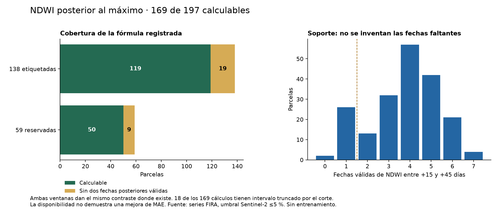
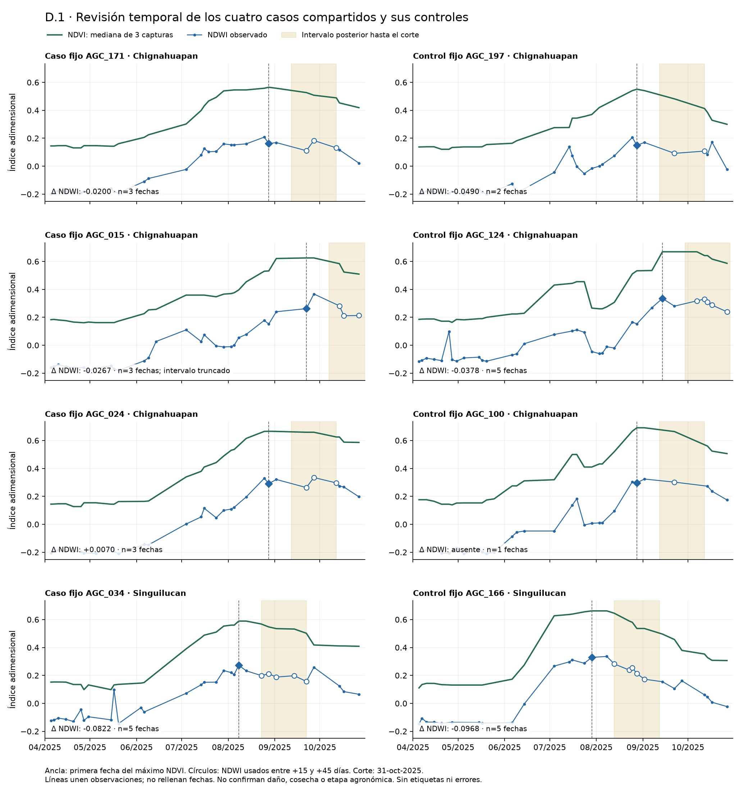

# T15 · D.1: factibilidad de NDWI posterior al máximo

14 de octubre de 2026. Responsable: Dani. Alcance autorizado: comprobar el punto 1 de la fase D, sin entrenar ni evaluar modelos. Diseño previo a calcular los perfiles; resultados y verificación se incorporarán después sin cambiar estas reglas por lo observado.

## Problema que resuelve

T06 y T13/T13e resumen NDWI alrededor del máximo de la curva de NDVI. Eso no comprueba si puede observarse de forma consistente un cambio posterior a ese máximo. Antes de registrar una evaluación predictiva, necesitamos saber si existe el soporte temporal, qué queda ausente y si la hipótesis duplica exactamente una representación ya probada.

## Solución y alcance

Auditar las series FIRA ya existentes para los 197 IDs y las dos ventanas, sin utilizar el rendimiento. Se parte de `dev` `97a8906b243b63f1e7c24ec85f7050642d9a98f5`, que ya incorpora T14 por PR #13. La rama del PR #21 se conserva estable; su propuesta B se cita como antecedente pendiente de revisión, no como experimento aceptado.

El [diseño estructurado](../registro/t15_d1/diseno.json) fija reglas, huellas, fuentes y controles antes del cálculo. No modifica T06/T07, etiquetas ni resultados históricos; no abre la fase de relieve ni descarga imágenes.

## Fórmula fijada

Sensor: Sentinel-2. Planet no contiene NDWI en el paquete PRO; no se obtiene ese índice de otro sensor ni se inventa.

1. Ventanas candidatas: 1-abr–31-oct y 1-jun–31-oct de 2025.
2. Cortar primero por fechas; conservar NDVI finito y nubosidad informada de 0 a 5 %, como T06. Una captura sin NDVI no entra a esta curva aunque tenga NDWI.
3. Requerir al menos cinco capturas válidas; mediana móvil centrada de tres capturas, con extremos de dos valores, como T06. Elegir la primera fecha del máximo exacto de esa curva. Un máximo observado no acredita una etapa agronómica.
4. Ancla: NDWI observado en esa fecha exacta, no la mediana de ±15 días de T06.
5. Posterior: media aritmética de NDWI en fechas válidas distintas entre máximo+15 y máximo+45 días, ambos extremos incluidos y sin superar el corte. Al menos dos fechas con NDWI finito.
6. Contraste candidato = media posterior menos NDWI del ancla. No interpolar NDWI, extrapolar, completar fechas ni sustituir un vacío por cero.

La media pondera observaciones por igual, no días. Se guardan fechas, número, separación, huecos y si el intervalo nominal llega más allá del corte. Cuando quedan dos fechas antes del corte puede calcularse el contraste, pero se declara el intervalo truncado; no se representa como observación completa de 45 días. Esa calidad necesitará una política explícita si se diseña un modelo.

Si falta soporte, se conserva la fila y su motivo. Se separan menos de cinco capturas, NDWI ausente en el ancla y menos de dos fechas posteriores. Los errores de esquema, claves duplicadas, fecha/valor malformado, sensor ajeno o fuente distinta detienen la ejecución; no se silencian como faltantes.

## Comprobaciones previstas

- Contrastar máximos y NDWI ±15 días con T06/T07 sin usar su implementación en el productor nuevo. Esa conciliación es una prueba de la regla previa, no un segundo predictor elegible.
- Auditor independiente mediante aritmética racional sobre los decimales originales; comparar anclas, fechas elegidas, conteos, vacíos y valores. Tolerancia numérica 1e-12 para índices; fechas, estados y conteos deben ser exactos.
- Probar corte antes del suavizado, nubosidad, dos extremos 15/45, NDWI ausente en ancla, cero real, duplicados, orden, empates, curva constante, intervalo truncado y falta de soporte. Una columna de rendimiento añadida o alterada no puede cambiar la salida.
- Proteger originales y tablas previas por huellas. Reproducir el alcance focalizado en Mac y Docker Linux/amd64 con Python -O; apagar Docker al terminar.
- Alcance completo: 394 perfiles Sentinel-2/parcela/ventana; no son 394 ejemplos etiquetados. Resumen separado de las 138 etiquetadas y las 59 reservadas usando sólo su pertenencia al conjunto.

## Novedad y límites

T13/T13e se examinan en [PR #20](https://github.com/danielalira20/AgroCebada-2026/pull/20), commit `50e656bdea1087be9c408cd96885cb7115abaa0e`. `t13_indices.py` usa NDWI de T06; `t13_extension_indices.py` resume las familias adicionales a ±15 días del máximo. No se encontró en esos dos scripts la media de 15–45 días posterior menos el ancla exacta. Esto acredita una diferencia en la representación inspeccionada; no una revisión universal de su PR ni una mejora de predicción.

El NDWI de FIRA se define como (B08−B11)/(B08+B11) en su documento de ecuaciones, página 1. Aquí se usan sus resúmenes originales; no se reconstruyen bandas ni se mide directamente agua del suelo. Una disminución posterior puede acompañar distintos procesos y no confirma estrés, cosecha o daño.

Los rasgos se describen con su soporte y, de forma secundaria, con variación entre/dentro de municipios y coincidencias con las entradas existentes. No se calculan correlaciones con rendimiento, MAE, selección de parámetros ni se decide qué ventana conviene. Las reglas para admitir faltantes de un predictor nuevo y su integración/evaluación quedan para una decisión posterior.

## Entregables previstos

Perfiles por ID/ventana, resúmenes por conjunto y municipio, conciliación de T06, evidencia de no duplicación, diccionario, manifiesto y auditoría; detalle por fecha local. Revisión visual de cuatro fallos compartidos y sus controles fijos, sin incluir etiquetas en los paneles ni escogerlos para favorecer el contraste. Ninguna descarga o información nueva de FIRA es necesaria para esta comprobación.

## Apoyo y fuentes

Plan unificado corregido consultado el 14-oct, revisión `AHj4eMTE…xN-rps0`; [propuesta B del PR #21](https://github.com/danielalira20/AgroCebada-2026/blob/4afabf0/docs/t15_fase_b_documental.md); [método T06](T06_satelite.md), código/entregas identificados por huellas; [ecuaciones originales de FIRA](Ecuaciones_indices_AgroCebada_FIRA_2026.pdf). Apoyo de las skills privadas T07, análisis exploratorio y pensamiento crítico científico; no son una certificación de aporte predictivo.

## Resultado de factibilidad

La fórmula se puede calcular en **169 de las 197 parcelas (85.8 %)**. Las otras 28 conservan el valor ausente. Las dos ventanas producen exactamente el mismo contraste en las 169 calculables y coinciden también en cuáles quedan ausentes; eso no duplica la información ni el número de etiquetas. Las demás variables de la base Sentinel-2 pueden seguir distinguiendo ventanas, por lo que no se altera la búsqueda acordada en B.

| Población | Parcelas | Calculables | Ausentes | Calculables con intervalo nominal completo | Calculables con intervalo truncado |
|---|---:|---:|---:|---:|---:|
| Etiquetadas, sin leer el valor de rendimiento |138|119|19|106|13|
| Reservadas |59|50|9|45|5|
| Total |197|169|28|151|18|

«Completo» en esta tabla sólo significa que máximo+45 días no supera el corte; no que se observe cada día o que todos los píxeles sean válidos. La mediana de fechas posteriores válidas es cuatro. La fórmula requiere dos, pero no impone que estén uniformemente distribuidas: se conservan fechas, huecos y separación para evaluar esa limitación.

### Por qué hay 28 ausencias

Las 197 tienen NDWI en el ancla exacta y al menos cinco capturas válidas para localizar el máximo. El problema está en las observaciones posteriores:

- **9 parcelas:** el intervalo antes del corte contiene menos de dos fechas Sentinel-2 originales, incluso antes de aplicar el filtro de calidad.
- **19 parcelas:** hay al menos dos fechas originales, pero quedan menos de dos con NDVI/NDWI y nubosidad admisible. En estos casos no hay un descarte adicional por índice ausente una vez admitida la nube; la clasificación asigna prioridad al dato de nubosidad.
- En total, 26 ausentes conservan una fecha posterior válida y dos no conservan ninguna. No se convierten esas fechas únicas en medias elegibles.
- 17 de las 28 ausentes tienen el intervalo truncado por el corte; las otras 11 no. Corte y calidad pueden actuar juntos: no se suman como causas independientes.

De las 35 parcelas cuyo intervalo nominal cruza el corte, 18 todavía permiten el cálculo con al menos dos fechas y 17 no. El contraste de esas 18 queda marcado como parcial, sin presentarlo como una observación completa del tramo de 45 días.

Las nueve reservadas sin contraste son AGC_003, AGC_043, AGC_063, AGC_091, AGC_094, AGC_143, AGC_153, AGC_156 y AGC_175. Sus filas y entradas previas se conservan. Chignahuapan reúne 24 de las 28 ausencias y Singuilucan cuatro; no debe confundirse la falta de observación con un daño agronómico o con una etiqueta incorrecta.

### Qué información describe y qué sigue sin demostrar

El contraste varía de −0.17833 a +0.09300, con mediana −0.03525 en las 169 calculables. Tiene variación dentro de municipio: el 90.4 % de la suma de cuadrados descriptiva del contraste corresponde a variación interna. Se calcula sobre entradas disponibles, no sobre el rendimiento ni sus residuos. No es una mejora, correlación predictiva, efecto causal o medición de agua radicular. Las otras filas de `variacion_sin_y.csv` tienen sus propios tamaños de muestra; no se comparan como si utilizaran siempre los mismos IDs.

El ancla exacta difiere de la mediana NDWI ±15 días de T06 en 150 de las 197 parcelas. Esa distinción ya estaba fijada antes de calcular. No se sustituye la columna antigua por esta nueva y no se concluye que tomar una sola observación sea mejor: puede tener más ruido que la mediana. El valor del cambio temporal debe comprobarse con el comparador y presupuesto fijados si se decide evaluarlo.

La comprobación de no duplicación se limita al código de T13/T13e examinado en PR #20 `50e656b`. Confirma que allí se usaban resúmenes alrededor del máximo, no este contraste posterior. No invalida sus resultados ni acredita todos los posibles usos de sus índices.

## Revisión de los cuatro casos y sus controles

Los pares están fijados en [casos_controles_fijos.csv](../registro/t15_d1/casos_controles_fijos.csv), derivados de los controles F0 del diagnóstico previo, sin reselección por el resultado D.1. Los paneles no contienen rendimientos ni errores.

| Caso | ΔNDWI | Fechas | Control fijo | ΔNDWI control | Fechas | Observación |
|---|---:|---:|---|---:|---:|---|
|AGC_171|−0.0200|3|AGC_197|−0.0490|2|Ambos tienen cambio negativo; por sí solo no separa el caso.|
|AGC_015|−0.0267|3|AGC_124|−0.0378|5|El intervalo del caso está truncado; el del control no.|
|AGC_024|+0.0070|3|AGC_100|Ausente|1|El control carece del soporte mínimo; no se le asigna cero.|
|AGC_034|−0.0822|5|AGC_166|−0.0968|5|Caídas comparables; no confirman un daño diferencial.|

Los cuatro casos tienen contraste calculable, pero esta inspección **no encontró una regla sencilla de signo o magnitud que identifique los cuatro fallos**. No se elige un umbral con estos ocho IDs ni se concluye imposibilidad de mejora. Es un control de plausibilidad y soporte, no una evaluación predictiva nueva.





## Verificación técnica y problemas resueltos

Se verifican 394 perfiles parcela/ventana y 1,182 contrastes de máximos, NDWI ±15 y conteos frente a T06. La conciliación de esos valores previos es exacta; las fechas de máximo abril–octubre también coinciden. Esta conciliación no acredita una nueva evaluación de T06.

El auditor separado usa `Fraction` con los decimales originales: reconstruye medianas, máximo, ancla, fechas, soporte, vacíos, medias y resúmenes, sin importar el productor ni un estimador. La diferencia máxima observada es 1.11e−16 frente al límite fijado de 1e−12 para índices. Fecha, conteo, IDs y estados se exigen exactos. La evidencia final de Mac/Docker, número de pruebas y comparación de entregas se conserva en [verificacion.json](../registro/t15_d1/verificacion.json).

Problemas encontrados y tratamiento:

1. **Las series intermedias de T06 no estaban presentes en esta copia.** Se leyó directamente el CSV FIRA original de forma acotada, después de comprobar su identidad con el miembro de DataSet.zip. No se regeneró T06 ni se heredó su incidencia de interpolación diaria de 98/99 días: D.1 sólo usa fechas observadas.
2. **NDWI no existe en Planet.** Se limitó el contraste a Sentinel-2; no se mezclaron sensores ni se inventó la variable.
3. **El soporte no cubre todas las parcelas y algunos intervalos son parciales.** Se conservaron vacíos, motivos y conteos; se separó falta de calendario de exclusión por calidad. No se relajó la nube, amplió el corte o cambió 15–45 para aumentar cobertura.
4. **La primera escala vertical de las figuras ocultaba NDWI negativos.** Se corrigió antes de entregar, usando un rango común que incluye todos los valores de los ocho paneles. No cambió ningún cálculo.
5. **La acumulación descriptiva por municipio se ordenó explícitamente.** Evita depender del orden interno de conjuntos; una prueba comprueba invariancia al ordenar los IDs de otra forma.

La calidad de FIRA sigue sin documentar por completo su máscara de nubes/píxeles. Una captura admitida por su porcentaje no se convierte en una fracción de cobertura espacial comprobada. La fecha de captura tampoco acredita la fecha histórica de publicación.

## Dictamen y siguiente decisión

**D.1 es técnicamente factible con soporte parcial y queda lista para revisión. No está lista como una columna completa admitida automáticamente por el modelo actual.**

El contrato común v3 del PR #21 sólo contempla su faltante previo D020; no admite por defecto estas 28 ausencias, ni decide cómo usar los 18 intervalos parciales. Antes de integrar o entrenar E1 hay que registrar su política de faltantes y calidad, aprendida dentro de cada entrenamiento. No se eliminan 28 parcelas ni se imputan con una media de las 197. Una regla de respaldo o imputación con indicador sería un diseño nuevo que se revisa antes de evaluar.

Se propone conservar este contraste único como candidato condicionado, con sus fechas/calidad, sin añadir variantes para escoger por MAE. El resultado D.1 no justifica ampliar automáticamente el presupuesto ni cambiar la evaluación principal. T15 principal puede avanzar cuando se cierre su revisión, sin esperar esta extensión. La fase D.2 de relieve y las descargas externas no se ejecutaron aquí.

## Reproducción de D.1

Desde la raíz, con el entorno del proyecto y destinos nuevos:

```text
python -m unittest tests.test_t15_ndwi_factibilidad
python -m scripts.t15_ndwi_factibilidad --salida data/processed/t15_d1/nueva
python -m scripts.auditar_t15_ndwi_factibilidad --salida data/processed/t15_d1/nueva --evidencia data/processed/t15_d1/auditoria_nueva.json
python -m scripts.t15_ndwi_figuras --salida data/processed/t15_d1/nueva --figuras data/processed/t15_d1/figuras_nuevas
```

Los lanzadores Docker del README permiten ejecutar los mismos módulos. El cálculo rechaza fuentes distintas de las identificadas y destinos existentes. Los originales externos permanecen ignorados; la entrega compacta comparte trazabilidad, perfiles, calidad, figuras y verificación. La revisión humana y cualquier publicación de esta rama son posteriores.
