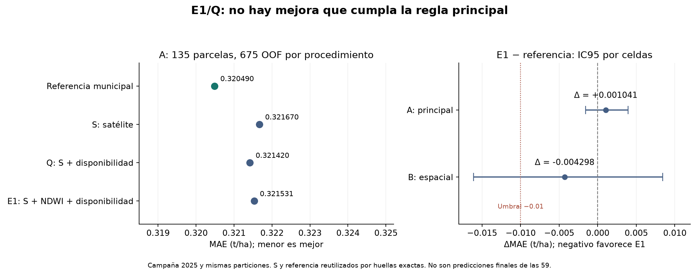

# T15 · evaluación completa de E1 y su control Q

16 de octubre de 2026. Responsable: Dani. Rama: `t15-e1-evaluacion`. Implementación y evaluación local terminadas; publicación y revisión humana externa pendientes. **E1 no cumple la regla de promoción; se conserva la referencia municipal vigente.**

## Problema que resuelve

La factibilidad D.1 demostró que existe un contraste NDWI posterior al máximo de NDVI, pero no que ayude a predecir rendimiento. Además, una aparente ganancia podría proceder de cuáles parcelas tienen observación utilizable. Faltaba implementar el tratamiento de ausencias dentro de cada entrenamiento, comprobar H3 y evaluar separadamente el valor y su disponibilidad.

## Solución que implementa

Se añade una preparación E1/Q dentro de un Pipeline, seguida del estimador común **comun-centrado-loo-v3**, sin modificarlo. E1 incorpora el contraste y un indicador de ausencia; Q incorpora sólo ese indicador. Se comparan con S y la referencia ya publicados bajo exactamente las mismas fuentes y particiones. [Registro operativo previo a estas OOF](../registro/t15_e1_evaluacion/registro_v1.json). La propuesta histórica del 14-oct se conserva: el registro operativo del 16-oct es la autorización de ejecución por Dani, sin atribuir aprobación a Daf, Migue o Jass.

Se conocían los resultados anteriores de T08–T15 y el diagnóstico de errores. Esto es una nueva comparación registrada, **no una validación externa ciega ni una nueva campaña**. No se cambiaron reglas después de sus resultados.

## Qué se evaluó

E1 conserva la fórmula D.1: NDWI observado en el ancla exacta y media de observaciones distintas entre +15 y +45 días menos ese NDWI. Ancla: primera fecha del máximo de NDVI suavizado con mediana de tres capturas. Sentinel-2, nube ≤5 %, cinco capturas para la curva, dos fechas posteriores y corte 31-oct-2025. Sin interpolación ni extrapolación. El índice no mide directamente agua radicular ni acredita una etapa agronómica.

Se admiten los **151 intervalos nominales completos: 106 etiquetadas y 45 reservadas**. Las otras 46 filas permanecen, con valor ausente: 32 etiquetadas y 14 reservadas. D.1 conserva por separado los 18 valores calculables pero truncados. Las dos ventanas producen el mismo E1; sólo cambian las cinco variables S de base. No son etiquetas adicionales.

| Procedimiento | Entradas además de la referencia | Papel |
|---|---|---|
| Referencia | Ninguna corrección | Comparador vigente: media municipal con respaldos |
| S | Cinco variables Sentinel-2 ya fijadas | Comparador satelital publicado |
| Q | S + indicador fijo de E1 no utilizable | Control diagnóstico, no elegible para promoción |
| E1 | S + contraste E1 + indicador fijo | Candidato de esta extensión |

Cada Q/E1 compara las dos ventanas, cuatro λ = 0.01, 0.1, 1 y 10, y referencia sola. α = n de todo el entrenamiento × λ. Cuatro divisiones internas; A/B × cinco repeticiones × cinco particiones externas. La regla principal sigue en A/sin_respaldo: ΔMAE ≤−0.01, extremo superior del IC95 por celdas <0, mejora en al menos cuatro repeticiones y ΔRMSE ≤+0.01. B y sin24 son sensibilidades.

## Protección frente a fugas y H3

La mediana E1 se aprende únicamente de los valores admisibles del entrenamiento correspondiente, interno o externo. Se almacena y aplica sin reajustar con validación, consultas ni las 59. La bandera tiene siempre la misma columna. Si un entrenamiento no tiene ningún E1 admisible, la extensión se desactiva también al predecir y reproduce S para esa configuración; no aparece una señal nueva porque una consulta sí tenga E1.

Después, v3 aprende escalas y centros sólo del entrenamiento. Cada residuo y su vector de entrada usan el **mismo pool sin la fila**; las consultas usan centros almacenados del entrenamiento. No se suma la componente municipal completa sobre un aprendizaje sólo de diferencias internas. La extensión no sustituye v3 ni vuelve al R original de H3. Se probaron municipios de cero, una y dos observaciones, respaldos, columnas constantes, cero observado y lotes/orden de consultas.

Los metadatos de fechas, conteos, IDs y calidad no se incorporan automáticamente como predictores. El rendimiento no entra al preparador. Contratos contradictorios, fuentes distintas o errores numéricos detienen la ejecución; no se omiten opciones ni se convierten fallos en referencia sola.

## Resultado principal

Población A/sin_respaldo: **135 parcelas y 675 OOF por procedimiento**. MAE con igual peso por parcela; RMSE y R² como promedio de las cinco repeticiones. No confundir esas OOF repetidas con nuevas parcelas.

| Procedimiento | MAE (t/ha) | RMSE medio (t/ha) | R² medio |
|---|---:|---:|---:|
| Referencia municipal |0.320490|0.492593|0.658577|
| S |0.321670|0.490677|0.661212|
| Q |0.321420|0.490700|0.661194|
| E1 |0.321531|0.490979|0.660809|

| Contraste, A/sin_respaldo | ΔMAE | IC95 por celdas de ΔMAE | Repeticiones con menor MAE |
|---|---:|---|---:|
| E1 − referencia |+0.001041|[−0.001582, +0.003940]|2/5|
| E1 − S |−0.000139|[−0.001694, +0.001019]|1/5|
| E1 − Q |+0.000111|[−0.000380, +0.000469]|2/5|
| Q − S |−0.000250|[−0.001746, +0.000969]|2/5|

E1 empeora ligeramente el MAE frente a la referencia. Su ΔRMSE es −0.001614 t/ha; esa mejora pequeña no sustituye el criterio MAE y su intervalo tampoco excluye cero. No hay evidencia favorable del valor E1 sobre Q en esta comparación. Esto no demuestra equivalencia, inutilidad universal de NDWI ni ausencia de procesos hídricos; limita la conclusión a esta representación, estos modelos y esta campaña.

### Sensibilidades y selecciones

En B/sin_respaldo, con 135 IDs y 659 OOF, MAE por parcela: referencia 0.363187; S 0.351921; Q 0.357790; E1 0.358889. E1−referencia = −0.004298, IC95 por celdas [−0.016123,+0.008437]: no alcanza la regla. Frente a S, **E1 empeora +0.006968** y su IC95 espacial [0.001898,0.011995] es positivo. Por tanto, añadir esta extensión tampoco mejora al satélite en esa sensibilidad. B no es un segundo criterio para escoger ganador. En B, el promedio de MAE por repetición y el promedio por parcela pueden diferir por el respaldo; los CSV conservan ambos con nombres explícitos.

Q y E1 eligen referencia sola en 3/25 contextos de A y 5/25 de B cada uno. Los desgloses por municipio, calidad y sin24 están incluidos en la entrega. Sin24 retira casos del resumen, nunca de los entrenamientos; no se usa para volver a seleccionar variables o hiperparámetros. Las 59 no tienen nuevas predicciones finales.

## Fragilidad del ancla: hallazgo adicional sin usar rendimiento

Se retiró por separado el ancla y cada vecina válida inmediata; se recomputó toda la curva, no sólo una fórmula al final. Son **1,180 perturbaciones de 394 perfiles**. Las ventanas repiten la misma señal, por lo que no son réplicas independientes.

Retirar el ancla obliga a cambiarla y por sí solo no prueba fragilidad. El diagnóstico más informativo es retirar sólo una vecina: en 393 perturbaciones de una ventana, **154 de 197 parcelas cambian de ancla al menos una vez**. Entre las 151 originalmente admisibles, 28 pierden admisibilidad en alguna retirada; 14 originalmente no admisibles la ganan. En las 59, 42 cambian de ancla y siete de las 45 admisibles pierden admisibilidad al menos una vez. Son pruebas de sensibilidad artificiales, no probabilidades de error en campo.

Este hallazgo aconseja cautela con una fecha exacta y pocos puntos. No justifica inventar una fecha de floración, cambiar suavizado o rescatar otra ventana después de ver MAE. Una representación más robusta tendría que registrarse como otro experimento; aquí no se abrió esa búsqueda.

## Ejecución, incidencias y verificación

- Fuentes de ejecución: commit `a32a59ff0616dda2f558393cc5af27b645bf2868`; tres commits de preparación anteriores a la evaluación. Registro operativo identificado por SHA256 `4c05485a…20c89`.
- Corrida completa en Docker común Linux/amd64, Python 3.12.15, imagen `b2dea1bd162fb607dedb4e1a670edde239743db940d2868e2167f7414e8875aa`, sin red, repo de sólo lectura, 768 MiB, dos CPU y BLAS a un hilo. Duración: 740.707 s, unos 12.35 min; memoria observada alrededor de 379 MiB.
- **3,600 ajustes internos**: 3,200 Ridge y 400 de referencia; **100 externos**, 84 Ridge y 16 referencias. 2,760 OOF nuevas Q/E1 y 2,760 reutilizadas de S/referencia mediante huellas exactas. 3,700 trazas, 100 selecciones y 100 estados externos.
- **115 pruebas en Mac y las mismas 115 en Docker con Python −O**, sin depender de `assert` para las guardias del código. Piloto común: 56 OOF nuevas, diferencia máxima entre entornos 8.88e−16. El puente S reproduce exactamente el modelo de base para las ocho configuraciones en los contextos reales comprobados.
- Auditor independiente sin importar productor ni sklearn: **132,490 comprobaciones en cada entorno**. Reconstruye las 3,700 soluciones por pools y álgebra, selección, estados, OOF, MAE/RMSE/R², IC espaciales y regla. Diferencia máxima 7.11e−15, inferior a la tolerancia fijada 1e−12. Se audita la misma corrida Linux desde ambos sistemas; no se afirma haber repetido todo el entrenamiento en Mac.
- QA del ancla: tres CSV idénticos en Mac y Linux. Auditor independiente desde raw: **12,234 comprobaciones**, diferencia cero. No lee rendimientos.
- Problema encontrado en el primer piloto: dos conteos NumPy no podían guardarse como JSON. Se convirtieron explícitamente a enteros y se añadió una prueba de portabilidad. Ese piloto quedó marcado fallido; no se usó como evaluación ni se perdieron errores silenciosamente. Las pruebas y el piloto corregidos preceden a la corrida completa.

El campo histórico `metodo_comun_acreditado=false` del manifiesto procede del validador genérico de CSV, que no acredita un entrenamiento leyendo predicciones. Se conserva sin retocar; la evidencia real del procedimiento son las fuentes fijadas, trazas, estados y auditoría independiente.

## Archivos y reproducción

Entrega completa: [registro/t15_e1_evaluacion](../registro/t15_e1_evaluacion/README.md). Trazas y estados están comprimidos sin pérdida; el manifiesto original conserva las huellas del contenido descomprimido. No se cambian sus bytes para que parezca una corrida distinta.

Preparación: `scripts/t15_e1_modelo.py`. Ejecutor: `scripts/t15_e1_ejecutar.py`. Auditor independiente: `scripts/t15_e1_auditar.py`. QA de sensibilidad: `scripts/t15_e1_estabilidad.py` y `scripts/t15_e1_auditar_ancla.py`. Los diccionarios D.1/E1 describen el dato observado, la admisibilidad y sus vacíos; las trazas añaden mediana aprendida, activación, IDs de entrenamiento y estado del ajuste.

## Qué sigue y qué no se abre automáticamente

Se cierra esta comparación conservando la referencia. El siguiente piloto propuesto es [relieve local de INEGI](t15_inegi_factibilidad.md): acceso y cobertura ya comprobados, extracción E2 y modelos todavía pendientes. Antes de sus OOF se fijarán fórmulas, rejilla métrica, tratamiento de planos, NoData y bordes, presupuesto y comparadores S+E2 / S+E1+E2. La combinación no se descarta sólo por el resultado individual de E1, pero requiere contrato técnico explícito y declarar que ya vimos E1. No está autorizada por un booleano retrospectivo del contrato histórico.

Después siguen, con registros separados: alternativa compacta para error absoluto, aplicabilidad final a las 59 con los predictores efectivamente retenidos, decisión T16, ajuste con las 138 y exportación del CSV/aplicación. Una evaluación espacial de 2025 no garantiza rendimiento en otros años. No se abren muchas fuentes y rejillas hasta obtener una cifra favorable.

## Fuentes y apoyo

Contratos y datos del repositorio identificados por las huellas del registro; [scikit-learn: prevención de fugas](https://scikit-learn.org/stable/common_pitfalls.html) y [Pipeline](https://scikit-learn.org/stable/modules/generated/sklearn.pipeline.Pipeline.html). No se cambiaron dependencias para imitar ejemplos externos. Se aplicaron las skills privadas T07, scikit-learn y pensamiento crítico científico como apoyo de procedimiento, sin presentarlas como revisión humana externa.

Kassis, T.; Agarwal, V.; He, Y.; Patel, D.; Brueckner, A. M. (2026). *Scientific Agent Skills: A Library of Procedural Knowledge for Research Agents*. [arXiv:2609.00065](https://doi.org/10.48550/arXiv.2609.00065), registro vigente consultado el 16-oct-2026. Se cita por el apoyo material de sus procedimientos, no como evidencia de mejora predictiva.
