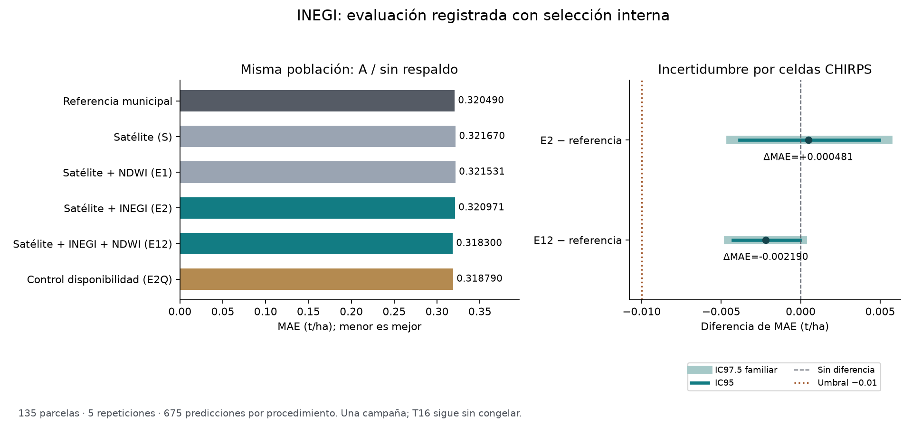

# T15 E2 · evaluación del relieve local INEGI

## Problema que resuelve

La tabla INEGI y el adaptador ya estaban comprobados, pero faltaba medir su aporte
con la selección interna, referencias, particiones y criterios comunes. Esta
ejecución evalúa una hipótesis fijada antes de conocer sus resultados: si la posición
topográfica a 150 m y dos componentes de exposición mejoran la predicción por parcela.

## Solución que implementa

Tres procedimientos nuevos se conectan al ejecutor completo: E2 = S + INEGI (8 columnas),
E12 = S + INEGI + valor NDWI e indicador (10), E2Q = S + INEGI + indicador (9).
E2Q sólo diagnostica disponibilidad. S, E1 y la referencia municipal se reutilizan
desde la entrega anterior por sus huellas exactas, sin volver a entrenarlos.

Se conserva el registro del 16 de octubre sin editarlo. Una autorización separada
del 17 de octubre recoge la solicitud actual. Las pruebas y los pilotos preceden a
la corrida completa, cuyo código debe estar guardado y sin cambios.

## Preparación, búsqueda y H3

- 197 IDs reales; 138 etiquetas; las 59 reservadas no entran en entrenamiento,
  selección ni evaluación. Unión 1:1 por ID. No se cambian etiquetas ni geometrías.
- Dos escenarios A/B, cinco repeticiones y cinco particiones: 50 contextos externos.
  B separa celdas CHIRPS también en sus cuatro divisiones internas.
- Cada procedimiento compara dentro del entrenamiento ocho opciones: abr_oct/jun_oct
  por lambda 0.01/0.1/1/10; la referencia sola también compite. Misma regla de desempate.
- Escala, mediana NDWI y centros territoriales se aprenden sólo en el entrenamiento
  de cada ajuste. H3 usa en entrenamiento el mismo conjunto sin la propia fila para
  el residuo y para centrar TODAS las columnas. La consulta utiliza centros guardados.
- E2 no se imputa ni renormaliza. Sus ceros son observaciones válidas. La disponibilidad
  no se convierte en valor del cultivo. Si un entrenamiento no tiene NDWI admisible,
  la extensión permanece desactivada durante la consulta.

El ejecutor conserva trazas de cada ajuste, todas las puntuaciones y selecciones,
estados de los modelos externos y sus consultas, OOF nuevas e históricas separadas
por identidad. Las etiquetas externas se unen después de seleccionar y predecir.

## Comparaciones y decisión registradas

Los siete pares son E2/referencia, E12/referencia, E2/S, E12/E2, E12/E1, E12/E2Q y E2Q/E2.
Se reportan en A/B y todas/sin_respaldo: 28 contrastes. Hay 24 resúmenes y 120 filas
de métricas por repetición. Las repeticiones reutilizan las mismas parcelas.

MAE principal se calcula promediando errores por parcela. El RMSE de decisión usa
la diferencia media por repetición. R² se informa sin decidir promoción; si el objetivo
es constante, queda indefinido. No se promedian predicciones antes de medir errores.

T03 permanece: A/sin_respaldo, deltaMAE <= -0.01 t/ha, IC95 espacial superior < 0,
mejora en al menos cuatro de cinco repeticiones y deltaRMSE <= +0.01 t/ha. Se añade
la protección ya registrada para E2/E12: IC97.5 espacial superior < 0, con los mismos
5000 índices de remuestreo y semilla 20261006. Es una protección Bonferroni aproximada;
el bootstrap con pocos bloques no garantiza cobertura exacta ni borra búsquedas previas.
E2Q no puede promoverse. B, sin24 y desgloses de calidad son sensibilidades; no sustituyen A.

## Verificación independiente

El auditor no importa los estimadores, el ejecutor, los reportes productores ni sklearn.
Hereda las ecuaciones normales independientes y reconstruye cada ajuste interno/externo,
la preparación con datos propios de entrenamiento, la selección y el desempate, los
150 estados externos y sus centros LOO, las OOF, MAE/RMSE/R², intervalos y decisión.

Las pruebas negativas alteran MAE interno y corrección H3 incluso después de actualizar
las huellas de archivos. La discrepancia numérica debe rechazarse. Se comprueba además
que el control E2Q no promueva, que la protección familiar pueda vetar una mejora nominal,
que B no decida por A y que los resultados incompletos no produzcan reportes globales.
La prueba de reportes usa copias identificadas de OOF históricas, nunca datos simulados
para entrenar ni como resultados de INEGI.

## Límites que no desaparecen al pasar pruebas

Una sola campaña y conocimiento de experimentos anteriores: evaluación retrospectiva,
no prueba externa ciega. El datum vertical del servicio y la disponibilidad en 2025
de estos mismos bytes no están acreditados. Una mejora de esta evaluación no demuestra
causalidad, comportamiento futuro ni aplicabilidad final automática a las 59.
No se atribuye revisión humana externa. T16 y el CSV definitivo requieren su propio cierre.

## Resultados de la ejecución completa

Población principal: **A/sin_respaldo, 135 parcelas y 675 predicciones por procedimiento**. Los 138 casos completos y B se conservan separados en los CSV. MAE y RMSE están en t/ha; R² no tiene unidad.

| Procedimiento | MAE por parcela | RMSE medio por repetición | R² medio por repetición |
|---|---:|---:|---:|
| Referencia municipal | 0.320489710 | 0.492593095 | 0.658576745 |
| Satélite S | 0.321669551 | 0.490676981 | 0.661211591 |
| Satélite + NDWI E1 | 0.321530813 | 0.490978682 | 0.660809293 |
| Satélite + INEGI E2 | 0.320970804 | 0.490429827 | 0.661537163 |
| Satélite + INEGI + NDWI E12 | 0.318300195 | 0.490987056 | 0.660800932 |
| Control de disponibilidad E2Q | 0.318789931 | 0.490292258 | 0.661761178 |

| Contraste principal | ΔMAE | ΔRMSE | IC95 por celdas | IC97.5 adicional | Repeticiones con menor MAE | T03 | Elegible con guardia |
|---|---:|---:|---|---|---:|---|---|
| E2 − referencia | +0.000481094 | -0.002163268 | [-0.003853, +0.004953] | [-0.004421, +0.005507] | 3/5 | False | False |
| E12 − referencia | -0.002189515 | -0.001606040 | [-0.004271, -0.000058] | [-0.004546, +0.000142] | 4/5 | False | False |

Decisión de la regla: **`media_mun__resp_grupo`**. La elegibilidad registrada se conserva; no se modifica el umbral después de observar resultados. T16 sigue sin congelar.

### Lectura del resultado

La combinación E12 reduce puntualmente MAE de 0.320489710 a 0.318300195 t/ha: **0.002189515 t/ha (aproximadamente 0.68 %)**. Su RMSE baja de 0.492593095 a 0.490987056 y R² sube de 0.658576745 a 0.660800932. Mejora MAE en cuatro de cinco repeticiones. Es una señal pequeña en esta evaluación; no una mejora suficiente para promoción.

Falla el mínimo registrado de 0.01 t/ha. El IC95 por celdas queda apenas por debajo de cero, pero el IC97.5 adicional es [−0.004546309, +0.000141525] e incluye cero. La guardia no se añadió después de conocer ese resultado. E2 sin NDWI no mejora MAE frente a la referencia. Los dos candidatos quedan no elegibles por la regla.

E12 frente a E1 reduce MAE 0.003230619 t/ha en A, con IC95 [−0.004712545, −0.001779717], pero ese contraste es descriptivo. Frente a E2Q, la diferencia de MAE es sólo −0.000489737, con IC95 que incluye cero: no queda acreditada una ventaja del valor NDWI sobre su disponibilidad. E2Q tampoco puede promoverse por ser control.

### Sensibilidad espacial B

B/sin_respaldo conserva 135 IDs y 659 OOF; no tiene el mismo número de repeticiones elegibles por ID que A. E12 obtiene MAE por parcela 0.362415171 frente a referencia 0.363187375 (Δ−0.000772204; IC95 [−0.007700418, +0.007544542], tres de cinco repeticiones con mejora). Satélite S obtiene 0.351920870: E12 es peor por 0.010494302 t/ha. También empeora E1 por 0.003526042 en B. La pequeña ganancia A no se convierte en una conclusión de generalización espacial. B no reemplaza la decisión principal.

### Aporte sobre sus comparadores específicos

- E2 frente a S: ΔMAE=-0.000698746; ΔRMSE=-0.000247154; contraste descriptivo, no decide promoción.
- E12 frente a E2: ΔMAE=-0.002670609; ΔRMSE=+0.000557229; contraste descriptivo, no decide promoción.
- E12 frente a E1: ΔMAE=-0.003230619; ΔRMSE=+0.000008374; contraste descriptivo, no decide promoción.
- E12 frente a E2Q: ΔMAE=-0.000489737; ΔRMSE=+0.000694798; contraste descriptivo, no decide promoción.
- E2Q frente a E2: ΔMAE=-0.002180873; ΔRMSE=-0.000137569; contraste descriptivo, no decide promoción.

### Desgloses registrados: municipios y sin24

En A/sin_respaldo, E12 reduce puntualmente MAE frente a referencia en cinco de los seis municipios presentes en ese subconjunto. Emiliano Zapata (tres parcelas) empeora 0.004109652 t/ha. Son desgloses descriptivos con tamaños pequeños; no cambian la selección ni prueban diferencias municipales.

La sensibilidad sin24 conserva 111 parcelas y mantiene una reducción puntual de MAE de 0.001725668 t/ha. Es una lectura de las mismas predicciones: no se retiraron esas parcelas del entrenamiento ni se repitió la selección para favorecer el resultado. No reemplaza el contraste principal ni acredita promoción.

### Qué se seleccionó dentro del entrenamiento

| Procedimiento | Escenario | Selecciones |
|---|---|---|
| E2 | A | abr_oct__lambda_10: 1; jun_oct__lambda_1: 7; jun_oct__lambda_10: 14; referencia_sola: 3 |
| E2 | B | abr_oct__lambda_1: 7; jun_oct__lambda_1: 11; jun_oct__lambda_10: 1; referencia_sola: 6 |
| E12 | A | jun_oct__lambda_10: 21; referencia_sola: 4 |
| E12 | B | abr_oct__lambda_1: 6; abr_oct__lambda_10: 1; jun_oct__lambda_1: 7; jun_oct__lambda_10: 9; referencia_sola: 2 |
| E2Q | A | jun_oct__lambda_1: 2; jun_oct__lambda_10: 20; referencia_sola: 3 |
| E2Q | B | abr_oct__lambda_1: 5; abr_oct__lambda_10: 1; jun_oct__lambda_1: 6; jun_oct__lambda_10: 12; referencia_sola: 1 |

### Evidencia de comprobación

- 95 pruebas por entorno (19 nuevas y 76 de regresión), incluidas pruebas negativas numéricas y de reportes.
- Pilotos A/B completos: 222 ajustes, seis selecciones y 186 predicciones; 105,558 comparaciones Mac/Linux, máximo 8.88e-16.
- Corrida completa: 5400 ajustes internos (4800 Ridge y 600 referencias), 150 externos; 4140 OOF nuevas y 4140 reutilizadas: 8280 en total. Tiempo del ejecutor: 2104.879 s.
- Auditoría Mac: 262388 comprobaciones; Linux: 262388; máximo 7.105e-15 con límite 1e-12. Selección, estados, OOF y reglas recalculados.
- H3: 150 estados externos verificados; máxima media absoluta de corrección dentro de municipios del entrenamiento 7.980e-17 t/ha. No se exige media cero en validación.
- Desgloses de calidad, sin24 y frecuencia de referencia auditados por una comprobación adicional; scripts y dictámenes conservados.
- Paquete comprimido sin pérdida y reauditable directamente. Fuentes de sólo lectura, imagen Linux/amd64 común, red desactivada, 768 MiB y dos CPU de límite.

### Incidente de ejecución y resolución

El piloto Docker quedó en `/private/tmp` dentro de la máquina Colima, sin visibilidad directa desde macOS. El primer intento de comparación en Mac se detuvo por archivo no encontrado. Se recuperaron piloto y auditoría desde ese volumen hacia una carpeta compartida explícita; sus manifiestos y huellas quedaron verificados. No se recalcularon ni sustituyeron los resultados. La evaluación completa usa desde el comienzo la carpeta compartida. No hubo cambio de datos, parámetros o tolerancias por ese incidente.

### Qué sigue pendiente

Esta evaluación no prueba que el relieve sea universalmente inútil o suficiente: mide estas tres variables, esta familia y esta campaña. No se incorporan nuevas variables ni se eliminan parcelas por el error observado. La alternativa cuantílica compacta del plan no se ha implementado aquí; requiere contrato y componente municipal correctos. Siguen pendientes la aplicabilidad final a las 59, el cierre T16 y su ajuste/CSV definitivo. No se publicó ni se fusionó esta entrega.

## Referencias

- [scikit-learn: validación y selección interna](https://scikit-learn.org/stable/modules/cross_validation.html).
- [scikit-learn: prevenir filtraciones](https://scikit-learn.org/stable/common_pitfalls.html).
- Contratos inmutables del equipo: `registro/t15_e2/contrato_tecnico_v1.json`,
  `registro/t15_e2_modelo/registro_ejecucion_v1.json` y procedimiento LOO v3.
- Kassis, T.; Agarwal, V.; He, Y.; Patel, D.; Brueckner, A. M. (2026).
  [Scientific Agent Skills: A Library of Procedural Knowledge for Research Agents](https://doi.org/10.48550/arXiv.2609.00065).
  Skills scikit-learn y pensamiento crítico científico aplicadas; referencia verificada el 17 de octubre.
