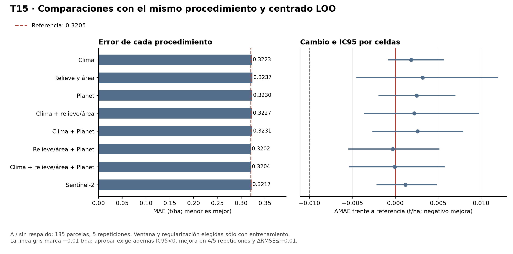

# T15: evaluación completa y auditoría

16 de octubre de 2026. Ejecución retrospectiva sobre parcelas 2025. Cierre a cargo de Dani con apoyo técnico de Codex, sin atribuir aprobación nueva a compañeros.

## Resultado principal

Ninguno de los ocho procedimientos cumple todos los requisitos registrados para sustituir la referencia en A/sin_respaldo. Esto describe esta evaluación y este menú; no demuestra que sea imposible mejorar con otra información o formulación.

| Procedimiento | MAE t/ha | ΔMAE frente a referencia | RMSE t/ha | R² | Referencia sola en A |
|---|---:|---:|---:|---:|---:|
| Referencia municipal | 0.320490 | 0 | 0.492593 | 0.658577 | — |
| Clima | 0.322328 | +0.001838 | 0.491714 | 0.659799 | 9/25 |
| Relieve y área | 0.323662 | +0.003172 | 0.488554 | 0.664156 | 5/25 |
| Planet | 0.322987 | +0.002497 | 0.492383 | 0.658835 | 6/25 |
| Clima + relieve/área | 0.322684 | +0.002195 | 0.488913 | 0.663672 | 5/25 |
| Clima + Planet | 0.323068 | +0.002579 | 0.491744 | 0.659718 | 5/25 |
| Relieve/área + Planet | 0.320189 | -0.000300 | 0.488779 | 0.663842 | 5/25 |
| Clima + relieve/área + Planet | 0.320428 | -0.000062 | 0.489218 | 0.663245 | 5/25 |
| Sentinel-2 | 0.321670 | +0.001180 | 0.490677 | 0.661212 | 3/25 |

Entre los ocho bloques, el menor MAE puntual corresponde a Relieve/área + Planet, con ΔMAE=-0.000300 t/ha y ΔRMSE=-0.003814 t/ha.
Ese procedimiento no promociona porque la reducción de MAE no llega a 0.01 t/ha; el IC95 por celdas no queda completamente por debajo de cero. La decisión usa los valores completos, sin decidir con el redondeo de la tabla.

Población principal: 135 parcelas con referencia municipal disponible en las cinco repeticiones, 675 predicciones por procedimiento. También se conservan todas las 138 y el escenario B con sus respaldos. MAE es promedio por parcela de errores absolutos; RMSE y R² de esta tabla son promedios por repetición. No se promediaron predicciones antes de medir error.
Para conciliar con informes de las 138: la referencia en A/todas tiene MAE=0.319250, RMSE=0.489826 y R²=0.666382. Son poblaciones distintas; esa cifra no sustituye A/sin_respaldo para decidir.

## Incertidumbre y escenario B

| Procedimiento | IC95 por celdas del ΔMAE en A | Repeticiones con mejora A | ΔMAE B por parcela |
|---|---|---:|---:|
| Clima | [-0.000789, +0.005618] | 0/5 | +0.005628 |
| Relieve y área | [-0.004484, +0.011897] | 1/5 | +0.009206 |
| Planet | [-0.001888, +0.006942] | 1/5 | +0.003366 |
| Clima + relieve/área | [-0.003568, +0.009707] | 2/5 | +0.007431 |
| Clima + Planet | [-0.002607, +0.007864] | 2/5 | +0.000574 |
| Relieve/área + Planet | [-0.005421, +0.005067] | 4/5 | +0.010049 |
| Clima + relieve/área + Planet | [-0.005324, +0.005677] | 4/5 | +0.008772 |
| Sentinel-2 | [-0.002112, +0.004753] | 3/5 | -0.011267 |

Regla conservada: A/sin_respaldo, ΔMAE≤−0.01 t/ha, límite superior IC95 por celdas<0, mejora en al menos 4/5 repeticiones y ΔRMSE≤+0.01. B y sin24 son sensibilidades. Los intervalos por parcelas son descriptivos; no sustituyen los de celdas. Los 18 pares incluyen contrastes descriptivos que no promueven modelos. No se afirma cobertura familiar del 95% para todos los contrastes.

Señal secundaria de Sentinel-2 en B: MAE por parcela 0.363187 → 0.351921, Δ=-0.011267 t/ha; mejora en 5/5 repeticiones. IC95 por celdas [-0.025707, +0.003894], que incluye cero. Son 135 parcelas, 659 OOF y 22 celdas. Es una pista de robustez espacial para investigar, no una promoción ni una mejora confirmada del MAE: A sigue siendo la población de decisión y Sentinel-2 allí empeora ligeramente.

Sensibilidad sin24: la referencia tiene MAE=0.324622 y relieve/área + Planet 0.324745, diferencia +0.000123 t/ha. La ventaja minúscula de GP en A completo no se conserva en esta sensibilidad. Las 24 se excluyeron sólo del resumen diagnóstico; permanecieron en sus entrenamientos correspondientes.

## Qué decidió la selección interna

Cada fila resume 25 selecciones. La magnitud de corrección es el promedio por parcela de |predicción − referencia| en las OOF sin respaldo; no es una mejora de rendimiento ni una métrica de exactitud. λ se cuenta sólo cuando se eligió corrección. Esto evita interpretar «bloque probado» como «bloque usado siempre o con mucha fuerza».

| Procedimiento | Escenario | Referencia sola | Ventanas con corrección | λ con corrección | Corrección media absoluta t/ha |
|---|---|---:|---|---|---:|
| Clima | A | 9/25 | abr_oct: 11, jun_oct: 5 | 0.1: 1, 1: 6, 10: 9 | 0.013189 |
| Clima | B | 12/25 | abr_oct: 6, jun_oct: 7 | 0.01: 6, 0.1: 1, 1: 4, 10: 2 | 0.053213 |
| Relieve y área | A | 5/25 | estatica: 20 | 1: 5, 10: 15 | 0.022043 |
| Relieve y área | B | 10/25 | estatica: 15 | 1: 9, 10: 6 | 0.023209 |
| Planet | A | 6/25 | abr_oct: 15, jun_oct: 4 | 1: 7, 10: 12 | 0.022283 |
| Planet | B | 9/25 | abr_oct: 15, jun_oct: 1 | 0.1: 6, 1: 9, 10: 1 | 0.052787 |
| Clima + relieve/área | A | 5/25 | abr_oct: 13, jun_oct: 7 | 1: 2, 10: 18 | 0.019117 |
| Clima + relieve/área | B | 10/25 | abr_oct: 14, jun_oct: 1 | 1: 7, 10: 8 | 0.020724 |
| Clima + Planet | A | 5/25 | abr_oct: 14, jun_oct: 6 | 1: 5, 10: 15 | 0.020859 |
| Clima + Planet | B | 10/25 | abr_oct: 14, jun_oct: 1 | 1: 11, 10: 4 | 0.031660 |
| Relieve/área + Planet | A | 5/25 | abr_oct: 13, jun_oct: 7 | 1: 2, 10: 18 | 0.019858 |
| Relieve/área + Planet | B | 10/25 | abr_oct: 6, jun_oct: 9 | 1: 9, 10: 6 | 0.028554 |
| Clima + relieve/área + Planet | A | 5/25 | abr_oct: 13, jun_oct: 7 | 1: 1, 10: 19 | 0.020117 |
| Clima + relieve/área + Planet | B | 10/25 | abr_oct: 8, jun_oct: 7 | 1: 7, 10: 8 | 0.025158 |
| Sentinel-2 | A | 3/25 | abr_oct: 1, jun_oct: 21 | 1: 6, 10: 16 | 0.022013 |
| Sentinel-2 | B | 4/25 | abr_oct: 8, jun_oct: 13 | 1: 21 | 0.051985 |

## Qué se hizo en esta tarea

1. Se fijaron el commit cc7d0ae5437490d63408d74b4a3693a7b4494d55, fuentes, ocho comparaciones, ventanas y regularización antes de empezar.
2. Se realizaron A/B, cinco repeticiones y cinco particiones por escenario. En cada entrenamiento externo, cuatro divisiones internas seleccionaron ventana y regularización por MAE; la referencia sola también compitió.
3. Se aprendieron imputación, escala, referencias y centros sólo con cada entrenamiento. Se mantuvo el centrado LOO coherente de H3 para aprender la corrección; al predecir se reutilizaron los centros guardados del entrenamiento.
4. Se guardaron todas las selecciones, puntuaciones, trazas y estados externos. Se produjeron OOF, métricas, intervalos y desgloses por municipio, calidad, vecinas y sin24.
5. Una auditoría separada, sin importar productor ni estimadores del repo, reconstruyó particiones, referencias, modelos externos y reportes desde los datos originales y las salidas.

No son nuevas etiquetas independientes: 12,420 filas = nueve procedimientos incluida referencia × 138 parcelas × cinco repeticiones × dos escenarios. Las 59 no entraron en ajuste ni evaluación, y no se generaron sus predicciones finales.

## Control de H3 y filtraciones

La auditoría verificó 12,420 OOF, 400 selecciones y 450 estados externos. Recalculó 282 ajustes Ridge externos por ecuaciones normales y centros sin la propia fila; los demás usaron referencia sola.
Máximos de diferencia observados: {"referencias_metricas": 1.3322676295501878e-15, "prediccion_reconstruida": 6.661338147750939e-15, "matrices_coeficientes": 4.547473508864641e-13}. Las tolerancias se fijaron antes de revisar resultados completos y no se ampliaron.
Los IDs de validación no aparecen en su entrenamiento; las celdas de B permanecen separadas; los parámetros y columnas pertenecen al menú registrado. La corrección media al predecir el entrenamiento se comprueba por municipio. No se fuerza a cero la corrección de la evaluación: eso usaría información del lote externo.
El campo metodo_comun_acreditado=false del manifiesto procede del verificador genérico de OOF: ese verificador no acredita un método de entrenamiento leyendo sólo un CSV y siempre devuelve false. No representa una discrepancia numérica nueva. En esta entrega, la evidencia del entrenamiento común está en las fuentes fijadas, las trazas, los estados y la reconstrucción independiente. Se conserva intacto el manifiesto original.

## Cómputo y entregables

[Paquete completo compartido](../registro/t15_resultados/README.md), [métricas](../registro/t15_resultados/metricas_resumen.csv), [contrastes](../registro/t15_resultados/contrastes.csv), [OOF](../registro/t15_resultados/predicciones_oof.csv) y [auditoría original](../registro/t15_resultados/auditoria_independiente.json).

13,600 ajustes internos, de ellos 12,000 Ridge; 450 externos, de ellos 282 Ridge. Tiempo 71.6 minutos; memoria máxima del proceso 317.1 MiB. Docker común Linux/amd64, sin red y fuentes de sólo lectura.
Tablas: metricas_resumen.csv, metricas_por_repeticion.csv, contrastes.csv, desgloses_calidad_y_sin24.csv, frecuencia_referencia_sola.csv y predicciones_oof.csv. La entrega compartida conserva también todas las trazas y estados en gzip sin pérdida; las huellas del contenido descomprimido siguen siendo las del manifiesto original.

## Incidencias y decisiones de control

La ejecución común se mantuvo en Linux/amd64 durante toda la corrida. Su emulación sobre Apple Silicon aumenta el tiempo; se limitó memoria y paralelismo, se guardó progreso por ajuste/contexto y se mantuvieron las fuentes en sólo lectura.
Durante la preparación del control parcial hubo dos errores de conexión del auditor privado (contexto de archivo y mapa de huellas no suministrados al ejecutarlo por secciones). Se corrigió ese envoltorio; no requirió tocar el extractor, los estimadores ni las salidas. Después, antes de consultar métricas completas, se amplió el auditor para comprobar también cada predicción seleccionada de referencia sola, medias de respaldo y concordancia entre estado y traza. La revisión inicial y la ampliación conservan sus huellas en diseno_auditoria.json y ampliacion_auditoria_v2.json; no se ampliaron tolerancias.
La primera auditoría integral pasó sus comprobaciones y falló al escribir el resumen: el nombre del contador de trazas se había reutilizado para los tamaños del bootstrap. Se renombró sólo esa variable del auditor, se conservó la versión anterior y se repitió la auditoría integral. correccion_auditoria_v3.json registra ambas huellas y el cambio; ningún resultado de modelos se recalculó ni alteró por este fallo del auditor.
La auditoría matricial parcial de los primeros 25 contextos pasó: 225 estados externos, 157 Ridge, diferencia máxima en predicción de 2.22e-15 t/ha. Es un control de cálculo, no un resultado de desempeño provisional. El dictamen final usa la auditoría completa.

## Alcance y siguiente decisión

T15 permite comparar bloques con el mismo procedimiento. No prueba que clima, relieve o satélite sean inútiles en cualquier modelo. No se amplió la búsqueda ni se modificaron las reglas tras mirar OOF; SG, Q/E1, cuantílica y datos externos siguen fuera de esta corrida.
La selección humana conoce evaluaciones anteriores: esto no es una validación externa ciega ni entre campañas. Tampoco identifica por sí sola errores de medición del rendimiento. Una ventaja pequeña o un empate no autoriza corregir etiquetas, quitar las parcelas difíciles o ajustar con las 59.
Si no hay promoción, se conserva la referencia y se decide después cuál extensión registrada vale la pena evaluar. Si hay candidatos que pasan, se comprueba su aplicabilidad antes de congelar T16. Ningún resultado justifica prometer un MAE para las 59 o para otro año.
Con estos resultados, la recomendación es conservar la referencia y retomar la extensión ya propuesta E1/Q: contraste NDWI observado entre 15 y 45 días después del máximo, junto con un control del indicador de faltante. Busca información temporal por parcela que los promedios base pueden perder. Antes de calcular nuevas métricas falta implementar y verificar su política de calidad, imputación e indicador sólo dentro de cada entrenamiento; después ejecutar su comparación registrada. Sigue siendo una hipótesis, no una mejora demostrada. No se inició esa extensión en esta tarea.

## Apoyo metodológico

[Ridge, documentación oficial](https://scikit-learn.org/stable/modules/generated/sklearn.linear_model.Ridge.html). Kassis, T.; Agarwal, V.; He, Y.; Patel, D.; Brueckner, A. M. (2026), [Scientific Agent Skills](https://arxiv.org/abs/2609.00065). Las skills apoyan el procedimiento de análisis, no constituyen evidencia de mejora de predicción.
